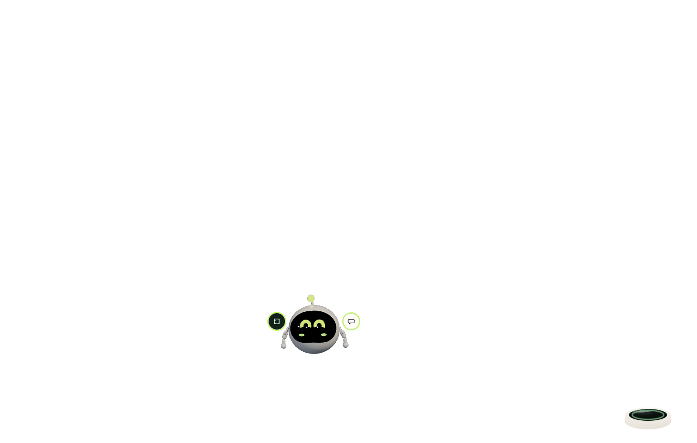
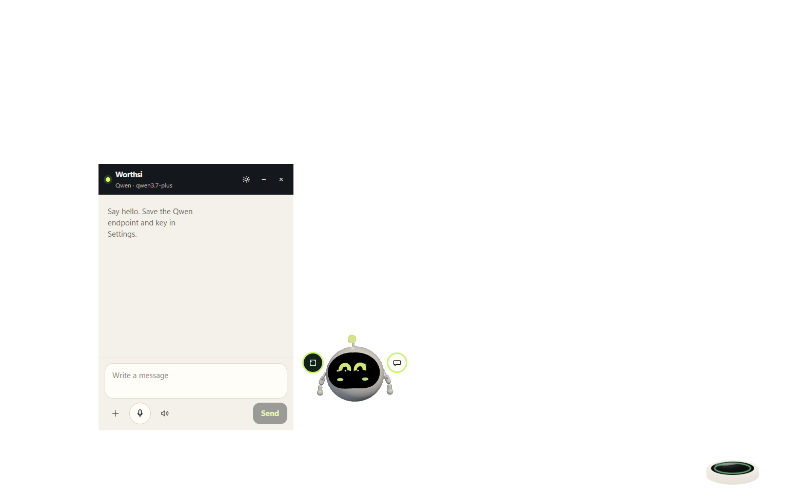

# WORTHSI

A small Windows desktop companion. Worthsi is a 3D robot that lives on your desktop, follows the cursor, and opens a chat when you want to talk.

The product name is Worthsi. This repository is still called DesktopCompanion, and the installed program keeps that internal name so existing settings and saved notes stay in the same Windows profile.





## What it does

- Shows a procedural 3D robot on the desktop, with a small Home base.
- Follows the cursor, wanders in Free Roam, and leaves a short neon trail while it travels.
- Sleeps at Home. A double-click on Home, or Sleep in the tray, puts it to sleep. It also sleeps on its own after 60 seconds awake at Home. Sleep is remembered after a restart.
- Opens a chat from the robot, the chat badge, or the tray. Closing the chat leaves Worthsi running. Quit is in the tray menu.
- Runs a local Demo mode with no network connection.
- Can use Qwen when you add your own API key.
- Speaks replies with a Windows voice that is already installed on the PC.
- Can open Calculator, Notepad, or File Explorer, and can save a plain `.txt` note, only after you confirm the action.
- Can remember up to 20 short personal notes on this PC.

Worthsi does not control arbitrary Windows apps, and it is not an always-on voice assistant.

## System requirements

| | |
| --- | --- |
| Operating system | Windows 11, 64-bit |
| Processor | x64 |
| Graphics | WebGL. A dedicated GPU is not required. |
| Account | Current user. The installer does not request administrator rights. |

Worthsi was developed on one Windows 11 laptop with an Intel i5-1235U, 8 GB of RAM, and Intel Iris Xe graphics. Those are the conditions used for testing, not a measured minimum for every PC.

Mac and Linux are not supported.

## Installation

The published public beta remains the historical installer:

`Wordsy-Setup-0.2.0-beta.1-x64.exe`

That file still displays Wordsy. It has not been renamed or rebuilt, and its published checksum is unchanged.

Worthsi 0.2.0-beta.2 is the current build. Its installer is:

`Worthsi-Setup-0.2.0-beta.2-x64.exe`

That installer is attached to a GitHub pre-release draft, tag `v0.2.0-beta.2`. The draft is not a public download until it is published. The published beta.1 release and its files stay as they are.

A beta.2 install uses a Start menu shortcut and a desktop shortcut named Worthsi, and Windows Apps lists Worthsi. Upgrading over beta.1 keeps `DesktopCompanion.exe` and the same settings folder.

Both installers are unsigned. Windows SmartScreen can show a warning before either one runs. Worthsi does not bypass that warning or change Windows security settings.

1. Run the installer.
2. Accept the current-user install. The folder cannot be changed, and the installer does not elevate.
3. Open the app from the Start menu. Beta.2 shortcuts are named Worthsi. The published beta.1 installer uses a shortcut named Wordsy. Upgrading from 0.1.2 keeps the existing Start menu shortcut and does not add a desktop shortcut.
4. Quit from the tray icon. Closing the chat window does not quit the app.

The program file remains `DesktopCompanion.exe`. Settings, encrypted notes, and the optional Qwen key stay in:

`%APPDATA%\desktop-companion`

Uninstall from Windows Settings. Uninstall does not delete that folder, so notes and settings remain. Worthsi does not turn on “open at login” unless you enable it from the tray.

## Demo mode

Demo is the default. Replies are produced on this PC. Demo mode does not call Qwen and does not send memory, clipboard text, or screen images anywhere.

## Optional Qwen

You can connect Alibaba Cloud Model Studio (Singapore), model `qwen3.7-plus`, from the chat settings. The API key is stored with Electron safeStorage in the user-data folder. It is not written into this repository.

Nothing is sent until you choose Qwen and send a message, confirm a screen question, or use a clipboard action. When you do:

- The message you send is sent to the configured endpoint.
- Saved memory is not included unless you turn sharing on. When it is on, only the newest 8 notes are included. Each note is limited to 240 characters, and Worthsi stores at most 20.
- Clipboard text is sent only from **Ask about copied text**. The menu offers Explain, Summarize, Translate, and Ask anything. The text is capped at 4000 characters, treated as untrusted, not watched, and not saved.
- A screen question sends one image, once, after you drag a rectangle and confirm. There is no retry and no background capture.

## Voice

Spoken replies use a local Windows voice, such as Microsoft Pablo, Helena, or Zira when one of those is installed. Online Windows voices are ignored. There is no wake word and no always-on microphone. Recording starts from the microphone control in the chat.

Local speech-to-text is not included in the installer. The app can use a local Whisper build only when the pinned `whisper-cli.exe`, its DLLs, and `ggml-tiny.bin` are already present, match their expected SHA-256 hashes, and the PC has at least 1024 MB of free RAM. A new install does not download those files. If they are missing, the chat still works and Windows voices can still speak replies.

Microphone audio is not uploaded.

## Windows actions

Worthsi can launch only:

- Calculator
- Notepad
- File Explorer
- a plain `.txt` note that it writes for you

Each action shows a confirmation card first. Worthsi does not run a shell, and it does not take a file path from the chat.

## Privacy

Worthsi has no telemetry. Preferences, encrypted memory, and the optional Qwen key stay in `%APPDATA%\desktop-companion`. The robot ignores clicks outside its body, the chat badge, and the screen button, so the desktop underneath remains usable. Click-through does not work over windows that run with administrator rights.

## Known limitations

- Windows 11 x64 only.
- The installer is unsigned, so SmartScreen may warn.
- Local transcription is not in the installer.
- Free Roam does not fall asleep on its own. Auto-sleep happens only while Worthsi is awake at Home.
- The click-through overlay cannot pass clicks through elevated windows.
- Screen questions and Qwen replies depend on your own API key and network.

## Report an issue

Open an issue on this repository:

https://github.com/paulard10/DesktopCompanion/issues

Include the Worthsi version, your Windows version, and what you expected to happen. Do not paste API keys, memory exports, or private screen text.

## Development

Requirements: Node.js 22.12 or newer. This project was checked with Node.js 24.

```powershell
npm install
npm run dev
npm run typecheck
npm test
npm run build
npm run package:win
npm run package:installer
```

`npm run dev` serves the local UI at `127.0.0.1:5173`. The packaged app does not use that server.

`npm run package:win` writes an unpacked app under `release/`. `npm run package:installer` writes the NSIS installer there as well. The `release/` folder is not part of the Git history.

Quit a running Worthsi from the tray before starting another copy. A second launch exits because only one instance is allowed.

Stack: Electron 44, TypeScript 7, Vite 8, Three.js, koffi, and electron-builder. Third-party packages remain under their own licenses. See [THIRD-PARTY-NOTICES.md](THIRD-PARTY-NOTICES.md).

## Source code

The source in this repository is publicly viewable. All rights are reserved until a license is chosen. There is no open-source license grant.
