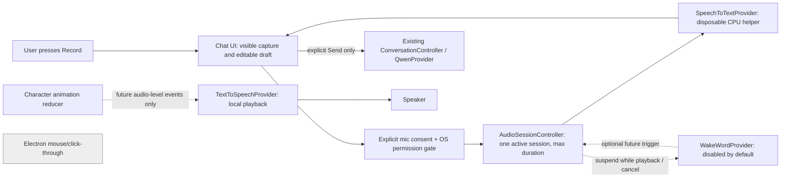

# M1.8 — Local voice architecture research

**Date:** 2026-10-23  
**Status:** research and design only; no speech software or weights installed, no audio captured.  
**Target:** Windows 11 Home 25H2, x64 Surface Laptop Go 3, Core i5-1235U, 8 GB RAM, Iris Xe.

## 1. Executive recommendation

Implement **M1.8A as explicit Spanish push-to-talk with multilingual Whisper Tiny through a short-lived, CPU-only whisper.cpp subprocess**. Show recording state and the resulting editable draft; only the existing Send action may submit it to Qwen. Cap a recording at 20 seconds, stop capture on cancellation/window closure, and terminate the ASR process after each utterance. The known upstream model is about 75 MiB; upstream reports about 273 MB inference memory for Tiny, but neither is a measured total on this laptop. Benchmark Tiny before offering multilingual Base (142 MiB model, about 388 MB upstream inference-memory figure). Pin and audit the actual Windows binary and model artifact before distribution. [whisper.cpp](https://github.com/ggml-org/whisper.cpp), [model repository](https://huggingface.co/ggerganov/whisper.cpp), [OpenAI Whisper](https://github.com/openai/whisper).

This recommendation prioritizes an identifiable, permissively licensed model lineage, no persistent ASR memory, and a small integration boundary. **Spanish accuracy and turnaround on this machine are unmeasured.** If Tiny misses the acceptance thresholds, compare Base and Vosk on the *same* consented Spanish corpus before selecting a replacement. The current architecture's [independent-review decision](08_CODEX_INDEPENDENT_REVIEW.md) remains in force: voice belongs behind independent providers and must not change the Qwen, animation, or overlay input paths.

For **M1.8B**, first evaluate an explicitly installed *local* Windows Spanish voice through a native Windows synthesizer API; quality and availability must be tested on the target PC. Piper/Open Home Foundation or sherpa-onnx with a Piper-format Spanish voice are quality candidates, but require a separate GPL and voice-rights review before bundling. For **M1.8C**, defer always-on listening until an actual Spanish keyword model, its license, and idle measurements pass review. An arbitrary configurable Spanish character name is **not yet a verified offline wake-word capability**.

### Confidence labels

“Verified” below means documented by the linked primary project, package, or platform source, **not measured locally**. “Estimate” means source-reported generic number or engineering budget; “unknown” means no defensible value found. Scores are design judgments, not benchmark results.

## 2. ASR comparison

| Option | Spanish and future languages | Windows x64 / Electron integration | Offline, cost and maturity | Size and memory evidence |
|---|---|---|---|---|
| **whisper.cpp + multilingual Tiny** (recommended M1.8A) | Whisper multilingual covers Spanish, Catalan and English; the English-only `.en` weights do not. Tiny accuracy varies by accent/noise. | Official project builds/runs on Windows. Spawn pinned CLI from Electron main/utility coordination; feed 16 kHz mono, 16-bit PCM WAV. No native Node add-on in the first implementation. | CPU inference fully local; MIT engine and original Whisper weights. Mature active project. | Upstream approximate **75 MiB model / 273 MB inference memory**; no measured app RSS, cold load or transcription time here. [whisper.cpp](https://github.com/ggml-org/whisper.cpp), [OpenAI license/model descriptions](https://github.com/openai/whisper). |
| **whisper.cpp + multilingual Base** | Same three languages, with likely accuracy improvement over Tiny, but needs a same-corpus test. | Same integration; greater CPU and memory pressure. | Local, MIT lineage. | Upstream approximate **142 MiB model / 388 MB inference memory**. Do not leave loaded on this 8 GB system. [whisper.cpp](https://github.com/ggml-org/whisper.cpp). |
| **sherpa-onnx Whisper Tiny ONNX** | Official ONNX Whisper Tiny export is multilingual. Spanish/Catalan transcription should be evaluated; do not infer quality from unrelated sherpa SenseVoice/Paraformer models, which are not verified for Spanish. | Official `sherpa-onnx-node` has Windows x64 prebuilt native components; N-API/ONNX Runtime DLLs and Electron packaging/ASAR unpacking need validation. A utility process is preferable to a long-lived main-thread call. | Offline. Repository Apache-2.0; audit each model and bundled native library separately. | Published Tiny ONNX INT8 encoder **12 MB**, decoder **86 MB**, tokens **~0.8 MB**; full archives and live RAM unknown. [Node installation](https://k2-fsa.github.io/sherpa/onnx/javascript-api/install.html), [Whisper export](https://k2-fsa.github.io/sherpa/onnx/pretrained_models/whisper/export-onnx.html). |
| **Vosk small Spanish 0.42** | Spanish model exists; separate small Catalan and English models exist. Published Spanish WERs are corpus-specific and cannot be compared to Whisper without common audio. | Windows x64 supported; Node binding uses native FFI/dependencies, raising packaging and ABI risk. A helper process or native adapter could isolate it. | Offline; Vosk engine and this listed Spanish model are Apache-2.0. Established streaming engine. | Spanish download **39 MB**; project says a typical small model uses **~300 MB runtime memory**. [Vosk model table](https://alphacephei.com/vosk/models.html), [installation](https://alphacephei.com/vosk/install), [Node package](https://github.com/alphacep/vosk-api/blob/master/nodejs/package.json). |
| **Windows legacy speech recognition / grammar** | Installed recognizer availability and free-form Spanish quality are unknown on this PC. List/SRGS grammar recognizes constrained phrases, not general dictation. | Native WinRT or .NET bridge, with packaging/API restrictions; incompatible with a minimal reliable M1.8A without experiments. | Local grammar can be offline; **Windows.Media.SpeechRecognition dictation is service-backed**. Voice Access is a separate on-device accessibility feature, with no verified embedding API. | No portable app download estimate; language packs and installed recognizers vary. [Windows app speech recognition](https://learn.microsoft.com/en-us/windows/apps/develop/input/speech-recognition), [Voice Access](https://support.microsoft.com/en-us/accessibility/windows/voice-access/set-up-voice-access). |
| **Windows AI on-device speech recognition** | Potential Spanish availability must be confirmed for its actual downloadable model/OS configuration. | Requires experimental Windows AI/Windows App SDK integration and system AI model capability, unlike the current unpackaged Electron setup. | Truly on-device, but Microsoft explicitly says **experimental and unsupported in production**. | Model footprint and CPU viability on this laptop unverified. [Microsoft API documentation](https://learn.microsoft.com/en-us/windows/ai/apis/speech-recognition). |

**Other lightweight alternative:** Vosk is the credible compact Spanish option. Its 39 MB archive does *not* imply low live memory: Vosk's own generic small-model estimate is ~300 MB. It may suit future live transcription, but its packaging complexity and punctuation/accuracy need direct testing. Windows Win+H voice typing is not a permissible shortcut: Microsoft describes its voice typing as using an online speech service. The browser Web Speech Recognition default may use a server, even though newer on-device API proposals exist; it is not an offline guarantee in Electron. [Microsoft voice typing](https://support.microsoft.com/en-us/accessibility/windows/use-voice-typing-to-talk-instead-of-type-on-your-pc), [MDN SpeechRecognition](https://developer.mozilla.org/en-US/docs/Web/API/SpeechRecognition).

### Exact candidate packages and models (research pins, not installed)

| Role | Candidate artifact | Why / gate |
|---|---|---|
| M1.8A engine | [whisper.cpp v1.9.4](https://github.com/ggml-org/whisper.cpp/releases/tag/v1.9.4), Windows x64 CPU CLI from that tagged source or an authenticated upstream release asset | Pin a specific SHA-256 after obtaining the actual binary; confirm CLI flags and required VC DLLs against that build. No npm speech package is necessary for this route. |
| M1.8A model | [ggerganov/whisper.cpp ggml-tiny.bin](https://huggingface.co/ggerganov/whisper.cpp/tree/main), **multilingual**, not ggml-tiny.en.bin | Verify original OpenAI-weight conversion lineage and SHA-256; configure Spanish language and transcribe task. The exact revision/hash is a release gate, not claimed from a mutable main branch. |
| Optional quality comparison | Same source's multilingual **ggml-base.bin** | Only after Tiny benchmark and available-memory check. Do not bundle by default. |
| ASR alternative | [sherpa-onnx-node 1.13.8](https://www.npmjs.com/package/sherpa-onnx-node), Windows x64 native package, with [sherpa-onnx-whisper-tiny ONNX](https://k2-fsa.github.io/sherpa/onnx/pretrained_models/whisper/export-onnx.html) | Candidate only; verify npm integrity, DLL licence inventory, exact model archive and runtime before use. |
| Compact ASR alternative | [Vosk Node package 0.3.75](https://github.com/alphacep/vosk-api/blob/master/nodejs/package.json) with [vosk-model-small-es-0.42](https://alphacephei.com/vosk/models.html) | Candidate only; validate FFI/native packaging and model quality. |
| M1.8B first experiment | The user's **installed local Spanish Windows voice**, discovered through a native synthesizer API | No redistributable third-party package or weight selected yet; availability/quality/offline status must be confirmed on the PC. |
| M1.8B neural candidate | [OHF Piper current GPL engine](https://github.com/OHF-Voice/piper1-gpl) plus [es_ES-davefx-medium.onnx and matching .onnx.json](https://huggingface.co/rhasspy/piper-voices/tree/main/es/es_ES/davefx/medium) | **Research candidate, not approved for bundling**; pin an OHF tag and weight commit only after GPL, model and dependency rights review. |
| M1.8C | **None selected** | No verified small, Spanish-capable and commercially cleared keyword model found. |

### Provisional decision scores

Scale: **5 is best for this laptop/product**, 1 worst, ? unverified. “Spanish” evaluates expected transcription utility; there is no local WER measurement. “Redistribution” evaluates clarity of the current engine/model route, not legal advice. Windows legacy and experimental APIs are shown for completeness but fail the present free-form/production gate.

| ASR option | Spanish | RAM | CPU | Latency | Install size | Electron packaging | Privacy/security | Offline reliability | Redistribution | Maintenance |
|---|---:|---:|---:|---:|---:|---:|---:|---:|---:|---:|
| whisper.cpp Tiny | 3 | 4 | 4 | 3 | 4 | 4 | 5 | 5 | 5 | 5 |
| whisper.cpp Base | 4 | 3 | 2 | 2 | 3 | 4 | 5 | 5 | 5 | 5 |
| sherpa Whisper Tiny ONNX | 3 | ? | 3 | ? | 3 | 2 | 5 | 5 | 3 | 4 |
| Vosk small es | 3 | 3 | 4 | 4 | 5 | 2 | 5 | 5 | 5 | 4 |
| Windows legacy free-form | ? | ? | ? | ? | 5 | 1 | 2 | 1 | ? | 2 |
| Windows AI experimental | ? | ? | ? | ? | ? | 1 | 5 | 4 | ? | 2 |

## 3. TTS comparison

| Option | Spanish voice and Windows route | Quality / resources | Offline and redistribution |
|---|---|---|---|
| **Installed Windows local voice** (first M1.8B experiment) | Enumerate installed voices with a native `System.Speech.Synthesis.SpeechSynthesizer` or suitable WinRT API bridge; choose an *actually available* es-ES/es-MX voice. Native playback supports pause/resume/cancel. Do not equate a browser voice name with local processing. | Zero additional bundled voice weight if installed; naturalness and latency depend on the actual voice. Newer Narrator natural voices are not proven accessible to third-party apps. | Verify the selected local voice works with networking disabled. Windows voice redistribution is unnecessary if using the user's installation; Windows API/licence terms still apply. [System.Speech](https://learn.microsoft.com/en-us/dotnet/api/system.speech.synthesis.speechsynthesizer?view=netframework-4.8.1), [WinRT synthesizer](https://learn.microsoft.com/en-us/uwp/api/windows.media.speechsynthesis.speechsynthesizer), [browser localService caveat](https://developer.mozilla.org/en-US/docs/Web/API/SpeechSynthesisVoice/localService). |
| **Piper, Open Home Foundation maintained** | Windows x64 C++/CLI integration is plausible, but needs ONNX Runtime, eSpeak NG and appropriate runtime packaging. Spanish es_ES voices and Catalan ca_ES voice exist. | More natural neural speech expected than many legacy local voices, **not auditioned here**. Candidate es_ES-davefx-medium ONNX **63,201,294 bytes (~60.3 MiB)** plus config; es_ES-carlfm-x_low **28,130,791 bytes (~26.8 MiB)** but likely lower fidelity. RAM and latency unmeasured. | Synthesis is offline. **Current OHF engine is GPL-3.0**; voice files and training datasets require separate audit. Commercial sale is possible under GPL obligations, but closed-source bundling needs legal/product decision. [OHF Piper](https://github.com/OHF-Voice/piper1-gpl), [voices](https://github.com/OHF-Voice/piper1-gpl/blob/main/docs/VOICES.md), [davefx card](https://huggingface.co/rhasspy/piper-voices/blob/main/es/es_ES/davefx/medium/MODEL_CARD). |
| **sherpa-onnx TTS + Piper VITS model** | Windows x64 and Node bindings exist; Spanish Piper-format VITS voices can be loaded. ONNX Runtime, native package extraction and eSpeak phoneme data add packaging work. | Same chosen voice's acoustic quality; process, graph and tokenizer memory unmeasured. | Offline. Although sherpa source is Apache-2.0, Piper-style TTS uses **eSpeak NG/piper-phonemize GPL components** in current builds; sherpa's maintainer has an open removal plan. Do not market this whole bundle as Apache-only. [sherpa TTS API](https://github.com/k2-fsa/sherpa-onnx/blob/master/sherpa-onnx/c-api/docs/tts.dox), [licence issue](https://github.com/k2-fsa/sherpa-onnx/issues/3731), [eSpeak NG](https://github.com/espeak-ng/espeak-ng#license-information). |

The [Piper voice repository](https://huggingface.co/rhasspy/piper-voices) has repository-level metadata, but that alone does **not** settle the rights of each model's weights. The davefx card identifies a **CC0 dataset** and a fine-tune lineage from the English Lessac voice, yet does not provide a clear stand-alone weight licence. The sharvard medium voice card identifies a **CC BY 3.0 dataset** and the same fine-tune lineage; the Catalan UPC Pau x_low card identifies a **CC BY-SA 3.0 ES dataset**. Those dataset terms are not automatically the weight licence. Do not bundle these voices commercially until the particular model card, upstream checkpoint and rights holder grant are reconciled. [davefx](https://huggingface.co/rhasspy/piper-voices/blob/main/es/es_ES/davefx/medium/MODEL_CARD), [sharvard](https://huggingface.co/rhasspy/piper-voices/blob/main/es/es_ES/sharvard/medium/MODEL_CARD), [Catalan UPC Pau](https://huggingface.co/rhasspy/piper-voices/blob/main/ca/ca_ES/upc_pau/x_low/MODEL_CARD).

**Do not substitute cloud TTS** (for example an online Edge or Azure voice) while calling the feature local. Likewise, Chromium's `speechSynthesis` alone does not guarantee local processing; if considered, require a verified localService voice and airplane-mode test.

| TTS option | Spanish naturalness | RAM | CPU | Latency | Install size | Electron packaging | Privacy/security | Offline reliability | Redistribution | Maintenance |
|---|---:|---:|---:|---:|---:|---:|---:|---:|---:|---:|
| Installed Windows local voice | ? | 5 | 5 | 4 | 5 | 3 | 4 | 4* | 4 | 4 |
| OHF Piper + davefx candidate | 4? | 3? | 3? | 3? | 3 | 2 | 5 | 5 | 2 | 4 |
| sherpa VITS + davefx candidate | 4? | ? | ? | ? | 3 | 2 | 5 | 5 | 2 | 4 |

\*Only after verifying the selected installed voice in airplane mode. Scores with ? are hypotheses, not tests.

## 4. Wake-word comparison

| Option | Spanish/custom-name evidence | Idle and packaging implications | Licence and decision |
|---|---|---|---|
| **sherpa-onnx KWS** | The documented open-vocabulary keyword list can change phrases/tokens and thresholds, but published small KWS models are **Chinese/English**, not a verified Spanish model. A custom Spanish name cannot be promised by changing the list alone. | A small model can remain loaded, but continuous mic, resampling, VAD/decoder CPU, false accepts and RAM must be measured. Windows native ONNX package complexity. | sherpa engine Apache-2.0; individual keyword weights still require audit. Future candidate only after Spanish-language validation. [sherpa KWS](https://k2-fsa.github.io/sherpa/onnx/kws/index.html). |
| **openWakeWord** | Project currently targets English; arbitrary Spanish phrases need separately trained models and Spanish validation. | Python/ONNX feature pipeline and always-on audio are awkward for the current Electron app and 8 GB budget. | Code Apache-2.0, **bundled pretrained wake models CC BY-NC-SA 4.0**, unsuitable for commercial bundling. Custom weights/training data need their own grants. Not default. [project README and licences](https://github.com/dscripka/openWakeWord). |
| **Vosk small Spanish phrase match** | Configurable textual phrase is possible by continuous Spanish ASR plus strict phrase normalization; false positives/negatives require data. This is **not** a dedicated tiny KWS model. | Keeps roughly a ~300 MB-class recognizer and microphone active while listening, a poor idle trade-off on this laptop. | Engine/model Apache-2.0; only consider after measured idle budget. [Vosk models](https://alphacephei.com/vosk/models.html). |
| **Windows local constrained grammar** | Could recognize limited configurable phrases *if* an installed Spanish local recognizer supports it; no verified production-ready path for this app. | OS language pack/API/packaging constraints; unknown idle footprint. | Windows API terms; capability is unconfirmed. [Microsoft grammar documentation](https://learn.microsoft.com/en-us/windows/apps/develop/input/speech-recognition). |

| Wake option | Spanish phrase accuracy | RAM | CPU | Latency | Install size | Electron packaging | Privacy/security | Offline reliability | Redistribution | Maintenance |
|---|---:|---:|---:|---:|---:|---:|---:|---:|---:|---:|
| sherpa KWS current English/Chinese model | 1 | 5? | 4? | 4? | 5 | 2 | 3 | 5 | 3 | 4 |
| openWakeWord bundled models | 1 | ? | ? | ? | ? | 1 | 3 | 5 | 1 | 4 |
| Vosk Spanish phrase match | 3? | 2 | 3 | 3 | 5 | 2 | 3 | 5 | 5 | 4 |
| Windows local grammar | ? | ? | ? | ? | 5 | 1 | 3 | ? | ? | 2 |

For a later configurable **character name**, separate the harmless UI/display name from the activation phrase. An arbitrary name is only available after a language-appropriate tokenizer/model or licensed custom training, and must pass false-positive testing against ordinary Spanish speech. Do not train or fetch voice data/models without explicit rights and approval. M1.8A/B use **no background microphone**.

## 5. Hardware, download, cold-start and unload feasibility

The project's [Windows resource audit](10_WINDOWS_LOCAL_AI_RESOURCE_AUDIT.md) previously saw only about **0.6 GB available RAM** at one point on this 8 GB computer; that is a historical snapshot, not current headroom. CPU inference avoids relying on Iris Xe GPU drivers and leaves graphics capacity for the Three.js robot. Even a few hundred MB of ASR memory may force paging if the user's normal apps are open. Loading and immediately exiting an ASR subprocess is therefore a material design requirement.

| Artifact or budget | Evidence | Value; interpretation |
|---|---|---|
| whisper multilingual Tiny model | [whisper.cpp](https://github.com/ggml-org/whisper.cpp), [converted weights](https://huggingface.co/ggerganov/whisper.cpp) | ~75 MiB model; ~273 MB upstream inference-memory figure. **Total helper RSS, load time and peak app commit unknown.** |
| whisper multilingual Base model | Same | ~142 MiB model; ~388 MB upstream inference-memory figure. |
| Vosk small Spanish / Catalan / English | [Vosk table](https://alphacephei.com/vosk/models.html) | 39 MB / 42 MB / 40 MB downloads; ~300 MB typical runtime for small models. Downloads differ from extracted installed sizes. |
| sherpa Whisper Tiny ONNX INT8 | [official model export](https://k2-fsa.github.io/sherpa/onnx/pretrained_models/whisper/export-onnx.html) | 12 + 86 + ~0.8 MB named required files; package/extracted total and RAM unknown. |
| Piper es_ES-davefx-medium | [voice repository](https://huggingface.co/rhasspy/piper-voices/tree/main/es/es_ES/davefx/medium) | 63,201,294-byte weight (~60.3 MiB) plus JSON; phonemizer, engine and runtime size extra. |
| Piper es_ES-carlfm-x_low | [voice repository](https://huggingface.co/rhasspy/piper-voices/tree/main/es/es_ES/carlfm/x_low) | 28,130,791-byte weight (~26.8 MiB), quality untested. |
| M1.8A packaged incremental size | Engineering estimate, **unverified** | Tiny weight ~75 MiB plus binary/VC runtime and packaging overhead; provision **~90–130 MiB**, measure actual compressed installer and installed bytes. |
| 20 s 16 kHz mono 16-bit recording | Arithmetic, not benchmark | 640,000 PCM bytes (~625 KiB), plus JS/audio buffers. Browser device capture may start at a different rate and require resampling. |

**Cold start:** No trustworthy load + transcription timing for this exact CPU, Windows build, antivirus state, and memory pressure was found. A new subprocess must load the model per utterance, which can add visible delay; measure p50/p95 from Stop to editable text for both cold and warm OS file cache. Do not keep the model resident merely to hide a slow cold start on a machine with tight RAM. Record startup time separately from inference and from model-download time. A later idle-unload timeout is acceptable only if measured memory headroom supports it.

**Unload behavior:** A finished/killed whisper CLI process returns its model allocations to the OS; file cache may remain reclaimable. Unloading ONNX graphs in a Node worker or native binding may leave allocator-reserved RSS, so a disposable Electron utility process or child process is the reliable isolation boundary. Killing a utility child must not terminate the app; renderer and main stay responsive. [Electron utilityProcess](https://www.electronjs.org/docs/latest/api/utility-process), [Node child_process](https://nodejs.org/api/child_process.html).

## 6. Licence and commercial redistribution gate

| Component | Code/binary licence evidence | Model/weight licence evidence | Dataset / provenance caveat | Commercial decision |
|---|---|---|---|---|
| whisper.cpp + original multilingual Tiny/Base conversions | [whisper.cpp MIT](https://github.com/ggml-org/whisper.cpp/blob/master/LICENSE); ship pinned binary and third-party notices | [OpenAI Whisper code and model weights MIT](https://github.com/openai/whisper/blob/main/LICENSE); verify converted file checksum/provenance | Training data provenance should be documented, but original model's redistribution licence is explicit. | Best documented first ASR route; preserve notices/checksums. |
| sherpa-onnx ASR | [Apache-2.0 repository](https://github.com/k2-fsa/sherpa-onnx/blob/master/LICENSE); inspect ONNX Runtime/native DLL notices | Verify particular exported Whisper ONNX weight card and source; Apache code licence does not license weights | Track conversion and dependency chain. | Potentially viable after artifact-level audit. |
| Vosk small Spanish | [Vosk Apache-2.0](https://github.com/alphacep/vosk-api/blob/master/COPYING) | [Model table explicitly Apache-2.0 for small es-0.42](https://alphacephei.com/vosk/models.html) | Track archive checksum and any included third-party files. | Viable fallback with notices. |
| OHF Piper | [GPL-3.0 engine](https://github.com/OHF-Voice/piper1-gpl/blob/main/LICENSE.md) | Each voice independently assessed; davefx weight rights **not established** by dataset CC0 alone | davefx fine-tuned lineage must be checked; other Spanish/Catalan datasets have different terms. | GPL does not prohibit commerce, but compliance and model rights must be resolved before bundling. |
| sherpa TTS + Piper | sherpa Apache-2.0, plus [GPL eSpeak NG/piper-phonemize issue](https://github.com/k2-fsa/sherpa-onnx/issues/3731) | Piper-format voice rights independently unresolved | Same provenance review. | No Apache-only assumption; legal review before commercial distribution. |
| openWakeWord | [Apache-2.0 code; packaged weights CC BY-NC-SA 4.0](https://github.com/dscripka/openWakeWord) | Bundled pretrained weights explicitly noncommercial | Custom training/model data may have separate licences. | Do not ship default weights commercially. |
| Windows installed voices | OS component/API terms, no voice binary to redistribute | Installed by Windows/user; do not extract or bundle | Voice catalog/capability vary by machine. | Use local OS API only after offline test; distribution relies on installed OS asset. |

At release time, retain exact URLs, revisions, SHA-256 hashes, binary dependency inventory, licence copies and attribution in an SBOM. A permissive engine licence is **not** a blanket licence for model weights, training dataset, phonemizer, DLLs or a downloaded voice. GPL components can be commercially distributed when their obligations are met; whether this app's packaging/composition can meet them needs qualified legal review. No model download or rights acceptance is part of this research milestone.

## 7. Proposed boundaries and audio lifecycle

Define four small TypeScript contracts in a future implementation (not in this milestone):

- **SpeechToTextProvider:** availability/model metadata, `transcribe(pcm, {language:'es', signal}) -> {text, language?, elapsedMs}`, and `dispose()`. Accept bounded in-memory PCM or a short-lived protected temp WAV. Never send transcript, raw audio or waveform to Qwen from inside the provider.
- **TextToSpeechProvider:** enumerate installed/offline voices, `speak(text, voice, signal)`, `pause()`, `resume()`, `stop()`, `dispose()`; expose playback state but no conversation policy.
- **WakeWordProvider:** `start(phrase, audioInput)`, `pause()`, `resume()`, `stop()`, `dispose()`, detection event with confidence/timestamp; disabled until explicit opt-in. Phrase support is provider-specific, not implied by this interface.
- **AudioSessionController:** sole owner of `idle -> requestingPermission -> recording -> transcribing -> draftReady` and cancellation/error states; owns microphone stream, mutually excludes recording/playback/wake listening, enforces the limit, aborts helper on cancel, and revokes device tracks and temporary data in every terminal path.

Keep these contracts separate from **QwenProvider**, **ConversationController**, animation reducer, and main-process click-through. The existing chat form is the only Send path. No renderer message should cause main-process arbitrary file execution or alter overlay mouse capture. Model paths and executable flags are trusted packaged configuration, not renderer input. Use `spawn` with an argument array, `shell:false`, `windowsHide:true`, fixed timeout and explicit kill/reap. If the CLI requires a WAV path, use a random private temporary file with restrictive sharing, erase in `finally`, and clean abandoned files on next startup. Prevent stdout/stderr dumps from containing audio or full transcripts in production logs.

The current main process [denies all permissions](../../src/main/security.ts). M1.8A must add a **narrow, user-gesture-scoped microphone decision** for the trusted first-party chat frame while continuing to deny camera, desktop capture, external origins and all unrelated permissions. Use both Electron permission request/check handlers where needed. Check Windows desktop microphone privacy settings; do not assume an Electron prompt can override them. [Electron session permissions](https://www.electronjs.org/docs/latest/api/session), [Windows microphone controls](https://support.microsoft.com/en-us/windows/privacy/turn-on-app-permissions-for-your-microphone-in-windows). Windows desktop-app microphone access may be controlled by a broad toggle, so the app must still ask explicitly and visibly indicate recording.

If M1.8B and C eventually coexist, pause KWS **before** TTS playback, keep it paused until playback stops plus an empirically chosen short acoustic decay interval, and never depend on software gating alone to prevent speaker-to-mic echo. Hardware echo, headset use and residual audio need testing. Muting TTS must not turn on listening. Sleep/wake animation remains independent of microphone lifecycle.

## 8. Implementation sequence and acceptance criteria

### M1.8A — Spanish push-to-talk (first build)

1. Obtain explicit approval for exact pinned whisper.cpp Windows x64 binary and multilingual Tiny model; record licences, source revision, checksum and actual installed size. No model is fetched automatically or silently.
2. Add a microphone button only in chat. Require user gesture and in-app consent, check Windows microphone status, show a persistent visible **Recording** state, support Stop/Cancel, cap at **20 seconds**, and turn every device track off before transcription.
3. Convert to bounded mono 16 kHz PCM, process with an isolated CPU-only helper, specify Spanish transcription, enforce timeout/abort, and dispose helper immediately after completion. Clean temporary audio on success, error, timeout and crash recovery.
4. Put recognized text into the existing editable draft; **never auto-submit**. Respect the chat draft's current 500-character limit by allowing review/truncation warning rather than silently sending or losing text.
5. Test with consented audio across accents, speech rates and noise. Compare Tiny with Base/Vosk only if targets fail; keep those models absent by default.

**Acceptance:** recording requires a click and consent; OS and app indicators reflect capture; audio stops after 20 s or cancel; offline airplane-mode transcription succeeds on this exact PC; transcript is editable and only explicit Send invokes Qwen; raw audio has no persistent residue; no unintended network call, background mic, white-screen/UI stall or input-overlay regression; abort releases helper memory. Set performance targets **before** testing: while the system has at least 1 GB available RAM, p95 Stop-to-draft ≤10 s for 10 s Spanish speech and helper peak incremental working set ≤400 MB. These are engineering thresholds, **not observed results**; if the current system lacks 1 GB headroom, document failure/low-memory behavior rather than forcing inference.

### M1.8B — local Spanish TTS

Inventory installed local Spanish voices and verify one with network disabled; audition clarity/naturalness with consented test sentences. Implement play, pause, stop and mute; stop output on shutdown/new request; KWS stays off. If OS voices fail quality/availability, audit and benchmark a Piper-format voice and GPL/weight rights before choosing a bundled engine. Character reaction receives playback amplitude/state events later; no conversation coupling.

**Acceptance:** Spanish audio is intelligible without network; controls respond; mute persists as a local preference; playback never opens the microphone; no native crashes and helper memory is released.

### M1.8C — optional wake word

Only after M1.8A/B: identify a genuinely Spanish-capable, redistribution-cleared KWS model or validated phrase recognizer; require explicit background-mic opt-in and an always-visible active indicator; provide pause and a complete disable switch. Record false accepts/false rejects, idle CPU/RAM/battery and TTS echo behavior. A configurable character name can remain UI-only if phonetic wake customization does not pass this gate.

**Acceptance:** microphone is inactive by default, after disable, and on exit; pause actually stops processing; explicit opt-in is revocable; documented phrase/accent test results and idle budget are met; TTS cannot trigger a wake event during or immediately after playback. No automatic model training or unauthorized downloads.

## 9. Measurement plan and unresolved questions

**Protocol for a later, consented implementation:** Test on the stated laptop in a release-like packaged build, on battery and AC, with typical Electron/Qwen chat plus normal user apps. Record OS build, Windows speech packs, CPU clocks, free/available RAM, page faults, model hashes and network state. Capture a small **opt-in** Spanish test set (quiet/noisy, accents, short/20-second utterances) without retaining audio beyond the test unless specifically consented. Include Catalan and English only in a future expansion test. Evaluate WER/CER against the same ground truth for every model, punctuation separately, p50/p95 cold and warm Stop-to-draft, real-time factor, microphone start latency, peak working set/private bytes/commit, CPU%, GPU load, process count, disk bytes, idle CPU/RAM and battery drain. Check airplane mode and network traces for inference privacy. Repeat under low-memory pressure and after helper cancellation/crash. Audio device selection, resampling and Windows 100–200% display scaling must not interfere with overlay input.

**Unresolved and decision-gating:**

1. Tiny Spanish/Catalan accuracy and CPU latency on this exact i5 and microphone; Base benefit relative to added memory.
2. Actual packaged whisper.cpp CPU executable size, VC runtime dependence, AV false positives and checksum source; whether a secure in-memory audio path is practical without a native addon.
3. Which Spanish local Windows voices are installed, truly offline, and accessible to a supported native app API on this machine; their real naturalness.
4. Exact Piper davefx/sharvard/carlfm and Catalan weight rights and fine-tune lineage; GPL composition/compliance strategy for any bundled Piper or sherpa TTS.
5. Whether a tested Spanish KWS model with commercially usable weights exists; detection thresholds, accent support, idle power and false-wake rate.
6. Windows privacy-toggle behavior for this packaged Electron app and whether microphone permission is exposed at app granularity; consent UX must be confirmed on device.
7. Actual initial memory headroom. The previous audit's ~0.6 GB available suggests a model load could page heavily; enforce graceful “insufficient memory” handling.

**Research conclusion:** The minimal, safe first implementation is **Whisper Tiny multilingual, Spanish-only push-to-talk, isolated and unloaded after each short recording**, with a visible microphone state and editable draft. No offline speech capability or commercial TTS/wake-word distribution is represented as validated until the corresponding Windows, benchmark and rights gates pass.

