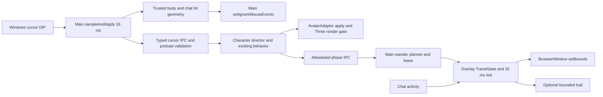

# M3.0 architecture audit and reference research

Date: **2026-10-27 (Europe/Madrid)**. Decision status: **proposal for user review; M3.1 is not authorized by this document**.

## 1. Evidence and scope

The initial `git status --short` was empty. HEAD is exactly **83036b7690fe1d7e22e667f7d1715c0c390c2d08**, the validated v0.1.1 checkpoint. The preceding commits are fa6917a (validated v0.1.0) and e9ee0e4 (M2.0 baseline). `git remote -v` returned no entries. Package and installed dependency metadata specify Electron **44.9.3**, Three.js **0.186.1**, @types/three **0.186.0**, electron-builder **26.18.0**, TypeScript **7.0.2**, Vite **8.3.4**. There is no React.

**Verified here:** current source, tests as text, packaging configuration, notes 31, 42, 44, 47–49, 52–55, public source at the six commits below, and official APIs checked against local declarations. **Historical evidence:** note 55's 220 passing automated tests and the user's 13/13 installed functional checks. Those checks were not repeated. **Not measured here:** new visual size, CPU/GPU/RAM, capture accuracy, Windows input delivery, or actual provider image entitlement. No application, test suite, reference program, installer, microphone or desktop capture was launched. Only documents 56 and 57 were created. No research clone was necessary.

Older notes contain superseded states (development-only movement, no commits, or pending validation). The checked-in source and later release record take precedence. The performance measurements in note 52 are **installed v0.1.0**, not a new v0.1.1 measurement. v0.1.1 startup registration was enabled/removed and left off; Windows sign-in launch itself remains untested.

## 2. Selected direction

Keep Electron + Three.js and the existing robot rig. Evolve toward **one fixed-size compact moving avatar window**, the existing independent chat, **one optional static home window**, and **one selection window created only during an explicit screen request**. The trail remains optional and fully click-through. Do not use a desktop-sized permanent avatar canvas or a second 3D renderer.

Use the existing main-process cursor sample for a deterministic autonomy planner. Retain one movement actuator and preserve the visual director. Introduce an exclusive intent arbiter so following, wandering, manual travel and returning home cannot move the window concurrently. Keep screen explanation separate from computer actions.

Start with a **130-DIP visible robot concept**, testing **176 × 200 DIP** window bounds and **104-DIP nominal body diameter** as provisional framing values. They are not a confirmed fit or final visual design. The first implementation should establish a shared layout profile with legacy and compact profiles; only then test the smaller profile. Details and approval decisions are in [the roadmap](57_M3.0_IMPLEMENTATION_ROADMAP.md).

## 3. Verified local architecture and source map

### Main process, travel and cursor data

- `src/main/main.ts` owns lifecycle, one-instance lock, tray composition, preference restoration and the **WanderState**. `runWander` calls the pure `planWander` and applies its commands to the overlay. One scheduled wander timeout and a separate exploration-expiry timeout use epochs to invalidate obsolete callbacks. Shutdown closes preferences, clears both timers, destroys tray, cancels/awaits chat speech cleanup, destroys avatar and trail, then quits.
- `src/main/overlayWindow.ts:createOverlayWindow` owns the avatar BrowserWindow, **TravelState**, actual `setBounds` calls, pointer modes and latest renderer phase. Initial placement comes from the primary display's workArea. The transparent 300 × 400 DIP window is frameless, nonfocusable, hidden until its first frame, ordinary floating always-on-top, no taskbar entry, Mica disabled. Show uses `showInactive`.
- `sampleAndApply` reads `screen.getCursorScreenPoint()` and current window bounds every **16 ms while visible**, including while asleep. It computes a trusted circle hit in local DIP, updates `setIgnoreMouseEvents` only on a mode transition, and sends one cursor IPC every tick to the renderer. Hide/destroy stop polling. The sample is already DIP; multiplying it by monitor scale would be an error.
- `src/shared/clickThrough.ts` defines a **160-DIP centered circle**, zero invisible slack, zero exit hold, and a 250 ms stale-sample rule. Transparent corners pass through; arms and antenna are outside the proxy. A separate **36-DIP chat button** is centered at **(262,332)** while awake (`chatTrigger.ts`, `styles.css`). Whole-window recovery starts false and is session-only. It intentionally captures transparent areas while enabled.
- `commandTravel` synchronizes live bounds, recomputes home from `placeOverlay(currentWorkArea)`, and requests a nudge or return. `tickTravel` runs every **32 ms only during non-idle travel**, rounds position and calls `setBounds` only when rounded coordinates differ. It emits travel status and trail samples. A paused move still has this timer. Hide halts it; destroy clears it.
- `src/shared/desktopMovement.ts` is pure DIP logic: clamp/recover, travel targets, pause/resume, interpolation and travel pose. Nudges default to **120 DIP**. Duration is at least 280 ms and distance/160 DIP/s; long returns may exceed the named 4,000 ms constant. Position uses smoothstep. **160 is an average distance/duration bound, not an instantaneous velocity cap**: smoothstep's maximum derivative is 1.5, so a segment can peak at 240 DIP/s. Existing tests check the average. Preserve validated manual behavior; use a genuinely bounded velocity rule for new following.
- `travelBlock` prioritizes voice, generating, then open chat. It does not inspect other applications, their selections, typing or mouse-button state. It does not itself block manual moves just because the character sleeps. Wandering has its own awake/lease checks.
- `wander.ts` starts disabled; its seeded pure planner uses a first 30–60 second rest (also requiring 45 seconds quiet), later 45–90 second rests, 80–160 DIP hops, a home command every third journey, and a **six-minute exploration lease** that cursor samples/hops do not renew. Manual movement yields wandering. Display changes, body hover, chat/voice and sleep constrain it.
- Important naming distinction: `wanderView().tracking` means **pointer on the body**, whereas renderer `TRACKING` means it has a fresh cursor sample for gaze, even if that cursor is stationary or far away. Using renderer TRACKING to suppress autonomous follow would suppress nearly all following.

### Renderer and character

`src/renderer/main.ts` wires canvas clicks to wake/pulse and the existing body-click notification. A click while already awake opens chat; the chat badge also opens chat. It does not move the OS window.

`avatar/createScene.ts` creates one WebGLRenderer and calls `director.step(performance.now())` from `setAnimationLoop`. It applies poses and draws only when the frame gate permits. `document.hidden` detaches the animation loop. In visible sleep the callback and pose math still run at the display cadence, but WebGL draws are gated at **80 ms**, approximately at most 12.5 draws/s before refresh alignment. Sleep is reduced drawing, not a stopped renderer. Do not claim zero sleep CPU.

`avatar/characterDirector.ts` owns **BehaviorState**, gaze interpolation, conversational presence, eye expressions, secondary motion and temporary gestures. `behavior.ts` retains SLEEPING, WAKING, IDLE, TRACKING and RETURNING_TO_SLEEP; wake is 700 ms, sleep blend 800 ms, inactivity 60 seconds, bounded exploration hold six minutes. Cursor motion neither wakes nor extends the inactivity deadline. Main uses wall-clock times; renderer uses performance time and receives exploration as a duration. Do not compare their absolute timestamps.

`proceduralRobot.ts` constructs the identity once: off-white slightly scaled sphere; glossy curved black lens; two independently expressive green eye arcs/catchlights; cheek lights; antenna; articulated shoulder/elbow/hand groups. `apply` changes transforms/material colors. `AvatarAdapter` already provides object/apply/pulse/dispose and is the future GLB seam. Reuse it, `faceExpression.ts`, `secondaryMotion.ts`, `ambientMotion.ts`, `presentation.ts`, and gesture/presence logic.

`robotFrame.ts` frames body radius 1 using a 28-degree perspective camera and the click proxy's nominal diameter. `createScene.resize` sets camera aspect/distance, projection matrix, renderer size and pixel ratio capped at **2**. Current fitting tests use a simplified rig envelope; they do not prove every raised-arm/gesture extremum fits a smaller window. The DPR refresh currently comes from resize/show; a same-DIP-size move between monitors needs an explicit tested refresh path.

### Chat, trail, preferences and package

`chatWindow.ts` creates its normal, focusable, non-topmost window on first open, hides it on close, and reuses it. `chatPlacement.ts` places/clamps a 380 × 520 DIP initial chat (minimum 320 × 420) beside actual avatar bounds. Open chat/voice/generation activity blocks travel. This is an existing appropriate separate UI surface.

`trailWindow.ts` creates an extra secure BrowserWindow only when enabled (or a dev marker is requested), fully ignores mouse events and draws bounded Canvas 2D particles. Disabling destroys it; an empty trail hides it. Its 100 ms age timer stops when particles are empty; renderer rAF stops when empty. `neonTrail.ts` caps **32 particles**, life **500–900 ms**, but independently hardcodes **80-DIP body radius**. Resize work must update this through the shared profile, not merely resize the avatar.

`userPreferences.ts` persists only version 1, Neon Trail and Start Awake using bounded/validated JSON and replacement writes. Wandering state, movement lease and current position are not persisted. Provider selection/endpoint and TTS enabled/auto-read/conversation/rate use separate stores; the API key uses safeStorage. Start with Windows reads OS login-item state and writes only after a deliberate installed-app tray toggle; it is independent of Start Awake and not stored in preference JSON. The validated checkpoint left it off. No preference contents or keys were opened in this audit.

Development uses localhost Vite, developer diagnostics, and ignored local Whisper assets. Production `npm start` and installed builds use `app://companion`. NSIS is x64, per-user, no elevation, no automatic post-install launch; renderer code is bundled in ASAR and the tray PNG unpacked. `electron-builder.yml` excludes development ASR/model files, user data, audio, docs and references. Installed speech therefore lacks the development Whisper assets; Pablo TTS is the existing chat renderer's local Windows voice path. The **1,024 MiB ASR guard remains present**.

### End-to-end flows

**Current Return Home:** current display → `placeOverlay(workArea)` → home coordinate → normal travel. There is no persistent home anchor, visible station, docking state, arrival-to-sleep callback or fixed home window. Sleep and Return Home are separate actions.

### Displays and trust boundaries

Display add/remove/metrics events clamp/recover the overlay, stop travel, recalculate home, clear trail, and reposition chat. Current travel stays within one matching workArea; it is not an arbitrary multi-monitor route planner. Negative origins are covered in pure tests. No current cursor-monitor crossing behavior exists.

The sandbox, context isolation, nodeIntegration false, webSecurity and restrictive CSP remain. Production renderer networking is denied; Qwen fetch runs in main with endpoint validation and redirect rejection. Media permissions allow only armed top-level chat microphone audio. Navigation, new windows and webviews are constrained.

Trust checks are **not identical everywhere**: overlay phase/click handlers currently check top-level frame and exact allowed page URL; speech additionally checks the owned visible chat WebContents; trail checks the owned window. New feature IPC must bind both sender identity and top-level URL, validate payloads and session tokens, and never grant arbitrary position/hit-region/capture-path control. This audit does not claim a complete penetration test. Existing pointer diagnostic logs include window-relative coordinates; future autonomy should not add cursor histories or production movement telemetry.

## 4. Public references inspected

All source links below are pinned to the exact reviewed commits. These were read through GitHub, without cloning, installing, running or importing assets/code. API compatibility means relevant Electron 44 declarations exist; it does **not** mean these older projects were tested on Electron 44.

### A. coglabss/deskcat

Commit **b5718472223bdb23d01abf92dae7bbd8d7de39b1**. Electron ^31, JavaScript, Canvas 2D, electron-store. [Repository/README](https://github.com/coglabss/deskcat/tree/b5718472223bdb23d01abf92dae7bbd8d7de39b1).

Reviewed [MoodModel](https://github.com/coglabss/deskcat/blob/b5718472223bdb23d01abf92dae7bbd8d7de39b1/src/renderer/mood-model.js), [BehaviorController](https://github.com/coglabss/deskcat/blob/b5718472223bdb23d01abf92dae7bbd8d7de39b1/src/renderer/behavior-controller.js), [Mover](https://github.com/coglabss/deskcat/blob/b5718472223bdb23d01abf92dae7bbd8d7de39b1/src/renderer/mover.js), [AnimationPlayer](https://github.com/coglabss/deskcat/blob/b5718472223bdb23d01abf92dae7bbd8d7de39b1/src/renderer/animation-player.js), [loop](https://github.com/coglabss/deskcat/blob/b5718472223bdb23d01abf92dae7bbd8d7de39b1/src/renderer/loop.js), [overlay](https://github.com/coglabss/deskcat/blob/b5718472223bdb23d01abf92dae7bbd8d7de39b1/src/main/overlay-window.js) and [passthrough](https://github.com/coglabss/deskcat/blob/b5718472223bdb23d01abf92dae7bbd8d7de39b1/src/main/passthrough.js).

Useful: needs → behavior decision → movement/animation, injected RNG, slow decision cadence separate from animation. The loop decides about every 2.5 seconds while motion uses dt. Avoid adding hunger/energy persistence to our MVP or allowing cursor motion to replace explicit wake semantics. Its primary-display-sized overlay, continuous sleep animation, renderer Node integration, disabled context isolation, renderer-controlled hover IPC, screen-saver z-order and default autostart do not meet our architecture. Core BrowserWindow APIs exist in 44; its security/window design should not be ported.

[LICENSE](https://github.com/coglabss/deskcat/blob/b5718472223bdb23d01abf92dae7bbd8d7de39b1/LICENSE) is MIT for source only; its asset terms are explicitly separate. No artwork/sound reuse is proposed.

### B. kokoronoka/desktopPet

Commit **9ee7815a7c2e973207d625c21c7a5e4182775ad3**. Electron ^31, JavaScript/HTML/CSS, emoji pet, NSIS. [README](https://github.com/kokoronoka/desktopPet/blob/9ee7815a7c2e973207d625c21c7a5e4182775ad3/README.md), [main](https://github.com/kokoronoka/desktopPet/blob/9ee7815a7c2e973207d625c21c7a5e4182775ad3/main.js), [preload](https://github.com/kokoronoka/desktopPet/blob/9ee7815a7c2e973207d625c21c7a5e4182775ad3/preload.js), [renderer](https://github.com/kokoronoka/desktopPet/blob/9ee7815a7c2e973207d625c21c7a5e4182775ad3/src/renderer.js).

Useful: main owns real window movement, integer coordinates, workArea clamp, stop walking on manual override, debounced preference writes, separate setup/overlay preloads and tray lifecycle. Renderer schedules 8–20 second random walks; main steps horizontally every 16 ms. It is not a cursor-follow implementation.

Avoid raw renderer movement deltas and ignore-mouse options, handlers without sender validation, screen-saver stacking, unrestricted repeated random walking, and persisted pixel coordinates validated only by center-in-display. These APIs remain available in 44, but Windows DPI/input tests must be ours. Its [package](https://github.com/kokoronoka/desktopPet/blob/9ee7815a7c2e973207d625c21c7a5e4182775ad3/package.json) declares MIT; **no LICENSE/COPYING/NOTICE file was present in the reviewed tree**. Treat reuse permission/notice as incomplete; learn concepts only. Do not adopt README advice to disable Windows security.

### C. SixOfFive/DesktopPet

Commit **4eeb333e1866f52163af1ea2f9c02d499141ddce**. C# .NET 9 WinForms, Silk.NET OpenGL, SharpGLTF, native layered windows. [README](https://github.com/SixOfFive/DesktopPet/blob/4eeb333e1866f52163af1ea2f9c02d499141ddce/README.md), [Pet.Update](https://github.com/SixOfFive/DesktopPet/blob/4eeb333e1866f52163af1ea2f9c02d499141ddce/Pet.cs), [IPetBehavior](https://github.com/SixOfFive/DesktopPet/blob/4eeb333e1866f52163af1ea2f9c02d499141ddce/IPetBehavior.cs), [LayeredPetForm](https://github.com/SixOfFive/DesktopPet/blob/4eeb333e1866f52163af1ea2f9c02d499141ddce/LayeredPetForm.cs), [Scene](https://github.com/SixOfFive/DesktopPet/blob/4eeb333e1866f52163af1ea2f9c02d499141ddce/Renderer/Scene.cs), [WindowWalker](https://github.com/SixOfFive/DesktopPet/blob/4eeb333e1866f52163af1ea2f9c02d499141ddce/WindowWalker.cs).

Useful: behavior exposes position/yaw/state, renderer interprets state, dt-based velocity, separate idle actions, cursor movement grace and arrival distances. It chases a moving cursor, walks toward an idle cursor to sleep after 60 seconds, and wakes on cursor movement. Our deliberate sleep must take priority instead. Its form updates behavior/location/render every 16 ms, with GPU rendering/readback into a layered bitmap. Do not replace Three.js or introduce its runtime/readback approach.

Its all-monitor bounds are a **bounding rectangle of the workAreas**, so gaps between monitors may become usable coordinates. Do not treat that as safe mixed-monitor routing. WindowWalker enumerates windows every 50 ms; our product does not need that access/polling. The pet window is wholly click-through, not a precedent for clickable body regions. No root source licence was present despite README referring to one. Kenney asset licence files are separate and do not grant permission for project code. No source or asset reuse is proposed. Electron compatibility is conceptual only.

### D. XiamiYoung/ctx-shot

Commit **956b943e298e3bb78f6a19a9909147c172742d55**. Electron ^31, Canvas 2D, optional uiohook-napi. [main captureFlow/safeCaptureFlow](https://github.com/XiamiYoung/ctx-shot/blob/956b943e298e3bb78f6a19a9909147c172742d55/main.js), [selection renderer](https://github.com/XiamiYoung/ctx-shot/blob/956b943e298e3bb78f6a19a9909147c172742d55/overlay-renderer.js), [preload](https://github.com/XiamiYoung/ctx-shot/blob/956b943e298e3bb78f6a19a9909147c172742d55/overlay-preload.js), [hotkey detector](https://github.com/XiamiYoung/ctx-shot/blob/956b943e298e3bb78f6a19a9909147c172742d55/hotkey-detector.js).

Useful: single in-flight capture, display_id mapping, actual thumbnail-size ratios for selection coordinates, crop clamping, Escape/right-click cancellation and listener cleanup. Avoid its index fallback if display_id cannot be matched. Also avoid prewarmed permanent windows per monitor, capture warmup at startup, initial capture of all screens, full-screen data URLs sent to renderers, timed PNG retention and clipboard path handoff. Those are its product choices, not our privacy/memory contract.

Core capture/shortcut/nativeImage APIs exist in 44. The optional double-Ctrl native global hook introduces permissions/ABI risk and is excluded; use Electron globalShortcut only after opt-in. [MIT licence](https://github.com/XiamiYoung/ctx-shot/blob/956b943e298e3bb78f6a19a9909147c172742d55/LICENSE) covers its source. Use our artwork, colors, consent flow and independently written implementation.

### E. Aish-web121/AI_Overlay

Commit **add88aaeaf97510144587fb14194d210d729f4fc**. Electron ^36.3.1, Groq SDK, screenshot-desktop, sharp and HTML. [main](https://github.com/Aish-web121/AI_Overlay/blob/add88aaeaf97510144587fb14194d210d729f4fc/src/main.js), [region selector](https://github.com/Aish-web121/AI_Overlay/blob/add88aaeaf97510144587fb14194d210d729f4fc/src/regionSelect.js), [answer renderer](https://github.com/Aish-web121/AI_Overlay/blob/add88aaeaf97510144587fb14194d210d729f4fc/src/overlay.js), [README](https://github.com/Aish-web121/AI_Overlay/blob/add88aaeaf97510144587fb14194d210d729f4fc/README.md).

Useful UX distinction: selection phase, contextual request, visible loading/answer. Actual main code immediately calls Groq on full capture, stores region PNGs for a batch, and uses a fixed vision model. Its API key is saved as plain JSON; renderers have Node integration/context isolation off; model output enters marked/innerHTML; region coordinates assume primary-display origin and no explicit DPI conversion. Those are material security and correctness reasons not to copy it. Its setup also makes a network validation call, contrary to our no-unexpected-charge rule. Do not inherit README quota/free claims or disabling GPU. screenshot-desktop/sharp add native packaging work not justified for our first screenshot gate. No source licence file was found in the tree. Electron 44 compatibility of those dependencies is unverified; concepts only.

### F. LGaben/Desktop-Pets

Commit **83ae6ffa63fdac7a3c3143b296aa8a1d153db2ec**. Python/PyQt5, Pillow, pynput, plyer; no proposed runtime adoption. [SimplePet](https://github.com/LGaben/Desktop-Pets/blob/83ae6ffa63fdac7a3c3143b296aa8a1d153db2ec/pet/simple_pet.py), [FullPet](https://github.com/LGaben/Desktop-Pets/blob/83ae6ffa63fdac7a3c3143b296aa8a1d153db2ec/pet/full_pet.py), [PetWindow](https://github.com/LGaben/Desktop-Pets/blob/83ae6ffa63fdac7a3c3143b296aa8a1d153db2ec/ui/pet_window.py), [states](https://github.com/LGaben/Desktop-Pets/blob/83ae6ffa63fdac7a3c3143b296aa8a1d153db2ec/pet/state.py).

Useful: optional follow setting, explicit user-sleep latch, cursor-still threshold that triggers rest/short wander, separate behavior/animation callbacks. The UI uses 33 ms animation, 1 s stats, 3 s behavior and 200 ms mouse timers. Follow targets the cursor itself with a small 15-pixel stop distance, frame-step speeds and random counters; that is too close and not deterministic enough for our companion. Use elapsed-time and seeded tests, larger separation and one reused cursor sampler. availableGeometry access here is not evidence of robust multi-monitor routing. [LICENSE is MIT](https://github.com/LGaben/Desktop-Pets/blob/83ae6ffa63fdac7a3c3143b296aa8a1d153db2ec/LICENSE), while the README says personal use; clarify that inconsistency before any direct reuse, and separately audit sprite/Qt/dependency terms. Conceptual reference only.

**Most useful combination:** DeskCat's decoupled decision cadence, SixOfFive's behavior/render interface, kokoronoka's main-owned motion, LGaben's explicit sleep latch, and ctx-shot's coordinate/cancel structure. DesktopCompanion already has stronger reusable foundations than most of these window/IPC implementations.

## 5. Official API findings and installed compatibility

Local reference: `node_modules/electron/electron.d.ts` from **44.9.3**, not just the latest website (which now shows newer examples). Signatures verified: screen display/cursor/conversion APIs (~12612–12670), display events (~12584), BrowserWindow setBounds/setPosition/setIgnoreMouseEvents (~6469/6660/6592), getSources and source display_id/thumbnail (~8095–8134), globalShortcut register/unregister (~9014/9047). Type presence is not a runtime result.

[screen](https://www.electronjs.org/docs/latest/api/screen): cursor and display geometry are DIP; workArea excludes reserved taskbar space. Use getDisplayMatching for an avatar rect, getDisplayNearestPoint for the pointer and getAllDisplays for a topology snapshot. Refresh on added/removed/bounds/workArea/scaleFactor/rotation changes. Windows screen/DIP point and rect conversion functions exist; never multiply a global mixed-DPI origin by one monitor's scale. Split regions by monitor, or initially reject crossing selections.

[BrowserWindow](https://www.electronjs.org/docs/latest/api/browser-window) and [custom interactions](https://www.electronjs.org/docs/latest/tutorial/custom-window-interactions): setBounds/setPosition are suitable main-owned actuators; the optional animation parameter is not a Windows motion controller. setIgnoreMouseEvents toggles an entire window, not pixel-perfect geometry; forwarding mouse moves has an elevated-window UIPI limitation. Our polling design does not need forwarding, but elevated/protected windows still require manual verification. **setVisibleOnAllWorkspaces does nothing on Windows**; the existing visibleOnFullScreen false option does not implement automatic full-screen suppression. [Transparent-window limitations](https://www.electronjs.org/docs/latest/tutorial/custom-window-styles) warrant fixed non-user-resizable profiles and Windows tests; do not resize on each motion tick.

[desktopCapturer](https://www.electronjs.org/docs/latest/api/desktop-capturer): getSources returns screen/window NativeImage thumbnails; requested size is not a guarantee of actual dimensions. Match display_id exactly, inspect actual image dimensions and crop in main. It provides no direct rectangle-only screenshot API or source-id filter in SourcesOptions. It can acquire other displays' thumbnails during enumeration; do not claim only the chosen region was ever captured. The MVP can guarantee only the crop is retained, previewed or sent. If acquisition of any surrounding pixels is unacceptable, use a later native capture gate. No continuous media stream is needed.

Also reviewed the official **v44.9.3** [NativeImage implementation](https://github.com/electron/electron/blob/v44.9.3/shell/common/api/electron_api_native_image.cc) and [desktop capturer implementation](https://github.com/electron/electron/blob/v44.9.3/shell/browser/api/electron_api_desktop_capturer.cc). NativeImage has scaled representations; do not assume a returned bitmap dimension and crop coordinates use the same units without checking. The first capture adapter should require a single 1x representation, use getSize(1) consistently and reject unexpected representation scales until a tested normalization exists. The native capturer may perform several refresh cycles before resolving; a single API request is not a guarantee that only one native frame was acquired. There is no proposed ongoing capture after that session.

[globalShortcut](https://www.electronjs.org/docs/latest/api/global-shortcut): register after ready, check the boolean result, report conflicts and retain tray activation, unregister owned accelerators on disable/quit. This observes a chosen accelerator, not arbitrary keyboard input. No hooks/double-modifier detector.

[Three renderer](https://threejs.org/docs/pages/WebGLRenderer) and [responsive sizing](https://threejs.org/manual/pages/responsive.html): maintain CSS/DIP layout separately from backing pixels; setSize and a capped pixel ratio once per resize/DPI transition, update aspect and projection. Those methods exist in the installed @types/three. Preserve the current perspective camera, lights, rig and adapter; compact size does not require GLB or shader changes.

## 6. Compact-window comparison and migration

**Option 1 — 300 × 400 window, smaller rendering only.** Lowest initial OS-window risk; good temporary comparison flag. It saves little surface memory unless backing resolution also changes. Keeping a 160-DIP proxy would create invisible capture around a small robot; the badge and edge placement remain far from it. A large transparent travel envelope unnecessarily limits corner placement. Use only as the intermediate migration experiment.

**Option 2 — smaller window plus camera/layout changes.** Better raster-area and positioning fit; no new renderer. Requires synchronized proxy, badge, trail origin, fitting tests, chat anchor and DPI refresh. A fixed layout profile is manageable; continually resizing a moving transparent window is not proposed.

**Option 3 — compact positioned avatar with independent UI when necessary. Recommended.** Implement option 2 as its first step while retaining the existing separate chat. Add a static optional home only when required, and an ephemeral selector later. This prevents a permanent display-sized renderer, avoids trying to put a fixed home in the moving avatar's local canvas, and respects both chat focus and avatar nonfocus behavior. Cost: an optional home renderer and more lifecycle tests. Do not merge clickable home into the currently noninteractive trail.

Migrate: shared layout profile with legacy-equivalent output → flag-only small rendered comparison → one compact fixed-window profile → Windows clipping/click tests → voluntary compact preference → follow gate → optional home. The candidate compact nominal body 104 projects neutral robot height around 120 DIP from the existing dimensions; motion/perspective may enlarge it. Sweep actual rig transforms, wake, gestures and sleep before accepting the 110–140 DIP visible-height goal. Keep a 36-DIP chat badge within the compact profile (candidate center 150,174), outside the body proxy. Do not silently remove a validated access path.

At DPR 2 the existing canvas is 600 × 800 (480,000 pixels); a 176 × 200 profile is 352 × 400 (140,800), **70.7% fewer backing pixels**. These are arithmetic counts, not a GPU/RAM benchmark. One RGBA plane is about 1.83 vs 0.54 MiB; antialiasing, depth, compositor buffers and driver allocations add more. Electron/geometry/material memory persists, so a 70.7% process-memory reduction is not credible.

## 7. Future capture and vision architecture choices

**Electron first:** a one-shot getSources/crop route uses existing dependencies and can be tested with fake NativeImages. Limit selection to one chosen display; explicit local confirmation precedes acquisition. Hide our own avatar/home/trail/selector before acquiring; preserve prior visibility and restore safely in finally. Windows setContentProtection is not selected as the sole exclusion mechanism: its effect waits for composition and platform behavior needs testing. Use a measured compositor-settle protocol and reject contaminated captures. Only the cropped preview reaches chat.

**Native Windows:** [Windows.Graphics.Capture](https://learn.microsoft.com/en-us/windows/uwp/audio-video-camera/screen-capture) supports a system picker, support checks, frame acquisition and visible capture border. It needs native/WinRT integration and device/frame-pool cleanup. [DXGI desktop duplication](https://learn.microsoft.com/en-us/windows/win32/direct3ddxgi/desktop-dup-api) requires GPU-resource, rotation, access-loss and frame management; it is optimized for frame updates, excessive for our first still image. Neither path justifies a large extra runtime. If Electron's display enumeration/crop cannot meet the privacy, quality or memory contract, stop that milestone and evaluate a small isolated native helper.

**External screenshot/OCR tools:** add distribution, executable trust, licence and lifecycle costs. Do not add screenshot-desktop, sharp, Python, an OCR daemon or a local vision model for the MVP. OCR alone cannot understand arbitrary UI; optional Windows OCR or another engine is a separate later audit.

**UI Automation:** future read-only structured element roles/text could help with user-selected UI, but cross-process access, inconsistent app trees and sensitive values need a separate consent scope. Microsoft's [UIA security guidance](https://learn.microsoft.com/en-us/windows/win32/winauto/uiauto-securityoverview) imposes integrity restrictions; do not request UIAccess/elevation to work around them. No UIA enumeration or computer action belongs to screen explanation MVP.

### Qwen audit result

Current `qwenEndpoint.ts` fixes **qwen3.7-plus** and validates a Singapore workspace HTTPS host with /compatible-mode/v1, no credentials in URL/port/query; `qwenProvider.ts` serializes every content value as **text**. `AIProvider`/conversation policies also carry strings. Therefore the current app cannot send images even if the cloud model supports them.

The official [qwen3.7-plus card](https://docs.modelstudio.console.alibabacloud.com/en/model-studio/qwen3-7-plus) lists image/text/video input including Singapore. [Alibaba's vision API](https://www.alibabacloud.com/help/en/model-studio/vision) documents text + image_url content parts and Base64 image input on the OpenAI-compatible Singapore workspace endpoint. **A different model/endpoint is not inherently required**, but workspace entitlement, exact request options and image billing still need explicit validation at implementation time. Do not assume the user's saved key grants image access.

Recommend a separate bounded `VisionProvider` contract and session controller that may reuse the **verified same endpoint/model** after user approval; preserve the text provider and conversation history. Main builds an inline image payload from its owned crop, not renderer-supplied URLs/files, and uses safeStorage internally only when a confirmed send occurs. Do not upload to public object storage. Use one image/one explicit question, no image history, no silent retry or model fallback. Show provider/model/region, paid-request possibility, image dimensions and disposal policy before Send. No API was called in this audit.

## 8. Performance and privacy assessment

[Installed baseline 52](52_M2.2A_STABILITY_BASELINE.md), v0.1.0: sleep with chat closed **1.03–1.15% whole-machine CPU**, awake idle **3.25–4.03%**, manual movement **4.17%**, one wander sample **4.30%**, trail movement **5.45%**. Private memory was ~244 MiB asleep, ~248–249 MiB awake idle, ~280 MiB with chat, ~302 MiB during trail movement. After chat/trail use, sleep remained ~298 MiB because hidden renderers stayed alive; it did not prove a leak. Working-set sums may double-count shared memory. Available RAM was roughly **780–948 MiB** across the captured scenarios. These are historical short intervals, not new v0.1.1 budgets or p95 measurements.

Expected costs: following increases travel duty cycle and wake time; smaller raster area may offset some GPU cost but not OS window-motion/IPC cost. Home adds one renderer if enabled even when static (cost unmeasured). Selection creates short-lived image/native buffers and a renderer; Base64 can add encoding copies. Avoid all-monitor prewarming and image histories. Battery impact and thermal behavior are unmeasured. Keep trail off by default and allow it to stay independently off during follow.

Use paired baseline/feature samples with the same installed build and user-confirmed state, CPU-time deltas normalized by 12 logical processors, private commit, working set, GPU engine/frame statistics, setBounds and IPC counts, memory before/after and available/commit headroom. Proposed regression budgets belong in document 57 and require measurement. Preserve the **1,024 MiB Whisper guard** and the existing validated animation cadence; do not fund new features by weakening either.

Screen images and AI replies are untrusted data. A screenshot can contain secrets or malicious instructions. Model output must never become executable commands, auto-clicks, IPC authority or trusted HTML. Show crop preview and explicit Send; no background screenshots, clipboard writes, full-screen logs, saved files or automatic uploads. Cancellation discards session references; JS/NativeImage GC is not a promise of forensic erasure or prevention of OS paging/crash dumps.

Full-screen/presentation detection is not solved by Electron's all-workspaces setting. Prefer a tray Pause/Hide for the first release. A later [SHQueryUserNotificationState](https://learn.microsoft.com/en-us/windows/win32/api/shellapi/nf-shellapi-shqueryusernotificationstate) adapter can query busy/presentation states without reading window contents; Microsoft notes no full-screen start/stop notifications. Its [states](https://learn.microsoft.com/en-us/windows/win32/api/shellapi/ne-shellapi-query_user_notification_state) are hints, not proof about every borderless app. Defer native integration and any bounded polling policy to a separate gate.

## 9. Conclusions, limits and protected modules

Reuse, do not rewrite: AvatarAdapter/robot geometry, facial/secondary/ambient presentation, speech/TTS/conversation controllers, manual travel functions, click-through policy, chat placement, pure wander planner, bounded trail and preference/startup stores. Extend through shared layout, an exclusive motion arbiter, deterministic follow logic, optional home controller and explicit screen-session boundaries.

Unresolved implementation gates: complete compact motion envelope, real mixed-DPI input/first-click reliability, intentional pause UX while working in other apps (external selection/typing is not observable with current privileges), optional home renderer cost, compositor exclusion timing, exact thumbnail crop mapping and memory peaks, provider entitlement/cost, and reference licence ambiguities. None is a reason to execute reference code or change the stable release during research.

Only the two approved Markdown documents are the audit output. v0.1.1 remains the last validated installed release. Review [57](57_M3.0_IMPLEMENTATION_ROADMAP.md) before authorizing the small M3.1 layout step.

