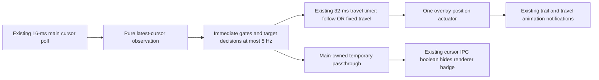

# M3.2a — Autonomous cursor following prototype

Date: 2026-10-27 (Europe/Madrid). Stable HEAD remains
`83036b7690fe1d7e22e667f7d1715c0c390c2d08`.

Status: **source implementation, automated verification and Prompt 79 Windows
validation complete: 14/14 user-confirmed manual checks passed**. Follow remains
development-only, explicitly opt-in and defaults OFF. It was not enabled during
implementation or smoke; the user subsequently enabled it for the real Windows
validation recorded below. Ready for approval as an experimental prototype, with
slow/intermittent pursuit retained as tuning feedback. No M3.2b work has started.

## Preflight and preserved work

Read the actual architecture/roadmap and layout records 56–59 and inspected the
current movement, cursor, animation, chat, trail, tray, IPC and tests. Git status,
last three commits and `git diff --check` confirmed the expected checkpoint with
the prior uncommitted M3.1a/M3.1b work. Those changes and research documents were
preserved. No reset, clean, commit, tag, push, installer, installation, dependency
change, provider request, microphone recording or credential modification occurred.

The compact layout is still **216 × 224 DIP**, nominal body/proxy **108 DIP**, with
the same 36-DIP badge and arm capsules. Robot geometry, materials, camera, facial
expressions, animation amplitudes/timing and the approved compact size were not
retuned. Installed v0.1.1 is unchanged. Start Awake, Start with Windows, provider,
voice, preference schema and the 1,024-MiB Whisper safety floor remain unchanged.

The prior development app was running. The user confirmed normal Tray > Quit;
a subsequent read-only process check found zero checkout Electron processes.
No process was force-closed. Before final smoke, both installed and development
process counts were again zero.

## Existing movement audit

- `overlayWindow.ts:sampleAndApply` owns the visible **16-ms** cursor poll. It reads
  `screen.getCursorScreenPoint`, live native bounds and trusted body/arm/badge
  hit geometry, then applies main-owned `setIgnoreMouseEvents` transitions.
- `desktopMovement.ts` owns pure fixed-target travel: `requestTravel`, `requestHome`,
  `stepTravel`, `clampWindow`, `recoverWindow` and `workAreaDip`. Manual duration
  derives from distance/160 DIP/s, minimum 280 ms; position uses smoothstep.
  That is an average-speed bound, not a hard instantaneous velocity ceiling.
- `overlayWindow.ts:commandTravel`, `ensureTravelTimer` and `tickTravel` use one
  **32-ms** travel interval and integer `setBounds` updates when coordinates change.
  Repeatedly restarting `requestTravel` for moving cursor targets would restart
  easing, so that approach was not used.
- `main.ts` owns the existing seeded `WanderState`, scheduling timeout, exploration
  lease and user interaction gates. The pure `wander.ts` planner remains unchanged.
- `travelBlock` gates chat, listening/TTS and generation. Renderer BehaviorState
  remains the sleep/wake authority; cursor observations never wake the character.
- Chat anchors and Return Home use actual live window bounds and display workArea.
  The existing trail consumes actual window positions, travel phase and gates.

## New ownership and data flow

`src/shared/cursorFollow.ts` is a pure deterministic module with **no imports**,
platform globals, timers, network, Three.js or device access. Explicit inputs are
window/workArea DIP rectangles, cursor sample, visual avoidance radius, monotonic
time, pinned display key, visibility, awake state and activity/recovery/motion
gates. It returns a new follow state with a safe target/velocity or a hold.

`FollowState` is separate from renderer animation state and fixed-endpoint travel.
It stores only the latest cursor and one meaningful-motion anchor, direction,
velocity, target, decision clock, finite bout/rest and session lease. It does not
record a cursor history. Internal times use main-process `performance.now()`;
existing cursor IPC wall-clock timestamps and renderer animation clocks are not
compared with these times.

The overlay remains the only movement owner. Its existing `tickTravel` selects
**either** follow integration when follow is enabled and fixed travel is idle,
**or** the original fixed-target travel. Both modes call one
`applyWindowPosition` actuator and share the same existing 32-ms timer. The separate
existing display-recovery bounds adjustment remains an OS topology handler, not
a competing movement loop.

There is no following renderer, second cursor poll, second movement interval,
new service, mouse hook, driver, permanent BrowserWindow or dependency.

## Behavior and tuning

These are **initial engineering choices**. Prompt 79 below records the subsequent
user verdict: natural/companion-like and smooth, but very slow.

- Ignore cursor displacement below **3 DIP** from the meaningful-motion anchor;
  smooth direction with a **150-ms** response. Small jitter does not renew motion.
- Enter pursuit only beyond **220 DIP** for at least **250 ms**, after a **500-ms**
  startup/resume rest. Decision sampling can make these waits longer.
- Baseline trailing distance **170 DIP**. Exclusion is
  `max(110, visualRadius + 12)`; the overlay conservatively uses the whole window's
  half-diagonal as visual radius. At 216 × 224 this is about **155.59 DIP**, so
  exclusion is about **167.59 DIP** and desired trailing distance is enlarged to
  `max(170, exclusion + 24)` = approximately **191.59 DIP**.
- The whole-window radius is an avoidance bound only. It does **not** make the
  rectangle clickable or enlarge the established hit-test shapes.
- Behind-cursor target is preferred. If clamping or its entire path would violate
  the cursor exclusion circle, choose a same-side radial/perpendicular/cardinal
  alternative. All goals are clamped to one workArea with the full native footprint.
- Filter target changes below **24 DIP**; otherwise blend **55%** toward the fresh
  candidate on a decision. Revalidate the blended segment rather than accepting
  interpolation through an unsafe region.
- Desired cruise speed **130 DIP/s**, hard fractional velocity cap **160 DIP/s**,
  normal acceleration/braking **320 DIP/s²**. Arrival is within **8 DIP** with speed
  below **5 DIP/s**, with final deceleration still bounded.
- Integrate at nominal **32 ms**, clamp dt to **64 ms**, and discard movement for
  a clock gap over **250 ms**. A stale/future cursor sample fails closed. There is
  no catch-up teleport after a pause.
- Every proposed position step checks the **whole center segment**, not just its
  endpoint, against exclusion plus a **2-DIP rounding guard**. Safety blocks may
  zero velocity immediately; ordinary target/idle braking is acceleration-limited.
- After **1,200 ms** without meaningful cursor motion, discard the target, brake
  and stop. Maximum movement bout **6 seconds**, then **5 seconds** rest. Fixed
  values keep this first prototype deterministic; no random rest system was added.
- A follow session has a **6-minute** ceiling which observations do not renew.
  Existing renderer inactivity/sleep policy still applies, normally stopping it
  sooner. Follow does not extend `setExplore`, alter sleep deadlines or send Wake.

Fractional bounds are retained internally; only the final OS position is rounded.
Rounding and real Windows scheduling mean actual desktop timing needs measurement.
No naturalness, first-click or actual maximum physical-pixel speed is inferred
solely from unit tests.

## Priority table and cancellation

| Priority / condition | Follow action | Existing movement behavior |
| --- | --- | --- |
| Quit/destroy, invalid cursor/display, stale sample or unsafe segment | Stop/discard follow work; no unsafe step. Destroy clears timers. | Existing shutdown and recovery remain. Native cursor/display read failures fail closed. |
| Hide or Sleep | Hold and zero follow velocity; Sleep request blocks before renderer acknowledgment. | Hide clears existing polling/travel. Explicit manual Sleep semantics are preserved. |
| Chat, listening, TTS, generation, recovery or reduced motion | Hold, discard target and wait for fresh state plus resume rest. | Fixed manual travel retains its existing gates; recovery retains main-owned whole-window capture. |
| Manual Move, Return Home or Stop | **Turn Follow OFF**, clear its target/timer and refresh checkbox. | Requested fixed-target command owns the same actuator; no automatic follow resumption. |
| Explicit Follow ON | Main turns Wandering OFF and cancels its owned hop/lease first. | Existing fixed travel is stopped before taking follow ownership. |
| Explicit Wandering ON | Turn Follow OFF first. | Existing wander timing/planner resumes only through this explicit command. |
| Rest / Follow OFF | No follow target or movement timer. | Existing pointer polling, static interaction, manual movement and opt-in Wandering remain. |

Disabling Follow never re-enables Wandering. Pausing for chat, hide or sleep keeps
the checkbox checked as **enabled intent**, even while no motion is allowed.
Fresh awake/visible cursor state can resume it after the rest/dwell rules. Display
metric/add/remove events turn it off and require a fresh explicit opt-in.

No follow-specific timeout exists. The existing movement interval is present only
while follow moves/brakes or existing fixed travel is active. Disable removes
follow work without removing the pointer poll needed for ordinary click-through.
Queued callbacks check disposal; mocked late callbacks cannot move a destroyed
window. Native animation preferences are queried at most once per 200 ms while
Follow is enabled; an unavailable result is treated as reduced motion.

## User control, input and security

Tray **Follow Cursor (Experimental)** exists inside the existing development
control gate, initially unchecked. Main rejects enabling it outside development.
The flag is session-only, absent from `user-preferences.json`, and never restored
by Start Awake/Start with Windows. Runtime changes, including manual overrides
and topology cancellation, refresh the tray's actual enabled state.

During follow motion/braking the avatar passes mouse input through. The badge is
hidden. Main restores normal input after **300 ms** stopped; recovery capture
remains an explicit exception. Normal settled input still uses the approved body
circle, arm capsules and awake-only badge. Exact-pixel hit testing remains out of
scope, and an intentionally clickable stationary robot still intercepts its own
body/arm clicks. Cursor motion alone cannot detect dragging, typing or selection
in other apps; no such capability is claimed.

The existing **main-to-renderer cursor message** gains one optional validated
boolean, `inputSuppressed`, so badge visibility can follow the main input policy
without extra IPC traffic or a new channel. The sandboxed preload validates it;
the renderer receives no new movement, arbitrary region, capture or follow API.
The renderer cannot turn main capture on with this field. Its one added listener
is removed on pagehide. IPC sender/page validation, sandbox, context isolation,
CSP, permissions, `app://`, navigation rules and provider security remain intact.

## Displays, DPI and limitations

This prototype is **single-display**. Enabling pins the current display id, scale
and workArea key. A cursor outside that workArea (including its taskbar strip or
another monitor) pauses follow. Coming back can resume through fresh gates; the
robot never targets a union of monitors or a disconnected gap. Negative origins
are ordinary DIP coordinates. Electron cursor/window/workArea DIP are not
multiplied by display scale. The approved renderer DPR handling is unchanged.

Topology/scale changes disable follow before the existing recovery handler runs.
An unplugged display may require that existing recovery placement; this is an OS
recovery exception, not autonomous cross-monitor travel. Small/invalid workAreas
or lack of a safe goal stop pursuit. If the cursor jumps onto the robot, the
robot stops rather than teleporting out of the way. The user can disable Follow,
use manual movement, Hide or Quit from the tray.

Prompt 79 below validates ordinary same-display edges, real input and tuning feel
on the user's Windows setup. Mixed-DPI/multi-monitor behavior, dragging-specific
interference and sustained CPU/GPU/RAM remain unvalidated. The compact model's
previous 12/12 visual checks are separate from this follow validation.

## Exact files changed in M3.2a

New:

- `src/shared/cursorFollow.ts`: pure follow state, observation, planning,
  exclusion/path safety, kinematics, holds and input suppression dwell.
- `src/shared/cursorFollow.test.mts`: 27 deterministic pure tests.
- `src/main/cursorFollow.integration.test.mts`: 18 tests using mocked Electron,
  cursor, clocks and timers against compiled overlay/tray/preload code, plus
  focused main ownership/source contracts.
- `docs/research/60_M3.2A_CURSOR_FOLLOW_PROTOTYPE.md`: this record and manual plan.

Modified:

- `src/main/overlayWindow.ts`: follow state under the existing owner/timer,
  shared position actuator, native failure handling, gates, session control and
  trusted moving-input suppression. Original fixed travel calculations remain.
- `src/main/main.ts`: development-only tray wiring, Follow/Wander mutual exclusion,
  guard against wander planning while follow owns motion and checkbox refresh.
- `src/main/tray.ts`: the development-only session checkbox.
- `src/shared/ipc.ts`: optional main-to-renderer cursor suppression boolean.
- `src/preload/preload.ts`: strict boolean validation on the existing cursor path;
  no new exposed control or send channel.
- `src/renderer/main.ts`: hides/restores the existing badge from main's boolean,
  keeping visual lifecycle ownership in the existing scene/director.
- `package.json`: adds the two test files to the existing test command only.

Research 56–59 and prior layout/geometry/test changes were preserved. This task
did not change `desktopMovement.ts`, `wander.ts`, robot construction/director,
compact layout values, speech/provider implementations, preference stores,
startup registration, packaging or the dependency lockfile.

## Verification results

- `npm run typecheck`: **PASS** for final main/shared, preload and renderer.
- `npm test`: **283 PASS, 0 failures, 0 skipped**: existing 238 plus 27 pure and
  18 mocked controller/bridge tests. Final test-runner duration approximately
  **5.19 seconds**, excluding the build; this is not app performance data.
- `npm run build`: **PASS**, including the explicit final production build.
- `npm run smoke`: **PASS**, fresh process, preload m1.6, first successful WebGL
  frame, disposable credential check and clean exit. Follow stayed at its default
  OFF; the smoke did not opt in. A second-instance exit was not accepted.
- Smoke startup render: **20 draw calls, 14,936 triangles, DPR 1**, ANGLE Intel
  Iris Xe / Direct3D11. This is initialization evidence, not active-follow FPS.
- `git diff --check`: **PASS**.
- Existing Vite >500-kB chunk warning remains; renderer main bundle is 563.28 kB
  minified / 142.87 kB gzip. No unrelated optimization was added.

Pure tests cover off/enable/dwell, spacing, dead zones/jitter, braking/arrival,
retarget pacing, rapid/idle cursor, negative origins/edges, segment exclusion,
invalid/stale inputs, display keys, session/bout/rest, all pause gates and capture
dwell. Mocked compiled controllers prove no startup movement, no production enable,
one cursor/travel timer, actual automatic window requests on opt-in, manual/Home/
Stop overrides, chat/sleep/hide/display/reduced-motion/recovery gates, native API
failures, tray state, preload validation and destruction/late-callback cleanup.
Additional boundary cases verify residual idle braking stays within its exact
acceleration budget and a cursor entering a moving body passes through until the
300-ms stopped dwell restores real body capture and the renderer's input flag.

No real installed companion was moved by unit tests. All existing tests stayed in
the suite; none was removed or weakened. Initial new-test failures were test
inspection errors (a data-field name mistaken for a DOM global, and a source-slice
endpoint before its start); the runtime regressions and expected values were not
changed to conceal a failure. Native API failure regression cases were added
after review identified the trail's secondary display query could otherwise throw.

## Performance: evidence versus expectations

During implementation, evidence was limited to automated test/build outcomes and
the default-OFF first WebGL render above; no real desktop pursuit was enabled.
Prompt 79 below now records a short paired CPU/private-memory/working-set
measurement and the user's responsiveness verdict. FPS, GPU load, battery and
long-run resource behavior remain unmeasured.

Expected bounded cost: fixed follow state/two cursor points, a lightweight native
display/geometry/gate check on the existing observation path, target math at most
5 Hz and integration at nominal 31.25 Hz only while moving. No extra renderer,
interval or service is added. The existing renderer receives one additional
boolean per existing cursor message and changes badge DOM state only when needed.
Allocations remain bounded per observation/decision; this is not a zero-cost claim.

For manual performance check N, use a short paired source-app comparison at the
same display/DPR, awake state, chat visibility and trail setting: Follow OFF,
then explicitly ON during controlled cursor movement, then OFF/settled again.
Use finite, clearly labeled windows with explicit user agreement; Prompt 79 used
one accepted 45–60-second window per state. Filter process metrics
to this checkout's exact Electron executable, not every Electron application.
CPU is `100 × delta CPU seconds / (wall seconds × logical processor count)`;
report private bytes separately from working-set sums, which can double-count
shared pages. Note process exits/new renderers, available RAM and user-observed
responsiveness. Limit conclusions to the actual measured workload and interval.
Do not close other applications or alter power/pagefile/display settings.

The installed M2.2A baseline is historical v0.1.0 data, not a directly comparable
development-follow benchmark. Neither smaller raster area nor mocked timer counts
establishes a measured system performance improvement.

## Guided Windows check procedure

Current user-observed results and performance measurements are recorded separately
in the Prompt 79 session below; this list is the procedure, not a pass record.

After quitting any installed/development instance normally, run `npm run dev`
from this checkout. Preserve current preferences, startup and display settings.
Use no provider Send or microphone action for these checks. Keep recovery capture
off except when deliberately testing recovery. **Do not enable Follow until B.**

Report PASS, FAIL with reproducible steps, or UNTESTED for each:

- **A:** At startup the experimental tray checkbox is OFF and no following starts.
- **B:** Wake explicitly if asleep; enable Follow Cursor (Experimental), then move
  the cursor well away on the same display for a few seconds. It moves autonomously
  after the startup/dwell delay. Reduced-motion settings intentionally prevent it.
- **C:** It trails comfortably, rather than sitting under the pointer. Near edges
  it selects a safe same-display position or waits without pushing outside workArea.
- **D:** Motion looks smooth/calm, with acceptable turns, arrival and rest periods.
- **E:** Fast cursor moves are caught up at bounded speed, without teleporting.
- **F:** Tiny cursor movements do not produce constant jitter.
- **G:** A still cursor causes braking/stopping, rather than endless pursuit.
- **H:** Over visible Notepad text/controls, underlying clicks remain easy near
  all avatar sides/corners while it follows. Settled body/arm clicks still work
  after the short capture dwell; report missed clicks or moving-badge flicker.
- **I:** Open chat from tray or the settled avatar: follow pauses. Close chat and
  move the cursor again: it can resume after rest, using a fresh goal. Do not Send.
- **J:** Tray Sleep immediately stops following and does not wake itself. Explicit
  Wake may resume only if follow remains enabled and the ordinary gates clear.
- **K:** Turning Follow OFF stops its movement promptly; it stays OFF on restart.
- **L:** While enabled, manual Move/Return Home/Stop turn Follow OFF and do not
  fight it. Explicit Wandering ON also turns Follow OFF; Follow ON turns Wandering
  OFF. Turning Follow OFF does not silently restore Wandering.
- **M:** If choosing to test the existing Neon Trail, check its origin/fade during
  follow movement, then restore its prior setting using its normal tray control.
  That existing toggle persists as before; no preference file editing is needed.
- **N:** During a short controlled test, use actual paired CPU/memory samples as
  described above and report responsiveness. Do not mark performance passed from
  subjective smoothness alone or from the startup smoke log.

Optional display safety: with existing displays/settings only, move the cursor
to another monitor/taskbar and back; check pause/no cross-display chase. A topology
or scale change must leave Follow OFF. Report negative-origin/mixed-DPI setups
that were unavailable. Do not alter Windows display settings to manufacture a test.

Disable Follow, then use Tray > Quit when finished. The implementation smoke
exited; no development session or actual follow movement was left running.

## Prompt 79 — Real Windows validation session

### AUTOMATED PASS versus current manual evidence

The prior typecheck, 283 passing tests, production build and clean Iris Xe smoke
remain automated evidence. They were not rerun or counted as manual results here.
Source still selects the approved compact 216 × 224-DIP layout and 108-DIP body
proxy. HEAD remains the expected checkpoint with the prior development changes.

The initial read-only process check found zero installed and zero source app
processes. Started `npm run dev` from this checkout. Its stdout/stderr is filtered
before collection to exclude existing cursor/position diagnostics; no cursor
coordinate log or movement history is retained for validation. Source was not
edited to arrange this. Startup reported `process-started`, preload m1.6 and
`frame-ready`, with no second-instance exit.

The source Electron executable and unique main process were verified: main PID
24012 at session start, under this checkout's `node_modules/electron/dist`.
Initial path matching found four Electron processes. The OS reports **12 logical
processors**. Performance snapshots pinned the main process start identity and
walked only its descendants, excluding Vite/npm parents, Cursor, browsers and other
Electron apps. Only process CPU/memory/identity and system RAM are sampled; no
window contents, cursor coordinates, audio, credentials or personal files.

No Wake or Follow command was issued programmatically. The user alone controls
Wake/Follow through the existing UI; existing Start Awake behavior was not changed.

### USER-OBSERVED checks

- **A — PASS:** user explicitly confirmed the compact robot, Follow OFF and
  Wandering OFF before activation.
- **B — PASS:** autonomous motion works without a Manual Move command.
- **C — PASS:** user explicitly selected comfortable trailing distance.
- **D — PASS, with tuning feedback:** user selected "smooth, although slow".
- **E — PASS:** fast pointer moves do not produce teleporting/instability in the test.
- **F — PASS:** tiny pointer adjustments do not produce continuous jitter.
- **G — PASS:** settles without endless oscillation and intentional stopped-body
  interaction works after the dwell.
- **H — PASS:** buttons/text selection near the moving robot and intentional
  stopped-character interaction work without reported flicker/blocking.
- **I — PASS:** chat pauses follow; closing chat permits resumption through the
  documented gates.
- **J — PASS:** Sleep stops movement, stays asleep, and **Follow remains checked**
  as enabled intent. The user explicitly confirmed that runtime policy.
- **K — PASS:** disabling Follow stops movement without queued residual travel.
- **L — PASS:** all listed Manual Move, Return Home, Stop and Follow/Wandering
  ownership checks passed, including no silent Wander reactivation.
- **M — PASS:** trail alignment/slow-fast movement passed. The user confirmed
  Trail OFF, Follow OFF and Wandering OFF afterward.
- **N — PASS:** the user confirmed the accepted ON state was maintained throughout
  and explicitly reported that the laptop stayed responsive without abnormal
  stutter/slowdown. Actual measured resource cost is recorded separately below.

Confirmed manual count: **14/14**. No formal failed check was reported.
Reported quality is **smooth but very slow**, with
**comfortable distance**. No normal-work interference was reported in H. Overall
impression was subsequently confirmed as **natural / companion-like**.

Preliminary user observation: **it follows most movements, but feels very slow
and does not consistently follow where the cursor is**. This is recorded as a
speed/intermittency concern, not an assumed root cause. The user subsequently
gave explicit B–G PASS answers, including "smooth, although slow" for D; those
answers establish the scores above. The reason for the intermittent pursuit has
not been isolated. No repair or tuning was attempted.

### MEASURED PERFORMANCE

Two accepted **45-second target** windows used the same development session,
first awake/Follow OFF/Trail OFF/chat closed, then awake/Follow ON/Trail OFF with
user-controlled cursor movement. Wandering was OFF in both. The user explicitly
confirmed the intended states were maintained throughout both windows, with Sleep
only afterward, if at all. A fresh user Wake preceded each window. State 3 with
Trail ON was not measured; its functional check M passed separately.

An initial OFF capture lasted **84.326 seconds** because the validation timing
check failed; the post-window phase log included RETURNING_TO_SLEEP/SLEEPING.
It is **excluded** from the awake baseline and was not compared against ON.
The app's sleep policy was not modified. An automatically timed endpoint sequence
was used for each accepted window; no cursor data was collected.

The OFF retry is **valid and user-confirmed awake throughout**; the user stated
Sleep happened afterward. Its actual counter interval was **52.598 seconds**
(including endpoint-query timing), within the requested 45–60-second range.

- State: awake, Follow OFF, Wandering OFF, Trail OFF, chat closed; pointer mostly
  still. Same source main process/session as preflight.
- Tree CPU delta: **28.46875 CPU-seconds**.
- Average CPU: **54.126% of one logical core**, **4.510% of all 12 logical cores**.
- Sum of private bytes: **216.555 → 216.637 MiB** (private commit, not resident RAM).
- Sum of working sets: **226.805 → 183.941 MiB** (may double-count shared pages).
- System available physical RAM: **872.836 → 921.621 MiB**, from
  `Win32_PerfRawData_PerfOS_Memory.AvailableBytes`.
- Process count: **4 → 4**, same PID/start identities, no added/removed or unreadable
  process at either endpoint; no non-source executable among these descendants.
  Transient activity between endpoints was not continuously monitored.

The ON window is **valid and user-confirmed awake with deliberate cursor movement
throughout**. Its actual counter interval was **56.319 seconds**, including
endpoint-query timing. The same four PID/start identities were present across
all four accepted endpoints, with no added/removed or unreadable processes.

- State: awake, Follow ON, Wandering OFF, Trail OFF, chat closed; planned robot
  rests were permitted. The user moved the pointer on the same display.
- Tree CPU delta: **44.609375 CPU-seconds**.
- Average CPU: **79.208% of one logical core**, **6.601% of all 12 logical cores**.
- Sum of private bytes: **221.418 → 218.703 MiB** (private commit).
- Sum of working sets: **196.438 → 189.242 MiB** (may double-count shared pages).
- System available physical RAM: **843.457 → 544.770 MiB**, from the same
  `Win32_PerfRawData_PerfOS_Memory.AvailableBytes` counter.
- Process count: **4 → 4**, no unexpected extra processes at either endpoint.
- User responsiveness verdict: **PASS — laptop stayed responsive**.

Comparison: average whole-machine CPU was **4.51% OFF versus 6.60% ON**, an
increase of **2.09 percentage points**, or **46.34% relative to the OFF tree CPU**.
This is a measurable cost, not evidence that following is free. Ending private
commit was **216.64 versus 218.70 MiB**, a **2.07-MiB** difference. Within the ON
window, private commit actually decreased by **2.71 MiB**. These endpoint readings
do not measure peak memory or establish long-term leak behavior.

System available RAM fell **298.69 MiB** within the ON window. This system-wide
drop is **not attributed to Follow**: the measured tree's private commit did not
grow correspondingly. Its cause is unconfirmed; other applications, GPU/shared
memory and system activity were not profiled. All available-RAM endpoints were
below the unchanged **1,024-MiB** Whisper floor; Whisper and the microphone were
not used. No application was automatically closed to improve the figures.

Snapshots use companion-tree CPU-time deltas divided by actual elapsed wall time,
report one-core and 12-core normalized percentages, private commit separately from
working set, process membership changes and system available physical memory.
The wall intervals came from a monotonic performance counter, not the nominal
45-second timer. There was no infinite monitor, global process sampling or
sustained stress test. Transient processes between endpoints were not continuously
observed. This one short pair does not measure peaks, GPU load, FPS, battery,
long-run resource use or optional Trail-ON cost, and is not equivalent to the
installed M2.2A baseline.

### UNTESTED, decision and safe end state

Left/right/top/bottom/taskbar visibility and accessibility were explicitly
confirmed PASS. The user again confirmed all movement modes and Trail OFF
afterward. Optional multi-monitor coverage, monitor count and exact Scale % remain
unconfirmed. No display settings were changed or unsupported cross-monitor travel
requested. No clipping or input regression was reported in the tested setup.
The user's slowness/intermittency observation remains a tuning concern with an
unconfirmed cause, despite all explicit checks passing.

Recommendation: **M3.2a is ready for user approval as a development-only, opt-in
prototype**, within the tested single-display scope. This is not a production
performance or cross-monitor certification. If M3.2b is authorized later,
investigate perceived slow/intermittent pursuit before changing speed, dwell,
rest or retarget behavior, and compare one controlled change at a time against
these bounded measurements. Preserve safety gates and settled-input restoration.
No repair or tuning was undertaken in this validation task.

Only this report was edited for Prompt 79. The installed v0.1.1 and source behavior
remain unchanged; no AI request or microphone recording was started. After the
measurements the user explicitly confirmed **Follow OFF, Wandering OFF and Trail
OFF**, then chose **Tray > Quit**. Read-only verification found **zero installed
DesktopCompanion processes and zero project Electron processes**. The filtered
development terminal reported `quitting` and exited with **code 0**. No process
was force-closed. Startup/display settings were unchanged; no installer, commit,
tag or push was created. M3.2b has not started.

## Rollback and M3.2b recommendations

Immediate runtime rollback: uncheck Follow. It has no persisted flag, so normal
quit/restart also returns to OFF. Ordinary movement/Wandering remains available
through its existing explicit controls. For a source rollback, inspect and remove
only this report's M3.2a hunks in the seven modified files, remove the two new test
entries and the three new TypeScript/test files as appropriate, and rebuild.
Preserve every prior M3.1a/M3.1b hunk and research 56–59; do not restore whole files
to the old checkpoint, reset/clean the tree, reinstall or change settings.

M3.2b should begin only after user validation. Based on reported evidence, tune
distance/dwell/turn/rest or edge fallback if necessary; measure paired active CPU/
memory, real fast-click restoration and mixed-DPI behavior first. Consider a
pause/status explanation for checked-but-held follow only if the prototype proves
confusing. Do not add homes, capture, new animation states or automatic provider
requests as part of that tuning. This report does not approve or start M3.2b.
