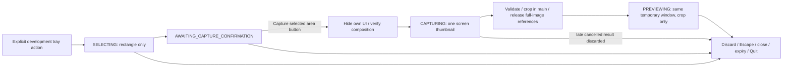

# M3.4a — Private screen selection and local preview

Date: **2026-10-28, Europe/Madrid**. Approved base/unchanged HEAD:
`32e2ab748e59767a3332554f90d6dbf2e7a08a5a`.

**Prompt 93 Windows validation complete, 2026-10-28:** Gate 1 transparency/drag/Escape
and Gate 2's personally confirmed crop/legibility pass by user observation after
the fixes in reports 65 and 66. Manual discard and repeated Cancel/Escape also
pass. Robot/Home exclusion, existing-feature regressions and all eight UX
responses are now user-confirmed. Normal Quit exited 0 with zero remaining
Companion processes. Section 13 recommends approval for the exercised
single-display setup, with explicit privacy/performance coverage limits.
Historical failures remain preserved. This is not authorization for M3.4b.

**Subsequent status — Prompt 92:** [report 66](66_M3.4A2_SELECTION_TRANSPARENCY_FIX.md)
records the native-background A/B diagnosis: the user saw the desktop after an
explicit post-construction transparent clear. The selector now applies that
clear after the preserved full-display geometry placement, before loading.
445 tests/check/smoke, own-renderer alpha/input and synthetic crop checks pass.
Full-app no-capture A–H revalidation must precede any real crop. Prompt 91's
opaque-selector failure below remains historical, not overwritten or approved.

**Subsequent status — Prompt 90:** [report 65](65_M3.4A1_SELECTION_GEOMETRY_FIX.md)
reproduces the constructor's 48-DIP workArea constraint and records an explicit
full-display client-area placement fix. Native geometry, 444 tests, build and
smoke pass; manual selection/capture must be retried. Prompt 89's failure below
remains historical evidence. This does not approve M3.4a or authorize M3.4b.

**Status: implementation and automated verification complete; actual Windows
selection/capture/input/privacy and resource validation pending.** No real desktop
image was acquired during this implementation or its tests. No manual check below
is marked passed. Installed DesktopCompanion **v0.1.1 is unchanged**.

## 1. Preflight and preserved behavior

Initial status was clean, log matched the approved checkpoint and its parent
`687a56d0e046d38e2302efc715a1ec54f0daeee2`, and `git diff --check` passed.
Reviewed research 56, 57, 61, 62 and 63 and actual main/tray/overlay/Home/chat,
preload, movement gates, display handling, protocol and security implementations.
Historical 380 tests and 17/17 docking checks remain historical Windows evidence,
not new validation of this feature.

The compact rig, dimensions, appearance, platform, docking geometry, manual
actuator, Follow tuning, sleep clock and renderer draw gates are unchanged.
Text chat, Demo/Qwen serialization, speech/credentials and the **1,024 MiB ASR
guard** are unchanged. No dependency, lockfile, release version or packaging
change. No installer, startup/registry change, microphone use, paid/API call,
model download, commit, tag, remote or push. No personal preferences/credentials
were opened. Existing smoke's disposable credential self-check still runs.

## 2. Verified APIs and important limitations

Checked official documentation and installed **Electron 44.9.3** declarations:

- [desktopCapturer.getSources](https://www.electronjs.org/docs/latest/api/desktop-capturer):
  main-process, screen-only one-shot thumbnails with explicit `thumbnailSize` and
  `fetchWindowIcons: false`. No getDisplayMedia/video/audio stream is introduced.
- [screen](https://www.electronjs.org/docs/latest/api/screen): getAllDisplays,
  getDisplayNearestPoint, getCursorScreenPoint and dipToScreenRect are available.
  dipToScreenPoint was investigated but is not needed: cropping uses local DIP
  and actual bitmap ratios, not a converted global point.
- [nativeImage](https://www.electronjs.org/docs/latest/api/native-image): isEmpty,
  getScaleFactors, getSize(1), crop and toPNG({scaleFactor:1}). No resizing.
- [BrowserWindow](https://www.electronjs.org/docs/latest/api/browser-window): secure
  temporary window, content bounds, hide/showInactive, input, destruction and
  webContents lifecycle. `setContentProtection` was investigated but is not used
  as an immediate-composition guarantee: documentation explicitly says its
  Windows effect is deferred to a composition.
- [ipcMain](https://www.electronjs.org/docs/latest/api/ipc-main) and
  [Electron security](https://www.electronjs.org/docs/latest/tutorial/security):
  exact owned sender/main-frame/page, capability-limited sandbox preload, denied
  permissions/navigation and restricted CSP.

**getSources cannot filter one display before generating thumbnails.** Therefore
this implementation refuses to start unless exactly **one display is connected**.
It still selects by the cursor's display rather than assuming primary. It does
not silently acquire all monitors and keep only one. Supporting an existing
multi-monitor setup requires a different verified acquisition boundary; merely
finding one `display_id` after capturing all sources would not meet this policy.

Display topology is checked before and after acquisition and changes cancel the
session. These checks are not atomic with OS hotplug; the API has no cancellation
or source filter. A display attached in the acquisition race could enter a
transient source result, which is rejected, never previewed, stored or sent.
Do not change displays during capture. This API limitation remains an explicit
privacy concern for a future multi-monitor implementation, not a solved guarantee.

## 3. Architecture and consent

`Select Screen Area (Experimental)` is an **action** inside development tray
controls, not a persistent checkbox. It is omitted in production and smoke.
The disabled controller creates no window, capture request, timer or listener.
The bundled page/preload remain inert in production; there is no production
entry point or capture handler granted to an existing renderer.

One main-owned session uses a random UUID, frozen display geometry, phase,
bounded timers, AbortController and one disposable BrowserWindow:

Dragging obtains no screenshot. The confirmation panel shows **local selected
bounds in DIP**, minimum size/errors and a privacy notice explaining temporary
whole-display acquisition in memory. Only a separate confirmation invokes
getSources. Buttons use text and DOM events; no external art, framework or OCR.
Cancel/Escape/window close work. One session at a time; repeated tray actions
are no-ops. New selection is unavailable while an old acquisition is unresolved.

This milestone has no Ask button, vision provider or automatic chat send. The
separate preview avoids exposing images or additional IPC in existing chat.

## 4. DIP, pixels and budgets

The selector covers the chosen display's **bounds**, including its taskbar area;
the preview is centered/clamped inside workArea. Native content bounds must
exactly match the captured display geometry before accepting/confirming a region.
Ctrl-wheel/zoom shortcut interference is prevented on this temporary page.

Rectangle coordinates are local DIP. Reverse drags normalize before submission.
Main rejects nonfinite, extra-property, too-small and out-of-bounds rectangles.
Dragging beyond the surface clamps to its display, never a monitor union.
Negative/nonzero global origins do not enter pixel offset multiplication.

Before showing selection, expected physical size is rounded DIP size × scale,
and checked against `screen.dipToScreenRect(null, bounds)` dimensions. The actual
scale-1 thumbnail must match those dimensions **exactly**, have only a scale-1
representation, belong to the selected display and be nonempty. Otherwise fail
with an explanation. There is no silent low-resolution fallback/upscale.

Crop coordinates use actualWidth / displayDipWidth and actualHeight /
displayDipHeight. Left/top round down, right/bottom round up, bounded by the
bitmap. This covers selected edge pixels with at most subpixel-to-one-pixel
rounding expansion; no stretching or global-origin shift. Cropped dimensions
are checked again before PNG serialization and IPC.

Fixed limits:

- Minimum selection: **16 × 16 DIP**.
- Supported scale validation: **1–3**; synthetic coverage is listed below.
- Display: at most **4,096 pixels per side**, **8,388,608 total pixels**.
- Crop: at most **4,194,304 pixels**; PNG at most **16 MiB** and nonzero bytes.
- Session lifetime: **120 seconds from opening**, including preview.
- Acquisition watchdog: **12 seconds**.
- Composition helper: **8-second process timeout**, inner **2-second / 120-query**
  readiness ceiling, **1 KiB** output budget and cancellation signal.

At maximum the raw full-display BGRA allocation is about **32 MiB**, and raw crop
about **16 MiB**. These are arithmetic bounds for individual bitmaps, **not total
runtime RAM or a measured peak**. PNG encoding, IPC copies, Blob/decoded image,
Chromium/GPU surfaces and the short-lived helper cost additional memory. Their
combined peak and main-thread PNG latency are unmeasured. Large text is rejected
if over budget rather than silently downsampled; select a smaller section.

## 5. Own-window exclusion and movement

Reject initiation during manual travel, waking/returning/settling/leaving docking,
open chat, active listening/speaking or generation. Stable docked sleep is allowed.
The selection hold uses the existing travel gate, immediately holds Follow,
stops the existing cursor sampler and releases avatar/Home input capture.
Wandering scheduling cannot issue a move while held. No global input hook or
second movement loop is introduced; enabled Follow/Wandering intent is not
snapshotted and later re-enabled.

After confirmation:

1. Hide the selector.
2. Snapshot visible owned BrowserWindows. Temporarily hide the avatar with a
   narrowly scoped trusted method that bypasses ordinary Hide's docking cancel.
   Hide other visible owned windows without changing enabled/saved preferences.
3. Verify a compositor presentation newer than the hide operation.
4. Require all owned windows still hidden, and display geometry unchanged.
5. Acquire once; repeat visibility/topology/source checks before retaining a crop.
6. Restore previously visible non-avatar windows **first**, then the avatar using
   showInactive. This prevents its sampler seeing Home still hidden. No wake,
   undock, resize or robot move is requested. Quit suppresses restoration.
7. Release the selection hold and show the separate local preview.

Relevant tray overrides cancel the selection before performing their normal
action. No old follow/wander enabled flags or positions are restored. Cancel,
errors, hotplug, renderer/window destruction, watchdog and Quit dispose selection
resources and release holds. Partial conceal failures attempt rollback too.

### Why the Windows composition helper exists

Electron's visibility events are not DWM presentation acknowledgements. An
arbitrary 50/100-ms sleep or immediate setContentProtection call is insufficient.
`windowsComposition.ts` therefore runs a fixed, hidden, short-lived Windows
PowerShell process using **execFile, shell:false**, no renderer-supplied flags,
paths, handles or commands. It calls Windows' existing dwmapi.dll through an
in-memory Add-Type definition. No native npm module, compiler/SDK installation,
download or external screenshot library is added. Host execution restrictions
may deny this helper; the capture then fails closed.

Verified official references:
[DwmGetCompositionTimingInfo](https://learn.microsoft.com/en-us/windows/win32/api/dwmapi/nf-dwmapi-dwmgetcompositiontiminginfo),
[DWM_TIMING_INFO](https://learn.microsoft.com/en-us/windows/win32/api/dwmapi/ns-dwmapi-dwm_timing_info),
[DwmFlush](https://learn.microsoft.com/en-us/windows/win32/api/dwmapi/nf-dwmapi-dwmflush).
The probe records an actual `qpcCompose` newer than its post-hide start, then
requires `cFrameConfirmed` to acknowledge that composed frame. DwmFlush merely
paces this bounded probe; **a helper's DwmFlush alone is not claimed to flush all
Electron rendering**. It logs no frame metadata or user activity.

A non-capturing diagnostic found per-window qpcFrameDisplayed/qpcFrameComplete
zero when querying HWND=NULL here. The implementation therefore uses the
documented composition/presentation pair above. The final non-capturing helper
test passed in **1,355 ms including PowerShell start/compilation**. This is not
capture latency or a guarantee under RDP, different GPU/driver or Windows policy.
Actual visible exclusion still needs user confirmation; any detected failure
aborts without a preview. Do not call this visually validated yet.

## 6. Preview, security boundary and retention

The same disposable window becomes an at-most 800 × 640-DIP preview, clamped to
workArea. It displays only cropped PNG bytes with a Blob URL, aspect-preserving
fit and an actual-pixel/scroll toggle. Label: **Local preview — nothing sent to
AI**. Discard/Close and Escape destroy the window. Blob URL is revoked on
discard/pagehide, and context destruction releases the page's references.

The feature uses an in-memory Electron session (no `persist:` partition). Its
own response-header CSP permits `img-src blob:` and `connect-src 'none'`. Global
app CSP is unchanged. Only trusted localhost Vite asset requests are accepted
by that session; arbitrary remote requests and permissions are denied. Development
Vite HMR connection attempts may be denied by this page's connect-src policy;
closing/reopening selection loads current source. No capture data is sent to
Vite or any provider. Navigation is fixed to the exact owned selection page;
redirects, popups, webviews and devtools are blocked. Sandbox, context isolation,
webSecurity and no Node integration remain enabled.

The preload has exactly ready/select/confirm/cancel/onNotice. Existing robot,
Home or chat preloads receive **no** capture capability. Main validates WebContents
identity, exact top-level frame/page, exact argument count, random session ID,
display ID, state, rectangle schema/bounds, source ID/count, density, image sizes
and payload budget. Duplicate confirms and obsolete IPC cannot acquire again.

Full-display image references are dropped before PNG delivery; only the crop
crosses IPC. No screenshot file, clipboard write, conversation/history entry,
upload, microphone access or provider invocation exists in this flow. Diagnostics
contain duration, **sizes** and byte length, never selected origins, image pixels,
source titles, credentials or image-bearing error text.

desktopCapturer has no cancellation API. Cancel invalidates the session,
aborts the helper and restores UI immediately, but an already submitted native
acquisition can finish later. Its result is discarded. No second acquisition
starts until it settles. A permanently hung native request requires restarting
the app; the selector itself times out and does not keep intercepting input.

Dropping references/revoking a Blob/destroying a renderer does **not** immediately
zero physical memory or Chromium/GPU allocator pages. No cryptographic erasure
or protection from OS pagefile/crash-dump behavior is claimed. The app itself
never persists screenshot data or changes Windows paging/crash policies.

Future **M3.4b** must accept only a still-valid user-approved cropped image via a
separate bounded main-owned attachment and **another explicit send/consent**.
There is deliberately no such connection or retained vision attachment here.
Do not reuse the full-display source or change current text-only provider bodies.

## 7. Exact changed files

New:

- `src/shared/screenSelection.ts`: geometry, budgets and narrow bridge types.
- `src/shared/screenSelection.test.mts`: deterministic DIP/pixel tests.
- `src/main/screenSelectionWindow.ts`: trusted session, acquisition, crop, preview.
- `src/main/screenSelection.integration.test.mts`: actual controller with mocked
  Electron, synthetic images and deterministic lifecycle boundaries.
- `src/main/windowsComposition.ts`: fixed bounded native readiness helper.
- `src/preload/screenSelectionPreload.ts`: isolated feature bridge.
- `src/renderer/screen-selection.html`, `src/renderer/screen-selection.css`,
  `src/renderer/screen-selection.ts`: drag, confirmation and local preview.
- `scripts/screen-selection-check.mjs`: real NativeImage/sandbox proof with only
  synthesized pixel buffers and hidden app:// preview; real desktop API disabled.
- `docs/research/64_M3.4A_PRIVATE_SCREEN_SELECTION.md`: this report.

Modified:

- `src/main/main.ts`: dev composition, movement hold, visibility transaction,
  tray override cancellation and shutdown.
- `src/main/overlayWindow.ts`: trusted selection hold and temporary hide,
  retaining stable dock/sleep and existing normal Hide behavior.
- `src/main/tray.ts`: optional dev action.
- `src/main/home.integration.test.mts`: append preservation/action regressions.
- `package.json`: add two test files to the test command only.
- `tsconfig.preload.json`: compile the extra isolated preload.
- `vite.config.mts`: build the extra local page.

## 8. Automated verification and measured evidence

- `npm run typecheck`: **PASS** (main, preload, renderer).
- `npm test`: **429 passed, zero failures/skips/cancelled**. Includes production
  build. Original tests retained. Final test runner duration **3.5549524 s**,
  excluding compilation/build; this is not an application CPU benchmark.
- `npm run build`: **PASS**, also repeated through final npm test. Existing
  >500-kB robot chunk warning remains; robot JS chunk content is unchanged.
- `node scripts/screen-selection-check.mjs`: **PASS, exit 0**. Actual native crop
  pixels verified individually at synthetic 100/125/150% scale and negative
  origin; hidden sandbox preload, scoped blob CSP, dimensions, label and cleanup.
  No desktop image, screenshot file or personal fixture. Temporary test profile
  deleted only after its app exited, with resolved-parent/prefix checks.
- Bounded standalone DWM readiness probe: **PASS**, **1,355 ms**, no capture.
- `npm run smoke`: **PASS, exit 0**, new process, m1.6 preload, first WebGL frame,
  disposable credential check and normal quit. Intel Iris Xe / ANGLE Direct3D11,
  DPR 1, 20 calls / 14,936 triangles. Selection is explicitly disabled in smoke.

Initial restricted run failed an existing temporary-preference rename with EPERM;
normal authorized Windows process access passed unchanged tests. An initial new
fixture used unsupported Node strip-only parameter-property syntax; fixed in the
fixture. A new sleep regression initially included the earlier docking wake in
its history assertion; corrected to compare before/after wake counts. These
initial runs are not reported as passing.

Coverage adds 49 tests over the approved 380: pure minimum/schema/normalization,
all bounds, negative origins, 100/125/150/175% arithmetic, fractional pixels,
native dimension and memory budgets, topology identity; actual controller
default/dev gate, no acquisition before confirm, owned IPC, state/tokens,
duplicates, cancellation before/during/after capture, late results, deadlines,
hidden-window readiness failure, wrong sources/density/dimensions/empty/oversized
payloads, preview disposal/retry/Quit; actual overlay stable dock sleep and
follow-intent preservation; production/dev tray action behavior. Existing chat,
Whisper guard, Qwen, Home, Follow and startup suites still pass. Source checks
supplement those boundaries; they do not establish native screen input delivery.

Real synthetic-proof process metrics: **1 app process before constructing the
hidden window, 4 with it loaded**. That +3 includes lazy Chromium infrastructure
in an isolated proof, **not** a measured +3 to the running companion. Production
feature adds zero permanent BrowserWindows. A selection adds one temporary
BrowserWindow reused for preview, plus one bounded PowerShell helper only during
confirmation. Renderer process sharing and incremental private commit in the
actual app are **unmeasured**, not assumed one renderer per window.

Before final smoke, read-only process checks found **0 installed / 0 checkout
Electron instances**. The sandbox initially denied CIM; a normal-access read
succeeded. No unrelated Electron app was touched or force-closed. No app is left
running by this milestone. Whitespace checks pass with LF-to-CRLF advisories only.

## 9. Manual Windows checklist — all UNTESTED

Use deliberately non-sensitive text/colored boxes in Notepad or a disposable
worksheet. Do not select credentials, private chats or personal documents. Keep
the current single monitor/DPI; do not change display settings as part of this
first validation. Normal Tray Quit must close any installed/dev instance before
`npm run dev`. Installed v0.1.1 is not updated.

A. Verify the action is absent from production and present in development.
B. Verify no selection appears or capture occurs at startup.
C. Close chat/voice/replies, let manual travel or docking finish; invoke the tray
   action. Exactly one selector appears; repeated actions do not duplicate it.
D. Drag in different directions around known non-sensitive text. Inspect bounds
   before confirming. Try a tiny rectangle and all display edges/taskbar.
E. Escape and Cancel before capture: selector disappears and Windows clicking
   recovers. A later selection works. No preview should appear from cancellation.
F. Confirm once; double-click confirmation must not acquire twice.
G. Preview must match only that rectangle, text and edges, with no shift/stretch.
   Compare known colored pixel borders and use Fit/Actual pixels for readability.
H. Deliberately include the robot/Home location in a harmless rectangle: preview
   must show the underlying content, without robot, platform, dimming, outline or
   controls. **If any appears, discard and report; do not approve the feature.**
I. Discard, Escape and close preview: no residual input layer or stale image.
J. Repeat select/cancel and confirm/discard a few times; no accumulating windows.
K. Check legibility on a disposable Excel sheet/web test page without AI Send.
L. Confirm avatar transparent sides/corners and body input recover, including
   after an error/cancel. Keep whole-window recovery OFF.
M. Check Follow intent, Home docking, docked Sleep, Wake/departure and ordinary
   chat still work. During a critical journey selection should refuse rather
   than cancel or move it. A capture while stably asleep must not wake/undock it.
N. Confirm no export/clipboard/AI operation occurs; screenshots must not appear
   in user folders/history. No AI or microphone test is required.
O. In a separately consented short test, compare before/after process count and
   private commit, responsiveness and cleanup over a few cycles. Capture/PNG
   latency, peak RAM and GPU behavior are not yet measured. Do not close other
   applications or change the pagefile automatically.
P. With any temporary UI open, normal Tray Quit must remove all app windows and
   processes without errors. Leave saved settings as they were.

Multi-monitor behavior is **unsupported/rejected**, not passed. Alternative real
DPI scales, resolution/hotplug, RDP, elevated/protected applications and driver
variations need separate coverage; synthetic arithmetic is not native proof.
Protected/DRM content can produce black pixels without an API error; a legitimate
black region cannot be reliably distinguished, so no bypass/detection is claimed.

## 10. Remaining limits, rollback and decision

No actual capture latency/peak RAM, text fidelity, foreground exclusion or Windows
input delivery has been validated. Compositor acknowledgment is tested, but
end-to-end screenshot exclusion still requires H above. Fixed helper startup can
add noticeable delay; restricted PowerShell environments fail closed. Session
expiry may close a preview after two minutes. Confirmation controls occupy the
top-left selector area; regions directly beneath them cannot start a drag there.
An OS acquisition already in flight cannot be cancelled atomically.

M3.3 historical settled-Follow **4.04–7.60% CPU variation**, unmeasured GPU load,
other DPI/monitors, long sessions and old hidden-harness GPU warning remain open.
Passing regressions does not prove identical real-world CPU or physical zeroing.

Runtime rollback: cancel/close the temporary UI or Quit; nothing is persisted.
Source rollback after normal Quit: remove only this milestone's new files and
reverse its seven tracked-file integration/test/build hunks against the approved
base, preserving this research and all unrelated work. Rebuild and verify. Do
not reset/clean user work. Installed v0.1.1 needs no repair.

**Decision: ready for deliberate Windows validation on the current single-display
setup; not approved for M3.4b, production rollout or image uploads.** Stop here.

## 11. Prompt 89 — Windows validation blocked, 2026-10-28

The implementation results and original checklist above remain historical.
This section uses **Prompt 89's A–P definitions**, which differ slightly from
the implementation checklist. No application source/test/configuration is being
changed. No new capture is implied by starting the development app.

### Preflight and evidence classification

- **SOURCE-VERIFIED:** HEAD remains the approved
  `32e2ab748e59767a3332554f90d6dbf2e7a08a5a`, with parent 687a56d. Status contains
  the expected seven modified and eleven new M3.4a files, including this report;
  no reset/clean or staging. `git diff --check` passes with LF/CRLF advisories.
- **SOURCE-VERIFIED:** baseline SHA-256 over **224 tracked/nonignored files,
  excluding only this report**, is
  `C9712AF52D119678B62EDCB2A8671145488A6514A07F205DE4D1C3C95B3C3F13`.
  Recheck at the end to establish preservation of the uncommitted source.
- **MEASURED:** native Windows display enumeration reports **one connected
  display**, with primary bounds 1536 × 1024 in that helper. This is not proof of
  Electron's DIP/pixel mapping or the Windows scaling percentage. No display
  setting was changed. Multi-monitor capture is not attempted.
- **MEASURED:** before launch, installed process count **0** and checkout Electron
  process count **0**. No process was closed or force-terminated.
- **MEASURED:** `npm run dev` reports process-started, m1.6 preload and frame-ready.
  CIM identifies one main process **47244**, from this checkout's
  `node_modules/electron/dist/electron.exe`, with **four** matching Electron
  processes at that endpoint. This is a startup endpoint, not a capture/memory
  benchmark. Installed v0.1.1 was not launched or changed.
- **MEASURED:** a subsequent Node os.freemem endpoint reports **796 MiB available
  physical RAM**, **8,017 MiB total physical RAM** and **12 logical processors**.
  This is not private commit or an awake baseline. Keep test regions modest and
  stop if available memory falls markedly or responsiveness degrades; no ASR
  guard or paging setting is changed.
- **SOURCE-VERIFIED:** development flag comes from the existing dev launcher;
  selection controller/action are guarded with `dev && !smoke`. Production action
  remains absent by source evidence; do not launch installed v0.1.1 to prove it.
- **SOURCE-VERIFIED:** inspected the current selection controller/preload/renderer
  and composition helper. Acquisition remains after owned, token-bound explicit
  confirmation only; the code has no screenshot persistence, clipboard write,
  model request or microphone invocation. Crop-only IPC and Blob disposal remain.
  These are source findings, not a forensic claim about physical memory erasure.
- **AUTOMATED (historical, Prompt 88):** 429 tests/typecheck/build/synthetic proof
  and clean smoke passed. They were not rerun as a substitute for real Windows
  validation. The previous 1,355-ms readiness probe is not real capture timing.
- **MEASURED:** terminal collection discards cursor/position diagnostics before
  retaining output. Only lifecycle, phase and size/duration/byte metrics are
  collected for this validation; no screen image or selected origins.

The user has been asked to prepare invented, non-sensitive Notepad text and
confirm startup A/B before opening selection. No screen contents are requested
for sharing with the assistant. Real selection/capture will be performed by the
user through the visible controls, not injected or invoked by a test harness.

### Prompt 89 A–P ledger

- **A — PASS, USER-OBSERVED (development):** user confirmed robot and action
  visible. **SOURCE-VERIFIED** production omission as above; installed app not
  launched for this check.
- **B — PASS for visible startup, USER-OBSERVED:** user confirmed no selector or
  preview appeared automatically. **SOURCE-VERIFIED** no startup acquisition
  path. Visible absence alone is not forensic evidence of no screen acquisition.
- **C — FAIL, USER-OBSERVED:** choosing the action produces the information
  dialog “Selection surface did not match the display. Nothing was captured.”
  instead of an operable selector. User supplied this screenshot voluntarily;
  the assistant did not acquire or save a new desktop image.
- **D — UNTESTED:** Escape, Cancel and close without capture, input recovery.
- **E — UNTESTED:** drag geometry/directions and outline responsiveness.
- **F — UNTESTED:** separate confirmation and one acquisition.
- **G — UNTESTED:** actual crop boundaries/aspect/offset accuracy.
- **H — UNTESTED:** real robot/Home/selector/controls/chat exclusion.
- **I — UNTESTED:** preview discard, reference release and focus recovery.
- **J — UNTESTED:** repeat sessions, no stale image/duplicates/crash.
- **K — UNTESTED:** real text legibility.
- **L — UNTESTED:** Windows input, avatar/Home click-through and focus.
- **M — UNTESTED:** existing feature regression and sleep/movement preservation.
- **N — SOURCE-VERIFIED only:** local-only handling described above;
  controlled runtime observations pending. No personal directories inspected.
- **O — UNTESTED:** actual CPU/private commit, interval/process counts, available
  RAM, transient timing/peak availability and user responsiveness verdict.
- **P — PASS for the exercised early-stop path, USER-OBSERVED / MEASURED:** user
  confirmed all four modes OFF, chat closed and normal Tray Quit with no selector
  or preview remaining. Terminal reported quitting and exit **0**. Subsequent
  native process check found **0 installed / 0 checkout Electron processes**.
  Shutdown during an actual capture/preview remains untested.

User confirmation for A/B: “Preparado — robot y acción visibles; sin selector ni
preview automático”. When asked to try C/D without confirming capture, the user
reported “me sale esto cuando clico select screen area” and the dialog above.
The remaining C/D attempts and all real-capture tests are stopped. D remains
untested: acknowledging an error dialog is not a passing selector Cancel test.

### Observed failure and safe stop

**SOURCE-VERIFIED:** that exact message is emitted in the temporary window's
ready-to-show handler when `displayValid(s)` or `surfaceValid(s)` returns false.
The latter compares all native content bounds to the frozen Electron display
bounds, in DIP. The handler disposes the session before showing the selector.
Acquisition is reachable only after selecting a valid rectangle and explicitly
confirming it; this failed opening does not reach that capture path.

**Unconfirmed root cause:** the message alone does not identify which predicate
failed or the actual differing bounds. DPI conversion, Windows workArea/native
window constraints or a display snapshot change are possible investigation paths,
not established diagnoses. No geometry, permissions, CSP or safety check has been
changed or bypassed, and no further capture attempt is requested.

**UNTESTED:** actual crop fidelity, UI exclusion, readability, capture latency,
capture/preview CPU or private commit, repeat captures and eight-item UX verdict.
The startup memory endpoint above is not a substitute for these measurements.
Source-only local handling findings in N remain separate from runtime evidence.

**USER-OBSERVED:** user confirmed “Sí — todo OFF y cierre normal con Tray > Quit”
after being asked to dismiss the dialog and close with no remaining selector or
preview. **MEASURED:** the development terminal returned exit 0 with quitting;
read-only CIM checks found zero installed and zero checkout Electron processes.
No app was force-terminated and no other Electron application was closed.

**SOURCE-VERIFIED preservation:** final aggregate across the same 224 files,
excluding this report, matches the preflight SHA-256 exactly. Application source,
tests, configs and other reports were not modified during validation. Whitespace
checks pass with existing LF/CRLF advisories. HEAD remains the approved checkpoint;
no commit, tag, push, installer, installed-app change or new milestone.

**Final result: three checks supported (A/B startup and P early-stop shutdown),
one failed selector-opening check (C), eleven untested runtime checks (D–M and O),
and one source-only privacy check (N). M3.4a is NOT ready for
approval. M3.4b must not proceed.** A separate implementation task would need to
measure the actual Electron/native content and display bounds, identify the
mismatch and verify a fix while retaining the capture safety boundary.

No capture/preview was reached in this validation, so crop accuracy, robot/Home
exclusion, text legibility, repeat sessions and capture/preview resource impact
have no new runtime results. The eight UX questions could not be meaningfully
completed; the user's actual feedback is the opening-error report, not approval.
One connected display was checked; Windows Scale %, other DPI/multi-monitor,
GPU load and long-session behavior remain unvalidated. Available physical RAM
796 MiB and four checkout processes were only preliminary endpoints, not CPU,
peak memory or capture-cost measurements. No secure erasure is claimed.

## 12. Prompt 91 — Windows revalidation blocked by opaque selector

Date: **2026-10-28, Europe/Madrid**. This is a new validation session after the
correction in [report 65](65_M3.4A1_SELECTION_GEOMETRY_FIX.md). Prompt 89's failed
C, early-stop results and unknowns above remain historical and are not erased.
Use **Prompt 91's A–P definitions** for the ledger below. Only this report may
change during this validation; no source/test/configuration changes are authorized.

### Preflight evidence

- **SOURCE-VERIFIED:** status contains the expected uncommitted M3.4a/M3.4a.1
  work. HEAD remains the approved M3.3 checkpoint
  `32e2ab748e59767a3332554f90d6dbf2e7a08a5a`; ancestor and whitespace checks pass
  with existing LF/CRLF advisories. No reset, clean, staging or commit.
- **SOURCE-VERIFIED preservation baseline:** SHA-256 over **226 tracked/nonignored
  files, excluding this report only**, is
  `10E016A74B113F7F3D4445C3F038BB4A429D7334DA3C78B7B10565423271EC94`.
  This includes report 65. Compare again at the end.
- **MEASURED:** one connected Windows display, helper primary bounds 1536×1024;
  no display settings changed. Report 65's actual Electron/native geometry proof
  was at scale 1 / 96 DPI; no new native DPI measurement is claimed here.
- **MEASURED:** before launch, 0 installed and 0 checkout Electron processes.
  Pre-launch available physical RAM **854 MiB**, total physical **8,017 MiB**,
  **12 logical processors**. These endpoints are not capture or CPU measurements.
- **MEASURED:** existing `npm run dev` workflow reports process-started, m1.6
  preload and frame-ready. Own main PID **42308**, creation UTC ticks
  **639287848226898747**, executable under this checkout's node_modules/electron;
  **four matching Electron processes** at the startup endpoint. The installed
  v0.1.1 was not launched or changed.
- **SOURCE-VERIFIED:** controller and tray action remain gated by `dev && !smoke`;
  the existing launcher supplies dev mode. Terminal collection retains lifecycle,
  phase, aggregate crop metrics and existing sanitized geometry diagnostics only;
  cursor/position logs are discarded before collection. No screen pixels or
  selected origins are collected by the assistant.
- **AUTOMATED (historical Prompt 90):** 444 tests/typecheck/build, native geometry,
  synthetic crop/preview and smoke passed as recorded in 65. They are not new
  manual passes or evidence that a real crop/own-window exclusion is accurate.

### Prompt 91 A–P ledger

- **A — PASS, USER-OBSERVED (development):** user confirmed robot/action visible;
  **SOURCE-VERIFIED** production omission, installed app not launched.
- **B — PASS for visible startup, USER-OBSERVED:** no automatic selector/preview;
  **SOURCE-VERIFIED** no startup capture path. Visible absence is not a forensic
  proof about screen acquisition or disk writes.
- **C — FAIL for visual usability, USER-OBSERVED; opening recovery retained:**
  user initially confirmed opening without the old mismatch. The later report
  “me sale todo negro” and voluntarily supplied image show the selector's
  controls on a uniform dark/opaque surface with no underlying desktop visible.
  Thus the geometry error did not recur, but the selectable target cannot be
  seen. Initial broad usability PASS is superseded by this concrete failure.
- **D — PASS, USER-OBSERVED:** user confirmed Escape closes, no preview and normal
  Windows input; no invisible layer reported. **SOURCE-VERIFIED:** this operation
  does not enter the confirm-only acquisition path.
- **E — NOT TESTED / blocked:** the opaque surface prevents meaningful targeting
  of test content. Drag precision/direction/release were not confirmed.
- **F — NOT TESTED:** visible separate confirmation and voluntary one-shot capture.
- **G — NOT TESTED:** actual crop edges, aspect ratio, scale, offset and borders.
- **H — NOT TESTED:** selector/controls/robot/Home/chat exclusion and restoration.
- **I — NOT TESTED:** discard, stale image absence and normal focus.
- **J — NOT TESTED:** two/three harmless separate sessions and pre-confirm cancel.
- **K — NOT TESTED:** real text legibility by application.
- **L — NOT TESTED:** Windows/taskbar input and avatar/Home click-through recovery.
- **M — NOT TESTED:** Follow/Home/docking/Sleep/Wake/manual/chat regression.
- **N — SOURCE-VERIFIED findings inherited from 64/65:** explicit consent,
  bounded one-shot main capture/crop, no intended file/clipboard/network/AI/OCR,
  no image contents in logs and reference disposal. Current runtime evidence
  pending; no physical zeroing or absence of whole-display acquisition claimed.
- **O — NOT TESTED:** finite A–E resource intervals, capture time and responsiveness.
- **P — PASS for early-stop shutdown, USER-OBSERVED / MEASURED:** user recovered the desktop and chose
  normal Tray Quit with modes/Home OFF and chat closed, no selector/preview
  remaining. Exit/process verification is recorded below.

The user explicitly confirmed A/B: “PASS — robot y acción visibles; sin selector
ni preview automáticos”, and C/D: “PASS — abre correctamente y Escape cierra;
sin preview y entrada normal”. This is the required open-and-Escape confirmation
before real capture. Prompt 89's failure is retained above.

Next requested E/F and G/K/I used invented Notepad text, both drag directions
before one voluntary confirmation, crop/readability inspection and Discard.
The user was reminded about transient whole-display acquisition and advised to
maximize harmless content. The user instead reported **“me sale todo negro”**.
No screenshot was requested for sharing or acquired by the assistant; the user
voluntarily supplied the selector image.

### Opaque selection surface — observed failure, safe stop

**USER-OBSERVED:** the supplied image shows “Select a screen area”, the initial
drag instructions and a disabled “Capture selected area” button. It is the
pre-capture selector, not an image preview. The background appears uniformly
dark/opaque, preventing the user from seeing the underlying target. No previous
geometry mismatch dialog is visible. Do not label this as a black captured crop.

**SOURCE-VERIFIED:** current CSS declares root `color-scheme: dark`, transparent
body, and `#surface` tint `#09181035`. Native selection options specify a
transparent window/background. These declarations alone do not prove actual
native/Chromium transparency. The root cause of the opacity is **unconfirmed**;
root canvas/color scheme, native compositing and window behavior require a
separate diagnostic task. No CSS, window setting, CSP or geometry was changed.
An implementation must not disguise this problem by capturing a background
image before confirmation: that would violate the existing consent boundary.

All further capture/exclusion/performance attempts were stopped. The assistant
asked the user not to confirm capture, to Escape/Cancel and Quit normally. The
user answered **“Sí — escritorio recuperado y cierre normal con Tray > Quit”**.
This supports desktop/input recovery and the exercised early-stop shutdown;
it does not validate discard or shutdown during a real acquisition/preview.

**NOT TESTED:** actual screenshot source dimensions/timing, crop edges, robot/Home
exclusion, preview quality/discard, repeated captures, text legibility, new
Follow/docking regression checks and A–E resource comparisons. The user's UX
feedback is that selection is unusable because the desktop is hidden, not an
approval of the experience. Only preliminary RAM/process endpoints above exist.

**Decision:** geometry-opening recovery is user-confirmed, but overall M3.4a
remains **NOT ready for approval** because selector transparency/visibility fails.
M3.4b must not start. Diagnose this separate failure while preserving exact
geometry and the no-acquisition-before-confirmation invariant.

### Final evidence and preservation

- **MEASURED:** development terminal emitted quitting and returned **exit 0**.
  Final native process counts: **0 installed / 0 checkout Electron processes**.
  No forced process termination and no other application was closed.
- **MEASURED:** collected runtime output has no `local-preview` completion metric.
  The current user-observed selector was pre-selection/pre-confirmation, and
  subsequent instructions explicitly stopped capture. No real capture success
  or screenshot timing is claimed; no screenshot file was read/written by the
  assistant. The supplied image was reviewed only as user-provided evidence.
- **SOURCE-VERIFIED:** final aggregate for all **226 files excluding this report**
  exactly matches `10E016A74B113F7F3D4445C3F038BB4A429D7334DA3C78B7B10565423271EC94`.
  Source/tests/config/report 65 are unchanged. HEAD remains the approved M3.3
  checkpoint. Whitespace checks pass with existing LF/CRLF advisories only.
- **Final A–P accounting:** **four supported checks A/B/D/P**, with their stated
  source/user/early-stop limits; **C failed for visual usability**; **ten runtime
  checks E–M and O not tested**; **N source-only**. No post-capture UX approval,
  CPU/private-commit comparison or preview-resource measurement was fabricated.
- Installed v0.1.1, dependencies, startup, credentials and saved settings were
  not edited by the assistant. No commit/tag/push, installer or M3.4b work.

**Recommendation: continue fixing M3.4a's opaque selection surface in a separate
authorized implementation task, then repeat the no-capture open/Escape gate
before requesting any real crop.** No AI or capture-background workaround is
authorized by this validation.

## 13. Prompt 93 — Final Windows validation after both fixes (complete)

Date: **2026-10-28, Europe/Madrid**. This section uses **Prompt 93's A–P
definitions**. Geometry fix: [report 65](65_M3.4A1_SELECTION_GEOMETRY_FIX.md).
Native transparency fix: [report 66](66_M3.4A2_SELECTION_TRANSPARENCY_FIX.md).
Previous failed validations remain historical evidence, not erased or passed.
Only this report is being edited; application source/tests/configuration and
both fix reports must remain unchanged.

### Preflight and evidence boundaries

- **SOURCE-VERIFIED:** expected uncommitted M3.4a, geometry and transparency work;
  HEAD remains `32e2ab748e59767a3332554f90d6dbf2e7a08a5a`. Last three commits are
  32e2ab7, 687a56d, 83036b7. No reset, clean, stage or commit. Whitespace check
  passes with existing LF/CRLF advisories.
- **SOURCE-VERIFIED preservation baseline:** SHA-256 over **228 tracked/nonignored
  files excluding this report only**, hashing sorted paths, NUL, bytes, NUL:
  `24eac6775c9a2a2950c7298eeb7190a789ebd361a769fffb45e32cced826c206`.
  Recheck after validation; includes both fix reports and the diagnostic scripts.
- **MEASURED:** one Windows display, helper bounds 1536×1024, workArea 1536×976;
  no display setting changed. Native scale 1/96 DPI was previously measured in
  report 65, not remeasured here. Other real DPI/multi-monitor remain untested.
- **MEASURED:** before launch, **0 installed / 0 checkout Electron processes**.
  No forced termination. Available physical RAM **854.95 MiB**, total physical
  **8016.68 MiB**, **12 logical processors**. Preliminary endpoints only, not a
  capture benchmark; no ASR policy or memory setting changed.
- **MEASURED:** `npm run dev` compiled and launched the checkout, reporting
  process-started, m1.6 preload and frame-ready. Own main PID **39064**, creation
  UTC ticks **639287902734689400**, exact executable under this checkout's
  node_modules/electron/dist. **4 checkout processes / 0 installed processes**
  at the startup endpoint. Installed v0.1.1 is unchanged.
- **SOURCE-VERIFIED:** selection controller and tray entry are gated by
  `dev && !smoke`; no installed-app launch is needed to verify production omission.
  Confirmation remains separately owned/token/phase validated. No acquisition
  occurs through startup, tray opening, drag or Cancel/Escape paths.
- **SOURCE-VERIFIED:** reviewed bounded acquisition/crop/Blob disposal and
  owned-window conceal/restore paths. No screenshot persistence, clipboard,
  OCR, AI/provider or microphone call is present in this feature. These are
  code findings, not a forensic proof of OS memory erasure or runtime exclusion.
- **AUTOMATED, historical Prompt 92:** 445 tests, typecheck/build/smoke, own-page
  alpha/input and synthetic crop proofs passed in report 66. Not rerun as a
  substitute for this real Windows validation; no new automated result claimed.
- Terminal collection retains lifecycle/behavior and aggregate preview/geometry
  diagnostics only; cursor/position output is discarded. No pixels, screen
  contents or selected origins are collected. The assistant did not initiate
  acquisition; the user's first personal confirmation is recorded below.

### Gate 1 and provisional Prompt 93 A–P ledger

Gate 1 visual/input checks are **PASS, USER-OBSERVED**. User confirmed:
"PASS — robot y acción visibles; sin selector ni preview automáticos" and
"PASS — escritorio claro, arrastre correcto y Escape sin problemas".
This confirms visible desktop/text, usable aligned rectangle and Escape/input
recovery. No screenshot or content upload was requested by the assistant.

**Consent chronology resolved, USER-OBSERVED:** on resuming the
development terminal, a `local-preview` completion metric was present:
**2250 ms**, **276×136 DIP / 276×136 pixels**, **2544 PNG bytes**. This is evidence
that the capture path completed during this running session, not evidence of
crop accuracy by itself. The log has no timestamp or consent interaction history.
When explicitly asked, the user confirmed: "Sí, lo pulsé yo tras completar Gate 1
y solo sobre texto inventado". Thus confirmation was personal, after the successful
no-capture gate and over harmless test content. No automatic capture was reported.
The assistant did not initiate acquisition or view the image. The measured
2250 ms includes concealment/composition readiness, acquisition, crop/PNG and
preview setup; it is not isolated native acquisition latency or a CPU sample.

- **A — PASS, USER-OBSERVED / SOURCE-VERIFIED:** robot/action visible in development;
  production omission verified in source only.
- **B — PASS for visible startup, USER-OBSERVED:** no automatic selector/preview;
  source has no startup acquisition path. Later preview metric is separate.
- **C/D/E — PASS, USER-OBSERVED:** desktop/text visible, no opaque obstruction or
  geometry error reported; aligned responsive drag/outline and Escape/input recovery.
- **F/G — PASS, USER-OBSERVED:** user selected harmless text and personally
  pressed Capture after Gate 1. **MEASURED:** one completion metric above.
- **H — PASS, USER-OBSERVED:** user confirmed "PASS — bordes y contenido
  correctos; texto legible" when asked explicitly about all four edges, correct
  proportions, no shift/stretch/black borders or unrelated content. Gate 2's
  first crop passes for this modest selection; this is not all-DPI validation.
- **I — PASS for robot/Home image exclusion, USER-OBSERVED:** user initially reported "no, cuando pongo
  para hacer la captura se ven el robot dormidp encima de la plataforma encima
  del bloc de notas". This does not yet distinguish the transparent selector's
  live desktop from pixels inside the resulting preview. No exclusion PASS or
  FAIL was inferred while that distinction was unclear. The user subsequently
  clarified that the final crop correctly shows Notepad without robot/platform;
  the overlays are visible only during selection. See the clarification below.
  Exact absence of selector controls and unchanged restored sleep state are
  source-verified here unless separately confirmed by the user. Chat was closed,
  so exclusion of a visible chat window was not exercised (selection requires it closed).
- **J — PASS, USER-OBSERVED:** after D, user confirmed "D mantenida; Discard
  manual PASS; listo E" when asked about closing via Discard / Close and normal
  input recovery. The first preview's earlier automatic expiry is distinct.
- **K — PASS for exercised sessions, USER-OBSERVED:** user confirmed "Listo D — captura voluntaria;
  arrastre inverso y preview correctos" after instructions for a moderate reverse
  drag and checking no stale image/duplicate window. Later user explicitly
  confirmed "PASS — Cancel y Escape funcionan en sesiones separadas" when
  asked to draw and cancel in two separate no-capture sessions, with no stale
  image/duplicate window or blocked input. Both additional capture completions
  were independently confirmed as personal clicks over invented text.
- **L — PASS for the first crop, USER-OBSERVED:** readable invented text;
  further selection sizes/applications remain untested.
- **M — PASS, USER-OBSERVED:** user confirmed all listed controls/input and no
  unexpected movement/wake after selection: Follow; Home show/hide; docking,
  arrival Sleep and Wake/departure; chat open/close without Send/microphone;
  Manual Move/Return Home; body response and avatar/Home transparent-region
  click-through to Notepad; ordinary Windows taskbar access. User instructed to
  leave modes/Home OFF, chat closed and no pending travel, before normal Quit.
- **N — SOURCE-VERIFIED with limited USER-OBSERVED runtime evidence:** separate
  personal confirmation, no unsolicited startup UI and successful Cancel/Escape/
  Discard were observed. Rechecked main/preload/renderer paths: one-shot bounded
  acquisition after confirmation, cropped-only delivery, in-memory partition,
  connect-src none, no export/clipboard/provider/OCR/recording path, no image
  data in diagnostics, Blob revoke/context disposal and stale-result guards.
  These remain source findings, not file-system/network tracing or proof of
  immediate physical erasure. Native full-display image is transiently acquired
  after confirmation. No user document/clipboard/credentials were inspected.
- **O — PARTIAL, MEASURED:** one completion duration/size above; finite CPU/private
  commit/RAM intervals, recovery and user responsiveness remain not tested.
- **P — PASS, USER-OBSERVED / MEASURED:** user confirmed all modes/Home OFF,
  chat/selector/preview closed, no pending movement and normal Tray Quit with
  no remaining windows/errors. Development terminal reports quitting and exit
  **0**. Read-only native enumeration finds **0 installed / 0 checkout Electron
  processes**. Thus no Companion selector/preview renderer or running capture
  controller remains. No force-close or other-app shutdown performed.

### Finite resource samples (in progress)

Read-only Windows CIM identifies only the exact checkout Electron executable;
Get-Process supplies cumulative TotalProcessorTime and PrivateMemorySize64.
CPU is summed across matching PID/start-time identities and divided by actual
wall seconds and **12 logical processors**, then multiplied by 100. This is
Companion CPU normalized to whole-machine capacity, not total Windows CPU load.
Memory is summed private commit, not working set/physical RAM or a sampled peak.
Available RAM comes from Win32_OperatingSystem.FreePhysicalMemory. Only aggregate
results and own process IDs/start times are collected; no other app details.
Two endpoint samples do not measure transient peaks or GPU usage.

**A — normal Companion, robot reported asleep, selector/preview closed:**
actual UTC start 13:24:20.3919101, end 13:24:52.9260947 (**32.535 s**;
initially intended about 10 s, orchestration time included). Own process count
**4→4**, cumulative CPU delta **7.3125 s**, normalized CPU **1.873%**;
private commit **210.242→210.172 MiB**, available physical RAM
**773.551→807.379 MiB**. PID/start identities stable. User confirmation that the
prepared state was maintained throughout is **confirmed by the user**: "Sí —
estado mantenido durante toda A". This single short interval
does not establish settled/long-run CPU stability, including the historical
Follow-ON variation. No audio, model, API or system setting involved.

**B — selection surface visible, asleep robot, no drag/confirmation:**
UTC 13:26:57.9435299–13:27:13.2876491, **15.344 s** actual endpoint interval.
Own processes **5→5**, stable PID/start identities; CPU delta **3.453125 s**,
normalized CPU **1.875%**; private commit **248.527→248.160 MiB**;
available physical RAM **854.105→786.996 MiB**. **USER-OBSERVED:** "Sí — estado
mantenido durante toda B" confirms the prepared state throughout.
The one extra process and roughly 38 MiB higher endpoint private commit than A
are observations in these sequential samples, not an isolated causal allocation
or measured peak. No periodic/benchmark-only acquisition was performed.

**D — cropped preview visible, robot previously reported asleep, Home/modes OFF:**
UTC 13:29:25.1013767–13:29:40.5310903, **15.430 s** actual interval.
Own processes **5→5**, stable PID/start identities; CPU delta **4.125 s**,
normalized CPU **2.228%**; private commit **242.984→243.418 MiB**;
available physical RAM **756.684→808.887 MiB**. **USER-OBSERVED:** user confirmed
the preview remained visible throughout D with the prepared sleeping/off state.

The next terminal read contained two new aggregate completion metrics, in order:
**1734 ms, 256×119 DIP/pixels, 2439 PNG bytes**; **2293 ms, 420×48 DIP/pixels,
1188 PNG bytes**. The log does not identify which was the reported reverse-drag
preview. **USER-OBSERVED:** user explicitly confirmed "Sí — ambos fueron
confirmados por mí sobre texto inventado". Both completions were personally
confirmed; no automatic capture or duplicate acquisition from one click reported.
No image or selected origin was read. No CPU/peak-memory sample covered these
transient acquisition intervals; durations are end-to-end completion timings.

**E — after manual Discard, sleeping robot, selector/preview/Home/modes OFF:**
UTC 13:31:03.9686191–13:31:19.3966383, **15.428 s** actual interval.
Own processes **4→4**, stable PID/start identities; CPU delta **3.750 s**,
normalized CPU **2.026%**; private commit **210.984→210.695 MiB**;
available physical RAM **823.996→900.211 MiB**. **USER-OBSERVED:** "Sí — estado
mantenido durante toda E" confirms the prepared state throughout.
Ending private commit is **32.723 MiB below D's end** and **0.523 MiB above A's
end**; the selector/preview renderer is no longer present. These sequential
endpoints support resource recovery in this run, not absence of all allocator
caches, no future leak or immediate erasure. No process was force-terminated.

**C — confirmed acquisition transient:** a later terminal read supplied a fourth
completion metric: **2309 ms, 278×271 DIP/pixels, 11139 PNG bytes**. It was received
after the exclusion clarification; log timing alone cannot uniquely associate
each completion with an individual user interaction. All observed completion
durations span **1.734–2.309 s** (four metrics, not a stress benchmark). The user
personally confirmed capture for the exclusion attempt. These end-to-end metrics
are listed above; no finite CPU/private-memory peak sample covered the short
native/helper transient. C's process count, CPU and peak commit are **NOT
MEASURED**, not inferred from preview endpoints. No extra benchmark capture is
requested. A/B/D/E are single finite samples, not proof of stable idle CPU or
a long-run performance guarantee; GPU load remains unmeasured.

### Exclusion observation requiring clarification

The next terminal read after the exclusion instructions contains wake/sleep
lifecycle entries but **no new local-preview completion**. This alone cannot
prove whether the user clicked confirmation, whether acquisition failed or what
was visible. **SOURCE-VERIFIED:** owned windows are concealed only after the
separate Capture confirmation; they are restored before preview display. Seeing
the live robot/Home while drawing, or outside/on top of a preview window, is
different from their pixels being present inside the cropped image. Ask the
user to identify the stage without another capture or an image upload. If actual
preview inclusion is confirmed, stop the relevant test and document the failure.

Follow-up **USER-OBSERVED:** "todo el rato, no han deesaparecido en ningun
momento". This confirms no disappearance was noticed; it does not establish
whether Capture was pressed or whether the overlays are pixels inside the image.
A further terminal read still has no new completion metric. Exclusion remains
unconfirmed and further capture requests remain paused. Ask one direct question
about the confirmation button/result, rather than request another experiment.

The user then clarified: **"Sí; abrió el preview, pero no comprobé si salen
dentro de la imagen"**. Personal confirmation/preview opening is user-reported;
actual robot/Home/selector exclusion is **NOT TESTED visually**, not a confirmed
privacy failure. The lack of a new terminal completion metric is a telemetry
discrepancy; no timing/count for this particular attempt is invented. Restoration
before showing preview means live overlays outside the image are expected.
First request inspection of the existing image, if still available; no image
upload or automatic repeat. Cancellation-only tests can proceed independently.

**USER-OBSERVED:** the existing exclusion preview had expired before inspection:
"El preview ya caducó; no pude comprobarlo". I therefore remains **NOT TESTED**
for image exclusion, not PASS or confirmed failure. Request one bounded repeat
for this functional requirement, with the user personally confirming and
inspecting/discarding immediately in the same step. This is not an additional
benchmark capture and will not be initiated by the assistant.

**Resolved by the user's unsolicited clarification before any repeat:**
"cuando guardo la captura si que es verdad que no salen el robot y la plataforma,
es solo meintras hago la captura que salen, pero la captura si que se ve bien
notas sin el robot ni la plataforma". This is explicit **USER-OBSERVED PASS**
for robot/Home exclusion and underlying Notepad image fidelity. No saved file
is inferred from the colloquial word "guardo"; the app exposes only an in-memory
preview/Discard, with no export action. The assistant did not read/write an image.
The planned functional repeat was **cancelled before being requested/performed**;
no further capture is needed to resolve this ambiguity. Live overlays during
selection are distinct from their pixels inside the final crop.

### Remaining regression and user feedback

**USER-OBSERVED M:** "PASS — todos los controles y la entrada funcionan; sin
movimiento/despertar inesperado" in response to the full list above. No regression
reported in exercised controls, click-through, movement/docking/sleep/chat or
Windows taskbar interaction.

**USER-OBSERVED final UX:** "Sí a las ocho" explicitly confirms:
1. Selector truly transparent and usable.
2. Rectangle easy to draw.
3. Final crop matches the selected rectangle.
4. Preview clear and legible.
5. Robot/platform excluded from the image.
6. Cancellation reliable.
7. Windows and other apps remained normally responsive during tests/measurements.
8. User would keep this interaction for future visual assistance.

This is feedback/validation, not authorization to implement AI/vision integration.
No further capture is needed.

### Normal shutdown, preservation and final recommendation

**USER-OBSERVED P:** "PASS — todo OFF y cierre normal con Tray > Quit; sin
ventanas ni errores". **MEASURED:** launcher reports quitting and exit **0**;
native read-only checks report **0 installed / 0 checkout Electron processes**.
No selector/preview/Companion process left running. No background capture
implementation exists in this flow, and no Companion process remains to run one.

**SOURCE-VERIFIED preservation:** final hash across the same **228 files excluding
this report** exactly matches baseline
`24eac6775c9a2a2950c7298eeb7190a789ebd361a769fffb45e32cced826c206`.
HEAD remains `32e2ab748e59767a3332554f90d6dbf2e7a08a5a`, index empty;
expected seven tracked modifications and untracked M3.4a stack remain untouched.
Only report 64 was edited in Prompt 93. Source/tests/configuration and reports
65/66 are unchanged. `git diff --check` passes with existing LF/CRLF advisories.
Installed v0.1.1, dependencies, limits, geometry/transparency, robot/Follow/docking,
startup and system settings were not changed. No installer, commit, tag, push,
AI/OCR, microphone or model/dependency download. No image was acquired through
an assistant tool, saved, uploaded or inspected by the assistant; the user
performed the app's personally confirmed local captures.

**Final accounting:** **14 functional checks A–M and P supported in their
exercised scope**, with the user/source distinctions in the ledger. **N is
source-verified with limited user runtime observations**, not forensic privacy
certification. **O is partially measured**: four end-to-end completion metrics
and finite A/B/D/E CPU/private-commit/RAM samples; C transient CPU/peak RAM not
measured. Do not describe this as 16/16 fully measured manual passes.

**No confirmed visual/input regression remains in the exercised setup.** The
earlier concern about live robot/Home visibility was resolved by the user's
explicit confirmation that they are absent from the final image. Transparency,
rectangle accuracy, crop boundaries/proportions/text, repeat sessions,
Cancel/Escape/Discard, existing controls and normal shutdown are confirmed.
The user's eight UX answers are affirmative, including normal laptop
responsiveness and preference to keep the interaction.

**Remaining limitations / NOT TESTED:**

- Exactly one connected display at the existing settings; native scale 1/96 DPI
  was measured in report 65. Other real DPI, multi-monitor/hotplug, RDP,
  elevated/protected/DRM windows and other GPU/driver setups are not validated.
  Multi-monitor is rejected by the current design, not supported by these tests.
- Exclusion inside the final image is user-confirmed for robot and Home.
  Absence of selector controls is source-verified, without a separately explicit
  per-control visual verdict. Visible-chat exclusion was not exercised because
  the selector requires chat closed. No claim about all possible owned windows.
- Only modest Notepad regions in this run; maximum budgets, large/long text,
  other applications/real DPI and prolonged capture repetition untested.
- Acquisition CPU/peak private commit, helper peak, GPU load, PNG main-thread
  blocking and long-session leaks/stability not measured. A/B/D/E CPU endpoints
  are short samples, not proof of stable idle CPU. Historical settled Follow-ON
  variation **4.04–7.60%** remains open; no tuning was changed.
- No filesystem/network forensic tracing, clipboard content inspection or
  immediate RAM erasure proof. Transient whole-display native acquisition after
  confirmation and unabortable in-flight API/topology race limits remain as
  documented above. Reference release/process exit is not physical zeroing.
- Automatic 120-second session expiry is observed and can close a preview before
  a delayed review; manual Discard and explicit Cancel/Escape were also tested.

**Recommendation: M3.4a is ready for user approval for the validated local,
development-only, single-display workflow**, retaining these documented limits.
This does not constitute production/multi-monitor/security certification or
authorization to integrate AI/vision. **STOP here; do not start M3.4b.**
