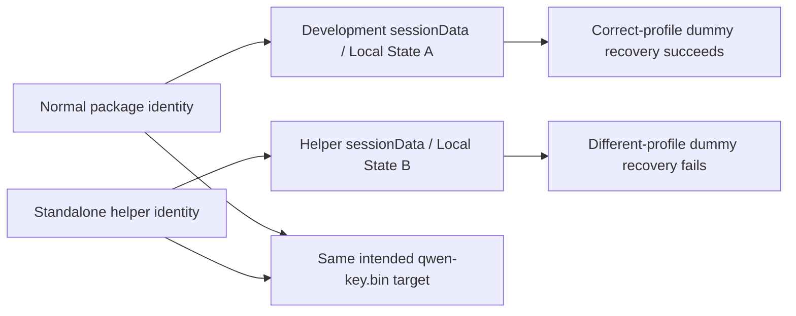

# M3.4b.3e — Credential context diagnosis and offline repair

Date: **2026-10-29, Europe/Madrid**. HEAD remains
`69a7fb30fe7507717cafb939ecacad9b97e0fbfd`.
Installed v0.1.1 is unchanged. Prior uncommitted M3.4b.3d work is preserved.

**Confirmed code defects:** the standalone pilot did not initialize the same
Electron crypto profile as ordinary development, despite selecting the same
intended credential filename; the shared vault could delete ciphertext after
a failed read/decrypt/validation. Both have safe, dummy-tested repairs.

**Historical real-record condition remains UNVERIFIED.** No actual Qwen key or
ciphertext was read/decrypted in this task. The profile defect is reproducible
with synthetic credentials, but we cannot prove it was the only cause of the
earlier `missing-key`, or assert that the real entry was missing/damaged/deleted.
**Zero provider requests. No live authorization; both old approvals stay consumed.**

## 1. Preserved original result and preflight

Report 73 records FAILED_BEFORE_TRANSPORT: zero HTTP invocations, no response,
usable key not obtained, valid complete receipt and consumed authorization.
Its generic `missing-key` category did not distinguish missing file, unreadable
record, encryption unavailability, decryption failure or rejected decoded format.
That historical result is not changed here; the first pilot remains inconclusive.

Checked status, log, exact HEAD/ancestry and diff check. Read the relevant findings
in reports 67 and 70–73 and inspected normal chat, initialization, launch scripts,
provider/endpoint identifiers, vault, installed Electron types/default-app loader,
packaging metadata and the retained Prompt 104 bootstrap code. No reset/clean,
secret-file read, installed-app launch, vault export or account query.

## 2. Actual source flow

- `scripts/dev.mjs`: launches the checkout Electron with **`.`**, loading the
  repository package manifest/main. Package name is **desktop-companion**.
- `src/main/main.ts`: waits for `app.whenReady()` before creating chat; sets
  the Windows application model ID for the desktop shell. No normal-app
  userData/sessionData override exists.
- `src/main/chatWindow.ts`: selects `app.getPath('userData')/companion`, then
  `qwen-key.bin` and `provider-settings.json`; prepares the existing secure store.
- `src/shared/conversationSession.ts`: Qwen provider/endpoint/encryption checks,
  then internal `vault.load()` only when the user sends an authorized text turn.
- `src/main/safeCredentialStore.ts`: existing Electron **asynchronous** safeStorage
  wrapper; `isAsyncEncryptionAvailable`, `encryptStringAsync`, `decryptStringAsync`.
- `src/shared/keyVault.ts`: encrypted file abstraction, format validation and
  optional key rotation; plaintext remains inside the main-process provider path.
- Prompt 104's retained ignored child bootstrap: launched **a standalone .cjs**,
  waited for readiness, but selected the fixed symbolic path
  `<APP_DATA>/desktop-companion/companion/qwen-key.bin` without aligning Electron
  identity, userData **or sessionData** to normal development.
- `src/main/qwenVisionTransport.ts`: consumed its opaque permit, called the
  existing store internally, received no usable key, returned before its sole fetch.

Both flows use provider ID **qwen**, credential filename **qwen-key.bin** and the
same intended configuration filename. There is no separate named OS credential
manager record or alternate key registry. Normal Qwen model/endpoint configuration
and text request handling are unchanged.

## 3. Two namespaces, not just a file path

The installed **Electron 44.9.3** `default_app.asar/main.js` was inspected read-only.
Package loading applies the manifest's productName/name. A standalone script
does not have that package manifest at its entry path and retains Electron's
default identity; setting cwd/AppPath alone does not apply the manifest name.

The official [app reference](https://www.electronjs.org/docs/latest/api/app)
describes how identity determines the default userData path and sessionData
defaults to userData. Normal package startup and the isolated file therefore
have different default crypto profiles. An explicit filename override does not
switch that profile. Windows shell AppUserModelId is not a substitute for it.

In the pinned [v44.9.3 browser-process source](https://github.com/electron/electron/blob/v44.9.3/shell/browser/browser_process_impl.cc),
the async Windows DPAPI key provider receives `local_state()`, whose `Local State`
preferences are loaded under **DIR_SESSION_DATA**. The protected profile key
and the encrypted Qwen record are separate pieces of state. Same Windows login
and same ciphertext pathname are insufficient if the helper initializes a
different profile key. No original Local State file was inspected here.

The diagram shows the bootstrap defect and disposable reproduction, not a
forensic conclusion about the real record's prior contents.

## 4. Electron API and Windows review

The official [safeStorage documentation](https://www.electronjs.org/docs/latest/api/safe-storage)
describes the asynchronous API and Windows DPAPI protection. Readiness precedes
lazy async initialization. Current documentation also discusses newer-version
deprecation; **no API migration was performed**. The project's installed
`electron.d.ts` confirms all three async methods and the decoded `result` /
`shouldReEncrypt` fields used by the existing wrapper.

The [pinned safe-storage implementation](https://github.com/electron/electron/blob/v44.9.3/shell/browser/api/electron_api_safe_storage.cc)
returns unavailable/rejects operations before ready and distinguishes a failed
decryption from successful plaintext in memory. The original pilot did wait
for readiness; we did not invent an ordering failure as its historical cause.
The new context guard makes the sequencing explicit before any vault lookup.

No account change, administrator operation, DPAPI setting change, synchronous
fallback, plaintext store or cross-profile secret copying was used. The native
experiment used this laptop's existing Windows logon solely for **synthetic**
DPAPI encryption; no real Qwen key was accessed.

## 5. Execution-context comparison

- **Ordinary development/text chat:** package identity desktop-companion;
  encrypted file derived from current userData; crypto profile from sessionData.
- **Historical isolated pilot:** standalone Electron identity, fixed intended
  file path, different default sessionData/profile. This is the verified defect.
- **Installed v0.1.1, source knowledge only:** electron-builder productName is
  desktop-companion, executableName DesktopCompanion, appId com.desktopcompanion.shell.
  Configured default names coincide with development; the repository has no
  dedicated development-profile suffix. The installed runtime/profile was not
  launched, inspected or redirected into.

Because installed and development defaults can coincide, this repair must not
silently discover/select installed data. Namespace initialization takes an
**explicit caller-selected development namespace**, not an installed-path fallback.
Only newly created TEMP namespaces were supplied in this task.

## 6. Hypotheses A–K and evidence limits

- **A — Entry missing:** UNKNOWN for the real entry. Generic missing-key is not
  evidence of absence. New missing-entry classification requires observed ENOENT.
- **B — Wrong lookup key:** not supported by source; both use qwen-key.bin.
- **C — Development vs installed locations:** configured defaults coincide;
  actual installed runtime was not inspected. No migration/redirect was attempted.
- **D — Isolated identity/profile mismatch:** CONFIRMED in loader/bootstrap
  code and reproduced by package-vs-file identity and dummy profile tests.
- **E — Before readiness:** ruled out in the recorded bootstrap's code flow;
  native dummy probes additionally verify APP_NOT_READY before ready and correct
  initialization/crypto availability afterward.
- **F — Encryption unavailable:** false in all disposable native probes; prior
  real-context availability was not recorded, so that historical possibility remains.
- **G — Malformed real record:** UNKNOWN; no ciphertext was read. Dummy format,
  I/O and decrypt errors are tested without conflating them.
- **H — Provider/workspace missing:** report 73 reached validated preflight and
  authorization, so the recorded attempt passed those local checks. Current
  personal configuration was not re-read to infer its present condition.
- **I — Different Windows identity for the real blob:** UNKNOWN; own dummy
  children recover under the same logon when sharing a profile. No SID/account
  switch or unrelated credential-manager search.
- **J — Omitted child environment:** original live parent inherited its environment
  except documented dev/smoke flags. No verified missing non-secret variable was
  found. The new dummy harness also succeeds with a minimal system/temp whitelist.
- **K — Destructive generic failure handling:** CONFIRMED. Prior file-vault code
  removed the selected ciphertext after invalid decoded format or decrypt failure.
  Whether that happened to the actual key is not established and is not claimed.

Thus the **code-level context cause is established**; the exact real-record
condition/sole historical cause remains **CREDENTIAL_ACCESS_UNVERIFIED**.
Determining it by decrypting the real key would exceed this task's permission;
that portion was stopped, without requesting or performing secret extraction.

## 7. Minimal repairs

### Explicit main-process context contract

New `src/main/pilotCredentialContext.ts` provides fixed Qwen filenames, explicit
early context initialization and readiness/provider/name/userData/sessionData
checks. `requirePilotCredentialContext` fails closed before callers construct
or load the existing vault. Packaged/late initialization is refused. Wrong
namespace/key ID/provider gets a sanitized status. There is no discovery of
installed profiles, secret getter/export, file reader, network call or live grant.

It mirrors the correct ordinary-development namespace contract rather than
creating a new credential system. Future separately approved bootstraps must
initialize the explicitly authorized namespace **before** whenReady, then require
a context match **before** the existing secure lookup. No real namespace was
initialized or actual setting changed here. The old ignored bootstrap is retained
as historical evidence, not rewritten or made live again.

### Non-destructive file-vault errors

`src/shared/keyVault.ts` keeps the existing load return contract and successful
encrypted save/load/rotation behaviour. Failed reads, invalid decoded data and
decrypt errors now preserve ciphertext; explicit `clear()` remains explicit.
The selected encrypted record is bounded to 16 KiB and must be a regular,
non-symlink file. Optional internal `diagnosticStatus()` exposes **only an enum**:

- CREDENTIAL_ACCESS_UNVERIFIED — not established yet.
- SECURE_STORAGE_UNAVAILABLE — the current availability check could not provide crypto.
- CREDENTIAL_ENTRY_MISSING — ENOENT actually observed at the selected entry.
- CREDENTIAL_RECORD_INVALID — bounded record/type or decoded-format check failed.
- CREDENTIAL_LOOKUP_ERROR — access, I/O, decrypt or rotation failure; not proof of absence.
- AVAILABLE — successful local validated recovery, not provider authentication.

No diagnostic enum includes key text, path, raw exception or ciphertext. No
renderer/preload/IPC method was added. The existing text provider/UI/request
format remains unchanged; its shared vault's failure path is intentionally safer.
No user credential was saved, cleared, rotated, re-encrypted or migrated by this task.

### Smoke isolation

`scripts/smoke.mjs` now starts with a verified disposable `--user-data-dir`,
waits for child **close**, and cleans only its resolved owned TEMP profile.
All prior startup/WebGL/preload/dummy-encryption/shutdown assertions remain;
timeout is still a failure. Failure output is sanitized instead of dumping
arbitrary process logs. The native probes verified that the switch isolates
both userData and sessionData **from startup**, before context initialization.
This avoids touching real app configuration/Local State during required smoke.

## 8. Disposable native evidence

`scripts/credential-context-check.mjs` launches fixed Electron workers, never
the installed app, with a temporary package and separate profiles A/B. Each
child receives its disposable user-data-dir before startup. Node network APIs
are blocked; key/config reads outside the owned TEMP root are rejected. No
BrowserWindow, clipboard, capture, microphone or provider client is created.

The only key is the required literal **TEST_ONLY_NOT_A_REAL_API_KEY**, held in
test code/memory and encrypted in owned disposable files. It is never sent,
printed, passed in argv/environment or written as plaintext configuration.
Parent output contains only booleans/enums; it does not return the dummy value.

Four actual native probes passed:

1. Package startup/profile A: expected identity, ready, encryption available,
   encrypt/persist/recover dummy, ciphertext does not contain plaintext.
2. Standalone child initialized to A: initial identity differs, explicit context
   aligns, same persisted dummy is recovered in a new process.
3. Standalone child/profile B, still selecting dummy file A: namespace guard
   rejects lookup. A deliberate **dummy-only** operation below that guard
   reproduces decryption failure; status LOOKUP_ERROR, original ciphertext retained.
4. Return to A in another child: dummy recovery succeeds again.

All four children closed with exit 0, encryption available, startup isolation
true, **networkAttempts:0**, **privateReads:0**, safe process arguments and
preserved ciphertext. Parent cleanup of the owned TEMP tree passed. No real
ciphertext was copied between profiles. The negative phase is not a production
bypass: it exists only to exercise the known synthetic blob under the wrong key.

## 9. Regression results

- `npm run typecheck`: **PASS**.
- `npm test`: **748 PASS**, zero failed/cancelled/skipped; **30 new** over 718.
- Focused credential suite after startup-isolation assertion: **30/30 PASS**.
- `npm run build`: **PASS**, existing >500-kB renderer bundle advisory unchanged.
- `npm run smoke`: **PASS**, disposable profile cleanup PASS, new process,
  sandbox preload/first WebGL frame/dummy crypto/normal shutdown. Intel Iris Xe
  ANGLE D3D11, 20 draw calls, 14,936 triangles, DPR 1.
- JavaScript syntax and diff checks: **PASS**, harmless LF/CRLF notices only.
- Final process check: **zero** installed/checkout Companion/Electron or dummy
  credential-check processes; no observed orphan.
- Default preflight remains **LIVE TEST BLOCKED / prior approval consumed**.

Tests cover normal/pilot lookup contracts, identity and both path namespaces,
readiness, wrong key ID/provider, dummy roundtrip, rejected dummy, missing entry,
availability/access/read/decrypt/format/rotation failures, byte preservation,
recovery, bounded records, sanitized output, no renderer secret API, no secret
argv/environment/receipt, gate-before-callback behaviour and native cleanup.
Existing text/mock vision/receipts/consent/capture/Follow/Home/docking tests pass.
The existing native/live-gate tests still reject consumed/reconstructed approvals.

One initial new unit fixture had the wrong app name and short-circuited before
its mocked path exception; corrected the fixture to reach that error branch,
without removing or weakening an assertion. Final tests above pass.

No Alibaba/provider request, authenticated billing query, image upload or real
key inspection/decryption occurred. Only public official documentation was
browsed. Guards verify the test boundary; no machine-wide packet trace or
assertion about unrelated applications' network traffic is claimed.

## 10. Exact files and preservation

Modified in this task:

- `src/shared/keyVault.ts` — non-destructive, bounded load failures and enums.
- `scripts/smoke.mjs` — isolated TEMP profile, awaited close and safe cleanup/output.
- `package.json` — add only the credential test entry; no dependencies/version change.

Added:

- `src/main/pilotCredentialContext.ts`.
- `src/main/pilotCredentialContext.test.mts`.
- `scripts/credential-context-check.mjs`.
- `scripts/credential-context-worker.cjs`.
- `docs/research/74_M3.4B3E_CREDENTIAL_ROOT_CAUSE.md` — this report.

SHA-256 baseline: **254** tracked/nonignored existing files, including prior
uncommitted work. Only the three intended existing files above differ; **251
unchanged**, zero missing. Reports 70–73, report 67, prior receipt changes/tests,
safeStorage wrapper, vision transport/gates, endpoint/model policy, ordinary
chat/main/preload/renderer, capture, robot, Follow/Home/docking and lockfile
remain identical. All previous diagnostic artifacts remain present; no ignored
evidence, real vault or configuration was deleted. The only data cleanup was
this task's explicitly owned disposable TEMP test data.

No installed-v0.1.1 access/update, dependency installation, Windows/account/startup
setting, installer, staging, commit, tag, push or remote change.

## 11. User-controlled next steps and approval boundary

Local credential availability can be checked **without a provider call**, but
levels differ: context/API/presence metadata does not prove decryption or model
entitlement. Dummy recovery is now verified; real credential access remains
unverified because this task forbids reading/decrypting it.

Before any further pilot:

1. Explicitly select/approve the development namespace to use, including its
   sessionData; do not infer an installed profile or copy an encrypted key.
2. Use the early initialization/required-context guard. Do not ask the user to
   repair a key merely because a mismatched helper cannot read it.
3. If necessary, obtain separate approval for an **entirely local** real-store
   availability/decryption check, keeping the value inside the existing main
   vault interface and reporting only a sanitized result. No API inference.
4. If the user independently observes a missing entry in the normal app's
   existing secure settings, they may save their chosen key through that masked
   UI themselves. Do not reset a working key, paste it into chat, edit blobs,
   automatically migrate installed data or assume this step is needed.
5. Any subsequent inference needs **another fresh explicit approval**, new ID,
   exclusive claim, unchanged synthetic scope, receipt preflight and no retry.
   Possession of a locally valid credential is not permission to call Qwen.

These are instructions for a later user-controlled action, not steps executed
here. No new live pilot or screenshot integration has started. Both prior
authorizations remain consumed; default-deny is unchanged.

## 12. Rollback and remaining limits

If reverting, review only this task's listed files/diffs; preserve the earlier
uncommitted M3.4b.3d work and reports/evidence. Do not reset/clean the repository
or touch user profiles. Reverting the vault fix would restore the destructive
failure behaviour and is discouraged. No actual credential/account/installed
data rollback is needed because none was changed.

Remaining uncertainty includes the actual record's prior/current presence and
format, prior crypto key/profile, original decryption outcome, any previous
deletion, installed runtime overrides and provider access/billing/vision quality.
No real secret was decrypted to resolve these. The code-level repair is verified
offline; it is not a claim that actual Qwen credential access or vision inference
has now succeeded.
