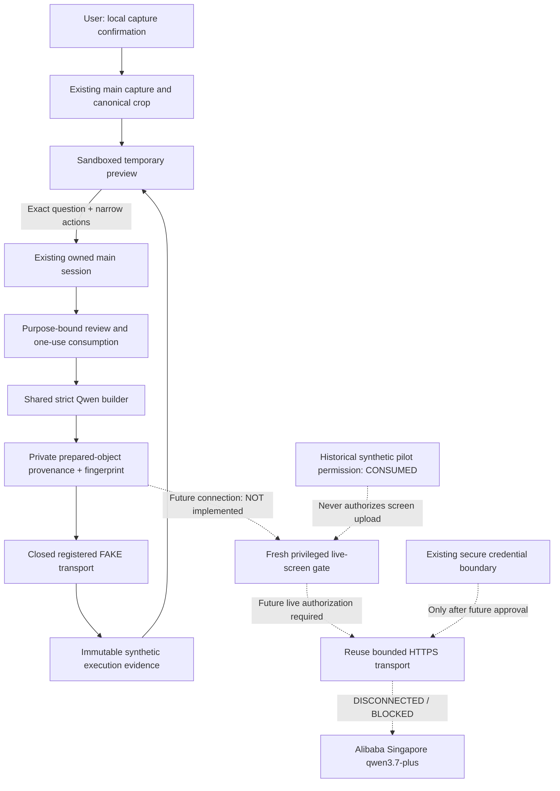

# M3.4b.4d — Controlled live vision preparation, offline safety validation

Date: **2026-10-30, Europe/Madrid**.
Approved and unchanged HEAD: **b3b9e6dcab1d8cec0119dea27f4b9e0d729b62be**.
Installed DesktopCompanion **v0.1.1 unchanged**.

**OFFLINE PREPARATION VERIFIED: 903/903 tests PASS, 27 new; typecheck, explicit
build, native hidden synthetic-preview check and clean smoke PASS. Real vision
remains BLOCKED. Zero real key retrievals, provider requests, screen captures
or image uploads in this milestone. No commit/tag/push/remote or installer.**

The existing main-process session and builder are reused. Only the prepared
request's internal provenance and execution-evidence contract are hardened.
There is no new provider stack, live driver, real-send control or consent system.
The user-approved renderer/layout and application behavior remain unchanged.
Reports **69–80** and previous consumed permissions remain unchanged. Their
earlier Windows approvals do not count as new manual passes for this milestone.

## 1. Checkpoint and preflight

Git status/index initially clean; four-commit log, exact HEAD and diff check
passed. Read the boundaries/results in reports **69, 70, 74, 77, 78, 79, 80**;
inspected actual crop ownership, session, request builder/mock, synthetic live
factory, configuration/secure-store/context source, IPC/preload, results and
test harnesses. No personal configuration, real vault, Local State or environment
secret was opened. Reading source is distinct from invoking a credential path.

No Companion instance was running before native tests. No user app was closed.
Task-start snapshot covers **274 tracked files** and **797 historical ignored
diagnostic artifacts**. Baseline and verification logs are isolated/ignored under
.local-vision-diagnostics; they contain no screen image or dynamic crop hash.

## 2. Architecture decision and implemented scope

Keep **createOfflineVisionSession** as the coordinator: it already resolves the
canonical crop, validates current question/revision, issues purpose-specific
review tokens, consumes before async work and owns busy/cancellation/generation.
Keep **prepareScreenVisionRequest / executeScreenVisionMock** as the narrow
builder/execution seam. Keep the existing real factory disconnected.

Two useful missing internal invariants are now explicit:

1. Execution recognizes only the original object issued by the trusted preparer.
   A structural copy or self-signed replacement cannot enter the fake boundary.
   The original private fingerprint, rather than a caller-editable checksum,
   determines whether a prepared request was changed.
2. A returned result carries immutable, explicitly **closed-fake** evidence:
   whether that prepared attempt was consumed, its zero/one fake invocation count
   and its correlated synthetic HTTP status or null. This distinguishes phases
   without inventing provider provenance, cost, latency or a second error enum.

These are defense-in-depth at an internal main-only seam, not a claim that the
previous renderer could already upload a replacement image. It could not.
They are not live authorization and cannot be promoted into one.

## 3. Exact source files changed

- **src/main/screenVisionRequest.ts:** add private WeakMap provenance/original
  fingerprint and consumption state; return existing validation codes from
  preparation; distinguish review/session expiry; return immutable execution
  evidence. Retain the same pure builder and closed fake driver.
- **src/main/screenVisionRequest.test.mts:** add **27 behavior-based tests** under
  the existing process-local network/private-access/persistence/capture guards.
  No old test is removed, weakened or replaced by a real request.
- **docs/research/81_M3.4B4D_CONTROLLED_LIVE_VISION_PREPARATION.md:** this report.

No package/lockfile/dependency, session-manager, renderer/preload/IPC, stylesheet,
real transport, receipt, credential/configuration, chat, robot, Follow, Home,
docking, startup, installed-release or native-harness source change.

## 4. Path A — approved offline screen UI

User opens selector -> drags -> personally confirms local capture -> trusted
main crops/releases full-display references -> temporary canonical PNG and
preview -> editable question -> separate screen-rehearsal review -> one-use
rehearsal confirmation -> strict shared Qwen builder -> prepared request ->
registered closed fake -> simulated answer in that same temporary preview.

The old Review question / Run offline vision test path still has its independent
offline-simulation-only token. Local capture authorizes neither execution nor
external transmission. New rehearsal purpose stays screen-vision-offline-rehearsal.
No real permission is minted by any of these actions.

## 5. Path B — previous real synthetic pilot

The existing **qwenVisionTransport.ts / createSyntheticVisionPilot** constructs
its own fixed **visionPilotFixture** and **VISION_PILOT_QUESTION**. Its approvals
have a separate one-synthetic-vision-request domain. Main/development/readiness/
context, TLS, one-shot/fingerprint and bounded transport guards protect the
credential/POST path. The ordinary factory remains LIVE_VISION_DISABLED=true.

Report 78 establishes exactly one historically authorized synthetic POST,
HTTP 200, about 2.25 seconds and correct synthetic arithmetic/shape recognition.
That approval is **CONSUMED**. It is not ongoing permission, a current credential
check or evidence about arbitrary screenshots. No retained pilot command,
in-memory exception, old receipt or consumed marker was executed/reused here.

## 6. Minimal eventual connection — DESIGN ONLY

The current synthetic factory is **not** a drop-in screen transport: its input,
permission domain and diagnostic receipts are deliberately synthetic-specific.
Do not pass a screenshot through that factory or replace its fixture at runtime.

A later reviewed change must separate/reuse its existing bounded authenticated
HTTPS execution beneath a new trusted live-screen authorization boundary.
The coordinator would supply the already validated, exact prepared request;
the native adapter would resolve the existing credential only after live grant
consumption. Existing HTTP/response/TLS code should be shared, not copied into
a new client. No generic URL/body callback or IPC proxy may result.

**Not implemented here:** that extraction/connection, actual endpoint lookup,
live-screen grant, privileged activation gate, credential acquisition or POST.
This milestone tests the request/result seam only with its registered fake.

## 7. Trust-boundary diagram



Dashed edges are future design/denial boundaries, not executable connections.
The compiled selector graph still contains **11 local modules**, **zero** actual
credential/settings/live-transport/receipt imports. Renderer CSP also denies
network connections; no secret capability is exposed in preload.

## 8. Threat model — protection, evidence and residual risk

1. **Offline grant becomes upload permission:** separate existing domains and
   disconnected native path. Domain/cross-token tests pass. A future live grant
   and privileged activation are still required; no rehearsal may be upgraded.
2. **Renderer swaps image:** main canonical crop, exact-key IPC and private digest.
   Existing injection/image-change tests plus new copied/resealed-request tests
   pass. Fully compromised main code is outside this renderer boundary.
3. **Question changes after review:** exact revision/text/fingerprint and edit
   revocation. Existing question tests and new resealed-body test pass. Model
   understanding of an eventual question is not tested with a real service.
4. **Expired session reused:** absolute 120-second owner deadline plus dispatch
   checks. New initial/session-at-async-gap tests pass. Event-loop delays do not
   renew permission; exact user-observed timing is not measured in this task.
5. **Double click sends twice:** synchronous main token consumption/busy slot;
   private prepared attempt is also consumed once. Duplicate/reset-counter tests
   and native duplicate proof pass. Cross-process live budgeting is future work.
6. **Timeout triggers retry:** finite timer, consumed state and no queue/retry.
   Fake timeout test reports UNKNOWN with one invocation. Provider processing or
   billing after a future timeout remains unknowable without service evidence.
7. **Stale result reopens UI:** session generation/owner/deadline gates and dispose.
   Existing late/discard/controller/native cases pass. No future closed preview
   may be recreated simply to deliver an answer.
8. **Provider/endpoint/model override:** fixed private policy/shared URL validator,
   exact-key IPC and original fingerprint. New reseal tests cover endpoint/model/
   limits/purpose. The actual configured workspace is deliberately not read here.
9. **Debug/test switch enables live:** no new switch/callback/driver selection;
   registered closed handles only, native gate unchanged. Native-callback and
   prospective-live-action cases pass. A future privileged gate needs review.
10. **Image/key enters logs:** no writes/console/credential imports in the seam;
    evidence has only fixed provenance, booleans/count/status. Existing guarded
    privacy tests pass. JS reference release is not physical RAM/paging erasure.
11. **Fake response shown as real:** only simulated-qwen-response exists in this
    result type and existing UI label is fixed. Native/label-forgery tests pass.
    Future real provenance must be minted solely by authenticated transport.
12. **Failure shown as success:** shared normalizer and code/outcome/evidence.
    New malformed/empty/tool/HTTP cases pass. Fake HTTP 200 is not provider proof.
13. **Cancellation claims remote recall:** zero/one invocation evidence distinguishes
    before/after boundary; existing warning remains. Both cancellation tests pass.
    Future dispatched data may still be processed/billed; no recall guarantee.
14. **Old synthetic approval reused:** different domains, hard-disabled factory,
    preserved tombstones. Existing pilot-shaped-token tests pass. No old approval
    is reset or imported to authorize a screen operation.
15. **Expiry recreates capability:** terminal attempt state never renews; new main
    review is required even after failure. Expiry/replay/gap tests pass. No durable
    live attempt ledger is added until a separately reviewed real pilot needs it.
16. **Screenshot injection controls computer:** unchanged safe system hierarchy,
    no tools/actions and plain-text rendering. Builder/tool-reply tests pass.
    No real model's resistance to visual prompt injection is proven offline.

## 9. Consent lifecycle and deadlines

Local capture, old local simulation and screen rehearsal are separate. A future
live-screen transmission must introduce a fresh, noninterchangeable live purpose
without duplicating the session manager. No persistent or always-allow grant.

Preview remains **120 seconds from selector opening**, including selection time.
Review remains **at most 30 seconds**, clipped to the original deadline. Editing,
scenario/crop change, Cancel, Discard, Close, expiry or replacement revoke unused
approval. Confirmation consumes synchronously before async work. Busy work stays
owned until settlement; cancellation does not open an overlapping queue slot.

The same rules would surround a future native adapter; they are not permission
to call it now. The renderer's sequence is validated against its owned frame,
active session and main-issued token; it is not cryptographic physical-click
attestation against a fully compromised renderer.

## 10. Main-owned crop identity

The original capture owner alone acquires/crops after the user's confirmation.
Full-display NativeImage references are released before delivery. Main retains
one canonical cropped PNG for the bounded preview, with main-generated image ID
and private digest. The renderer cannot submit bytes/Base64/URL/path/new image
identity or recapture coordinates in a question action. There is no second capture
when reviewing or confirming. Copies in renderer IPC/Blob/decoded image are the
existing preview implementation, not another main canonical owner.

## 11. Exact question and fingerprint

Existing main-issued scope binds session/image/request IDs, exact valid question
and revision, purpose, provider/region/model, limits and deadlines. Scope/question
are not silently normalized. SHA-256 binds that scope and exact shared builder
URL/body/body-byte count. Confirmation rebuilds and compares the request and
checks the current PNG digest. No dynamic crop fingerprint is written to logs.

New private preparation state remembers the **original** fingerprint. A caller
cannot modify body/URL/scope and then repair its public checksum. Copying the
whole original object also fails provenance. Tests exercise both without invoking
HTTP. The normal main-generated scope is frozen by the existing session.

## 12. One-time authorization and prepared identity

Main's review nonce remains the actual owned-IPC grant; the new WeakMap is a
prepared-request integrity/consumption layer, **not a second remote consent**.
Only prepareScreenVisionRequest creates recognized keys. Its value contains
fingerprint and small execution state, no encoded request/crop reference.

The executor checks a registered fake driver, marks that prepared identity consumed
before awaiting, then rechecks cancellation/deadlines/fingerprint before dispatch.
It records fakeDispatches=1 immediately before the fake call. A copied object,
modified checksum or reset caller counter cannot create another invocation.
Failure/timeout/cancellation never restores the token or prepared attempt.
WeakMap state is process-local and ephemeral, not account-wide/durable budgeting.

## 13. Default-deny live boundary

**SCREEN_VISION_LIVE_DISABLED=true**, **LIVE_VISION_DISABLED=true** and immutable
liveAvailable:false remain. They describe absent/blocked capabilities, not user
switches. No environment, preference, localStorage, URL, hidden-control or renderer
IPC field has been added to activate network execution. Existing exact-key rules
reject prospective live actions and arbitrary driver/model/endpoint/body fields.

Send to Qwen — unavailable remains disabled with no real-send listener/IPC.
Normal production composition exposes no usable selection/live path. Native
fetch, credential and synthetic pilot modules remain disconnected from the
ordinary preview; DevTools in its sandbox cannot obtain a generic main proxy.
The test-only opaque mock cannot delegate to an injected HTTP callback.

## 14. Credential boundary — source review only

Reports 74/77 explain that identity, readiness, both userData and sessionData,
provider and fixed lookup contract must match before secure storage is used.
Same filename/Windows user alone is not enough. Existing safeStorage/keyVault
source was inspected; no actual configuration, encrypted record or plaintext
was read. No local-availability diagnostic was run again.

A future live coordinator must check trusted context, live approval/consumption,
current endpoint fingerprint and text/voice/session busy ownership before its
existing secure-store acquisition. Recheck context/policy after async acquisition
before the sole dispatch; abort/reject rather than change scope. No key in
renderer, argv, environment, logs, receipts or result metadata. No alternative
vault, migration, key duplication or new credential export is introduced here.
Smoke/full-suite dummy crypto in isolated TEMP is not real Qwen-key retrieval.

## 15. Typed dispatch/result contract

Existing ScreenVisionWireRequest still carries scope, BuiltVisionRequest and
fingerprint in trusted main. Preparation now returns existing VisionFailure
codes (for example invalid-image/question/endpoint), preserving local validation
before an execution attempt instead of collapsing every failure into a boolean.

ScreenVisionResult retains ok, simulated kind or existing code/outcome, adding:

```ts
interface ScreenVisionExecutionEvidence {
  readonly transport: 'closed-fake';
  readonly attemptConsumed: boolean;
  readonly fakeDispatches: 0 | 1;
  readonly httpStatus: number | null;
}
```

Both returned result and evidence are frozen. This is **synthetic evidence**, not
a receipt, live activation grant or new IPC payload. It contains no usage,
latency, cost, image/hash/question, private endpoint or key. The existing session
continues projecting the same safe notice/answer to the same preview; renderer
behavior/layout does not change. A failed/fake result has no real-provider label.

## 16. Image/question validation — unchanged

Local: **one display**, **8,388,608 source pixels**, **4,194,304 crop pixels**,
**4096 source side**, **16 MiB local PNG**. Vision: RGB/RGBA **PNG only**,
**2 MiB**, **2,097,152 pixels**, **2048 per side**, proper subcrop of display.
Existing CRC/chunk/filter/inflate/signature and byte/body limits are reused.
Question: **500 UTF-16 units / 2000 UTF-8 bytes**, nonempty, valid round-trip
Unicode/control rules. No new resize/recompression/OCR/fallback or larger budget.

Review validates compatibility before issuing the rehearsal grant. Invalid local
vision eligibility keeps preview/Discard available and never reaches transport
or credentials. Confirmation still revalidates for changes after review. A
changed invalid request can consume its already-issued attempt while failing
closed; it is not automatically repaired or retried.

## 17. Classification without a redundant enum

Compose existing **code + outcome + immutable execution evidence**. Two specific
prepared-seam codes are added: authorization (unrecognized prepared identity)
and session-expired; expired still means the review expired. No parallel provider
error registry or always-success fallback is introduced.

- **SUCCESS:** ok:true, simulated-qwen-response, closed-fake/one invocation/200.
  Only a future authenticated adapter may create a real-provider success.
- **FAILED_BEFORE_TRANSPORT:** failed with fakeDispatches=0 and a specific code.
- **AUTHORIZATION_INVALID:** authorization, duplicate, or main scope/token mismatch;
  no new invocation. Duplicate evidence can describe the original consumed attempt.
- **SESSION_EXPIRED:** session-expired; owner also checks its absolute deadline.
- **IMAGE_INVALID:** preparation invalid-image; no prepared execution/credential.
- **CREDENTIAL_UNAVAILABLE:** not reachable offline; future existing native
  missing-key/context codes must retain before-transport evidence, not success.
- **HTTP_ERROR:** existing invalid/authentication/rate-limit/unavailable codes,
  failed outcome and correlated synthetic httpStatus 400/401/429/500.
- **TIMEOUT:** timeout, unknown, one fake invocation, status null. No retry.
- **RESPONSE_EMPTY:** empty, failed, correlated synthetic status 200.
- **RESPONSE_PARSE_ERROR:** malformed (or bounded-body rejection), failed, no answer.
- **CANCELLED_BEFORE_DISPATCH:** cancelled, consumed attempt, fakeDispatches=0.
- **CANCELLED_AFTER_DISPATCH:** cancelled, consumed attempt, fakeDispatches=1;
  future remote processing/billing cannot be ruled out or recalled.
- **INCOMPLETE_EVIDENCE:** missing fake reply or foreign correlation -> unavailable/
  stale, unknown, no accepted HTTP status. Future receipt gaps must stay unknown.
- **UNKNOWN_OUTCOME:** unknown after entry; never success, zero billing or retry.

Image/question/session rejection in main may produce its existing safe editing/
error notice without calling the executor at all. These layers are intentionally
distinguished rather than inventing a transport event that never happened.

## 18. Cancellation, expiry races and stale responses

Cancel at the existing pre-dispatch microtask prevents invocation while consuming
the prepared attempt. Cancel after fake dispatch aborts local waiting; no second
attempt is authorized. Absolute preview expiry is checked separately before
entry and after the microtask; a review expiring at that gap cannot dispatch.
Expiry after a valid dispatch does not renew permission or authorize another call.

Existing generation/session/window ownership suppresses late results on edit,
Discard/Close/expiry. Closed UI is not recreated. Native tests retain cancellation
and real preload-driven Discard. Future native waiting must also handle stalled
credential/fetch/body promises using the existing finite abort races. A local
abort cannot promise remote recall/deletion or absence of cost.

## 19. Privacy and memory lifecycle

Only the reviewed crop/question could form a future request; current encoded
wire/body values are transient and discarded before awaiting the closed fake.
Private provenance values contain no crop/body references. Main owns the crop
only through its original bounded session; dispose clears references and aborts,
renderer revokes Blob URL. No images/history, diagnostic payload cache or receipts
are added. No dynamic image hash/fingerprint is persisted by this flow.

No key/crop/request goes to files, preferences, chat/TTS history, logs, clipboard,
telemetry or a new crash-report path. Existing historical synthetic receipts are
preserved, not reused for screenshots. Dropping JS references/frozen metadata is
not a guarantee of secure physical RAM, pagefile or allocator erasure.

## 20. Prompt injection

Reuse the existing VISION_SYSTEM_PROMPT and exact two-message multimodal builder:
image text is untrusted data, never authority. No tools/search/functions, browser,
filesystem, shell, mouse/keyboard or credential actions. Plain text is returned
to temporary preview, not executed or added to persistent conversation/TTS.
Tool-bearing fake replies fail. Real screenshot interpretation and a real model's
instruction resistance are not evaluated by a scripted fake.

## 21. Offline execution matrix — all covered automatically

Coverage reuses retained session/controller/builder tests and adds 27 seam cases;
not every row needs a redundant new test. All pixels are generated fixtures.

- **A:** valid exact crop/question -> one labeled fake success.
- **B:** exact question/revision mismatch rejected; resealed changed question denied.
- **C:** foreign session/image/token and copied prepared identity rejected.
- **D:** expired owner session cannot execute/reopen; session-expired classified.
- **E:** expired review cannot dispatch, including async-gap race.
- **F:** edit revokes prior consent; original fingerprint cannot be repaired.
- **G:** Discard/dispose before invocation prevents transport.
- **H:** Close/dispose before invocation revokes grant and drops later publication.
- **I:** double confirmation yields one invocation/result.
- **J:** consumed grant/prepared object cannot replay, even with caller counter reset.
- **K:** fake 200 gives frozen explicitly synthetic success evidence.
- **L:** fake 400 -> failed/invalid, correlated synthetic status, no retry.
- **M:** fake 401 -> failed/authentication, no key read or retry.
- **N:** fake 429 -> failed/rate-limit, no retry.
- **O:** fake 500 -> failed/unavailable, distinct from unknown missing evidence.
- **P:** fake timeout -> UNKNOWN/one consumed invocation, no retry.
- **Q:** malformed JSON/tool-bearing reply -> failed/malformed, no success label.
- **R:** empty answer -> failed/empty with synthetic 200, no text invented.
- **S:** unknown/unavailable transport -> unknown, null accepted HTTP status.
- **T:** cancel in flight -> one invocation, consumed, no retry.
- **U:** late reply after Discard cannot publish/reopen.
- **V:** preview expiry at/near dispatch -> zero or bounded entered attempt, no renewal.
- **W:** over-500/invalid question blocked locally, no invocation.
- **X:** PNG over 2 MiB rejected; preview/Discard retained.
- **Y:** over-budget pixels rejected.
- **Z:** invalid/unsupported PNG rejected by shared validator.
- **AA:** injected model/endpoint and recomputed internal fingerprint cannot dispatch.
- **AB:** renderer bytes/Base64/path/URL/image replacement fields rejected.
- **AC:** actual fake-call counter stays at most one per consumed authorization.
- **AD:** prospective live IPC/native callbacks unrecognized; live graph disconnected.
- **AE:** private/credential imports denied; final actual private-access counter zero.
- **AF:** global fetch/WebSocket, HTTP/TCP/TLS/subprocess paths denied; counter zero.
- **AG:** simulated outer label cannot become real-provider provenance.
- **AH:** persistence/clipboard guard plus source ownership; no image write/handoff.
- **AI:** retained chat/provider/history/voice/startup regressions pass.
- **AJ:** retained Follow/Home/docking/Sleep/Wake/click-through regressions pass.

The dedicated process-local after-hook asserts **0 network, 0 private access,
0 persistence, 0 real capture** attempts across old and new cases. This is
instrumented code-boundary evidence, not machine-wide packet capture. Direct
internal tampering in tests exercises trusted-seam defenses; it adds no UI bridge.

## 22. Finite native synthetic test

**node scripts/screen-selection-check.mjs: PASS, exit 0.** Reused unchanged native
harness with generated PNG, hidden window, real sandbox preload/app protocol and
synthetic 100/125/150% geometry. Exact crop/question, separate screen review/
confirmation, shared builder/closed fake, duplicate, cancellation, simulated
answer and Discard all pass. These exercise the hardened main seam through its
existing composition, not merely a direct test call.

Counters: **zero external, zero credential, zero real-capture attempts**. The
proof had 1 process before its hidden window, 4 with it; disposable app exited
and owned TEMP cleanup completed. No screenshot or actual key was acquired.
This is not Windows human visual approval or a real provider integration test.

## 23. Automated test counts and execution evidence

- Initial focused session/seam run: **155 PASS / 0 FAIL**, **7,647.6307 ms**.
  The final preparation-code case was added afterward and included below.
- Final **npm test: 903 PASS / 0 FAIL**, **27 new** over 876; none cancelled,
  skipped or todo. Test runner duration **12,236.1147 ms**, excluding build/npm.
- Dedicated screen test file now covers **93 cases** (66 retained + 27 new).
  Existing 810 other tests are retained; no prior evidence is silently relabeled.

Full suite ran once in the normal Windows host context using the existing
disposable fake/native harnesses. Reports 74/78 previously document sandbox TEMP
atomic-rename/subprocess EPERM failures; the intended host run was selected
before execution, rather than weakening guards or repeatedly retrying failures.
No new failing run, admin privilege, production bypass or real diagnostic mode.

## 24. Typecheck, build, smoke and cleanup

- **npm run typecheck: PASS**, initial and final all three configurations.
- **npm run build: PASS**, explicit final build after full tests; final Vite phase
  **545 ms**. Existing >500-kB robot bundle advisory remains; no retuning.
- **npm run smoke: PASS**, lock-free, isolated disposable userData/sessionData,
  new process, expected m1.6 preload, first WebGL frame, dummy-only crypto check
  and normal exit. Owned profile cleanup PASS.
- Intel Iris Xe / ANGLE D3D11: **20 draw calls, 14,936 triangles, DPR 1**.
- Post-run native snapshot: **0 checkout Electron, 0 installed Companion,
  0 matching owned native/dev workers**. No user process was force-closed.
- Git diff check passes; only harmless LF/CRLF notices.

Native/smoke were sequential after process checks; no running user instance was
interrupted. No real settings/key lookup or screen capture was invoked by smoke.
Tested installed dependency versions remain unchanged; no package installation.

## 25. Later Windows plan — all UNTESTED for M3.4b.4d

No real Windows capture or microphone is used in this milestone. The existing
layout is unchanged and previously approved; that historical 16/16 remains in
report 80. These later practical checks are not claimed as new manual passes:

- **A — UNTESTED:** existing transparent selection/drag, Cancel/Escape.
- **B — UNTESTED:** personally confirmed harmless crop, exact preview/exclusion.
- **C — UNTESTED:** editable bounded question, no implicit execution on Enter.
- **D — UNTESTED:** exact same crop/question review.
- **E — UNTESTED:** provider/region/model, sharing/retention/cost disclosure.
- **F — UNTESTED:** separate consent clear, no global remembered permission.
- **G — UNTESTED:** one explicit offline fake execution; old flow still usable.
- **H — UNTESTED:** real sending remains unavailable with normal input.
- **I — UNTESTED:** clear simulated answer, no AI/usage/cost fiction or speech.
- **J — UNTESTED:** editing/scenario change invalidates approval.
- **K — UNTESTED:** Cancel/Discard/Close restore input and revoke work.
- **L — UNTESTED:** duplicate/30-s review/120-s session expiry; no retry/renewal.
- **M — UNTESTED:** late result cannot reopen a discarded window.
- **N — UNTESTED:** Follow/Home/docking/Sleep/Wake/chat/click-through unchanged.
- **O — UNTESTED:** bounded CPU/RAM samples and actual Windows responsiveness.
- **P — UNTESTED:** modes/Home OFF, temporary UI/chat closed, normal Tray Quit.

If repeated later, use only invented Notepad content; user initiates/confirms
each capture. Do not activate Qwen/text Send/audio, force controls or bypass IPC.
Stop the affected feature on a critical problem; do not fix source mid-validation.

## 26. Performance implications

No new polling, service, renderer/window, model or worker. WeakMap adds small
per-prepared-object fingerprint/count/status state; it holds no payload value.
Shared PNG validation/Base64/JSON/hash work stays explicit, bounded and synchronous
in main as before. No new performance benchmark or memory-reclamation claim.

Renderer output content hashes stay the same: preview **screenSelection-Cw0ZC1cN**,
**8.23 kB / 2.99 kB gzip**; robot main-BP41ZCuT **563.31 kB** and chat-CK6jtYL6
remain. Build duration is not request latency. Full-sized validation latency,
peak RAM, long-duration leak/CPU stability and natural screenshot legibility
remain unmeasured. Report 80's finite samples and earlier Follow CPU uncertainty
remain historical observations, not fresh proof for these main-only changes.

## 27. Residual risks and honest boundaries

The privileged main process remains trusted; private prepared-object recognition
does not withstand arbitrary code execution in main or cryptographically attest
human intent in a compromised renderer. It is layered integrity, not a live grant.
WeakMap consumption is per object/process; session/token ownership supplies the
actual one-request permission. Future cross-process/durable live budgets need
separate review. Restart never restores a historically consumed permission.

No real key validity/model entitlement/endpoint/account/billing/retention check,
provider HTTP, screenshot understanding or real-response provenance was performed.
Synthetic status/unknown/cancellation classifications are not remote guarantees.
No all-DPI/multi-monitor validation, timing of huge real images or physical erasure.

## 28. Exact remaining changes before real transport connection

1. Review the synthetic-specific factory and extract/share its bounded native
   execution behind a **non-generic**, trusted prepared live-screen contract.
   Preserve TLS/redirect/final URL/content type/64-KiB body/parser/20-s abort races,
   token/output limits, key-echo rejection and no retry/fallback.
2. Resolve the actual existing trusted configured Singapore endpoint without
   logging it, and bind that exact URL/body in the new review/fingerprint. The
   current fictional offline-ux endpoint is never valid consent for the real one.
3. Add a separately reviewed **privileged, scope-specific** activation gate;
   no renderer flag, environment toggle, global preference or pilot-permit reuse.
   Introduce a fresh real-screen purpose in the existing session, not a new
   unrelated permission service. Do not upgrade old fake/synthetic grants.
4. Enforce one in-flight session and normal text/voice/context busy checks before
   grant and again before entry; deny/revoke rather than queue/resume on its own.
5. Bind exact crop/question/session/request/provider/model/endpoint/limits/deadline;
   atomically consume fresh consent before credential access/dispatch. Protect
   one-attempt accounting across relevant processes/restarts for the pilot.
6. Use the existing correct-profile secure credential boundary only after that
   future approval; never add a separate real-key preflight or key export.
7. Separate native authenticated success provenance from simulated output. Keep
   text response temporary/plain, no image/history/TTS or diagnostic image hash.
   Design minimal durable consumed/attempt/UNKNOWN accounting without saving
   screenshots, question/answer, key or image fingerprint in diagnostic logs.
8. Validate all of that **with mocks first**, including key/configuration races,
   uncooperative promises, missing evidence, cancellation and no second POST.
   Only then request a separately supervised real-screen pilot authorization.

None of steps 1–8's live activation/connection is implemented or executed now.

## 29. Next human approval gates

User reviews this diff/report; proportionate Windows offline validation if needed,
then an explicitly requested local Git checkpoint. A subsequent development-only
activation implementation needs its own review and mock verification first.

Before the first actual screenshot upload, obtain **NEW explicit permission**
for the specific harmless selected crop, exact question, Alibaba Cloud Model
Studio, Singapore, qwen3.7-plus, external data transmission/retention, possible
billing, **maximum one request, no retries**. Both separate pilot approval and
fresh in-app confirmation must be respected. No old availability check or
synthetic success authorizes this. No live pilot starts as part of this report.

## 30. Preservation, rollback and stop

Snapshot comparison: only the two source/test files listed in section 3 changed
among **274 tracked files**; all other **272**, including reports **69–80**, real
transport/config/vault/receipts, main/preload/renderer/CSP, timers/budgets, robot,
Follow/Home/docking/chat/startup, package/lockfile remain byte-identical. All
**797 prior ignored diagnostic artifacts** retain original name/size/mtime;
consumed claims were not deleted, changed or reused. New QA logs/baseline and
generated build output are ignored. Report 81 is the only new non-ignored file.

If separately requested later, review this diff and restore only those two
source/test files from **b3b9e6d**; preserve report/evidence and historical consumed
markers. Do not reset/clean unrelated work or touch real profiles/keys/settings.
Code rollback never renews a spent permission. No global/credential/dependency
or installed-release rollback is needed: none was changed by this milestone.

**STOP: offline preparation and validation complete. Real screen sending remains
BLOCKED; zero actual key reads/provider calls/uploads. No commit, tag, push,
remote, installer, startup change or M3.4b.4d live pilot was performed.**
