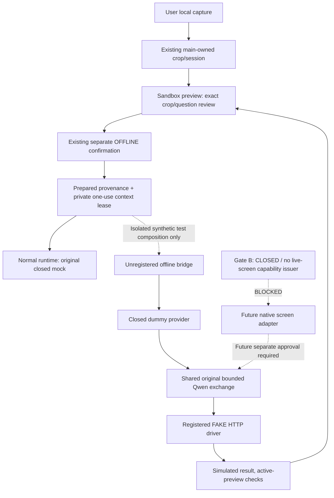

# M3.4b.4e — Development-only vision transport bridge, OFFLINE validation

Date: **2026-10-30, Europe/Madrid**.
Approved/unchanged HEAD: **4f7e254888b56c8e92404266068ec2058a7b3c3a**.
Installed DesktopCompanion **v0.1.1 unchanged**.

**OFFLINE BRIDGE VERIFIED: 958/958 tests PASS, 55 new; typecheck, explicit build,
original and bridge native synthetic proofs, and smoke PASS. Zero actual Qwen
key retrievals, provider requests, screenshot uploads or real desktop captures.
Normal production/development preview remains mock-only. Gate B stays CLOSED.**

No commit, tag, push, remote, installer, dependencies or Windows-setting changes.
No live pilot or new real inference approval. Current Windows manual status is
**UNTESTED**; M3.4b.4c's 16/16 remains historical, and M3.4b.4d remains UNTESTED.

## 1. Preflight and approved checkpoint

Initial status/index clean; log, exact HEAD and diff check passed. Read/reused
the preserved findings in reports **70, 72, 74, 77–81**, and inspected current
request/session, builder/mock, proven transport, receipt/collector, secure-context
and credential-check source, capture/preload/IPC, composition and test harnesses.
No private provider settings, Local State, encrypted vault or key was opened.
No Companion was running. Snapshot: **275 tracked files / 806 historical ignored
diagnostic artifacts**. No reset/clean/checkout/discard of existing work.

## 2. Exact files changed

Six existing files:

- **package.json:** register screenVisionBridge.test.mts only; no dependency,
  engine, version or other workflow change.
- **src/main/qwenVisionTransport.ts:** move the original execution body into a
  private shared routine; retain synthetic factory gates/permits/budget and add
  a narrow fake-only prepared-lease entry. No exported generic HTTP executor.
- **src/main/screenVisionRequest.ts:** extend existing private provenance with a
  confirmation/liveness lease; shared one-use consumption, revalidation/release;
  allow null invocation evidence when an adapter result is unobservable.
- **src/main/offlineVisionSession.ts:** mark the prepared request confirmed only
  after the existing review token was validated/consumed, binding liveness to
  current generation/job/session. Default execution stays the original mock.
- **scripts/screen-selection-check.mjs:** optional standalone **--offline-bridge**
  synthetic proof; normal proof retains its earlier behavior. Not an app flag.
- **scripts/vision-pilot-test-fixture.mjs:** add two first-party compiled dependencies
  to the isolated collector replica, preserving all guards/cleanup/assertions.

Four new files:

- **src/main/screenVisionBridge.ts:** isolated, unregistered, fake-only coordinator.
- **src/main/screenVisionBridgeFake.ts:** closed scripted HTTP adapter and opaque
  fixed dummy credential provider, with invocation/load counters.
- **src/main/screenVisionBridge.test.mts:** guarded behavior/concurrency tests.
- **docs/research/82_M3.4B4E_LIVE_TRANSPORT_BRIDGE.md:** this report.

No renderer/HTML/CSS/preload/security-policy, real credential/configuration/receipt,
text chat, robot/Follow/Home/docking, startup, lockfile or installed-app change.

## 3. Proven synthetic transport reused

Report 78's one authorized synthetic request used **createSyntheticVisionPilot**
in qwenVisionTransport.ts. Its specific HTTP 200/2.25-s/semantic success remains
historical; the consumed approval is not reused or renewed here.

The factory combined fixed synthetic input/consent with actual HTTP/response work.
Only the latter is extracted into private **runQwenVisionExchange** in the same
module. Source comparison confirmed its **90-line execution body is preserved**
apart from replacing direct active-controller assignment with its owner callback.
The old factory still supplies the same request, vault, gate, evidence, driver
and diagnostics. Existing HTTP/TLS/receipt/collector regressions pass.

The shared body retains POST options, key validation/echo rejection, canonical
request checks before/after acquisition, 20-s absolute abort races, redirects/final
URL, JSON MIME/UTF-8, 64-KiB bounded reads, normalization and usage bounds. No
HTTP rewrite, duplicated parser, fallback or retry loop was introduced.

## 4. Existing screen path preserved

Actual normal runtime remains: explicit local Capture -> main canonical PNG ->
temporary preview/question -> Review Qwen send (offline) -> separate Simulate ->
**executeScreenVisionMock** -> existing registered script -> simulated answer.
The original Review question / Run offline vision test route also remains.

The new lease marker has no new UI, IPC action, permission screen or preference.
It is marked only at the already-approved confirmation point. No main composition
imports the new bridge. Capture, editing, review alone and ordinary startup cannot
acquire a dummy credential or invoke either actual HTTP or the isolated bridge.

## 5. New bridge architecture

Trusted tests/unregistered future composition can take the confirmed prepared
request through **createOfflineScreenVisionBridge**. It admits the original
object once, resolves a private lease, checks active context and passes that
lease to **executeOfflineScreenVisionExchange**. That entry accepts only registered
fake transport and dummy handles, using the same private HTTP routine as the pilot.

The injected fetch-shaped driver is built internally from **createVisionMock**;
it cannot delegate to native fetch. The dummy handle can select only available,
missing or pending with a bounded delay; it cannot supply a key, path, vault or
load callback. Missing/foreign handles or extra configuration keys are rejected.

The native proof privately redirects the existing execution seam after genuine
session confirmation into this isolated bridge. This is test composition, not a
live activation or a change to normal app composition.

## 6. Main-process trust boundary

The normal compiled preview graph has **11 local modules**, no bridge, native
transport, real credential/settings or receipt imports. Normal main composition
imports neither the bridge nor qwenVisionTransport. The isolated bridge graph
contains the transport source but **no real vault/settings/receipt implementation**.
Type-only credential references are erased. No generic renderer HTTP/file proxy.

## 7. Two independent gates

**Gate A:** current request-shaped OFFLINE rehearsal confirmation. Main validates
and consumes the existing review token, then issues a private liveness binding to
this prepared object. It is internal enforcement of the same confirmation, not
another user prompt or a remembered permission. Copying a review/prepared object
or presenting the old synthetic permit cannot acquire it.

**Gate B:** actual privileged native screen execution. **No native-screen issuer
or native-run API exists in the bridge.** SCREEN_VISION_BRIDGE_LIVE_DISABLED,
SCREEN_VISION_LIVE_DISABLED and LIVE_VISION_DISABLED remain true. The old native
factory rejects review/run even under its old dev/argv conditions. Fake test
handles never mint a native capability or satisfy Gate B.

A later real operation needs BOTH a fresh real-purpose in-app consent and a
separately approved privileged one-request activation. Today's offline-purpose
grant cannot be promoted. No environment/localStorage/query/preference/live flag
or renderer-supplied boolean is an activation mechanism.

## 8. Prepared provenance and lease

Reuse M3.4b.4d's private WeakMap/original fingerprint. Only its preparer creates
recognized objects. The new confirmation callback is installed by the existing
trusted main session after review validation; it checks disposal, generation,
current job and original preview deadline. The callback is not accepted via IPC.

Claim consumes that prepared identity synchronously, checks signal/deadlines and
fingerprint, then creates an opaque **offline-screen-bridge-attempt** lease. Each
request resolution rechecks the original object/fingerprint and active context.
Release deletes the lease/callback; consumed state is never reset. The lease is
not a pilot permit, credential handle or reusable live permission.

## 9. Session, image and exact-question binding

Existing sender/mainFrame/origin/phase/argument/exact-key checks are unchanged.
Main resolves its current crop/digest and exact question/revision, generates the
request ID and checks fixed provider/model/endpoint policy before confirmation.
No renderer PNG/Base64/path/URL/body/model/endpoint/activation values are accepted.

The request fingerprint binds scope plus exact builder URL/body/byte count. Copies,
changed session/image/question/provider/region/model/endpoint/limits and repaired
public fingerprints fail before dummy lookup. Before POST, the shared routine
re-resolves the lease and compares the canonical URL/body again after acquisition.
There is no recapture/substitute image, automatic resize or compression.

## 10. Atomic consumption and deadlines

Existing main token removal precedes asynchronous execution. Bridge admission also
consumes its private prepared state before awaiting. Both old mock and bridge use
the same prepared identity consumption, so the same object cannot execute through
both. Failure/timeout/cancel/close never restores a permit.

Preview remains **120 s from selector opening**; review at most **30 s**, clipped
to preview expiry. Credential delay, review expiry and the final pre-POST check
cannot silently extend these. A valid dispatch may finish after review expiry if
the original preview/context still exists; that does not authorize another call.

## 11. Concurrency and replay

Existing session keeps one job until settlement; bridge independently admits one
active controller. Simultaneous confirmations, direct overlap, replay, copied
objects, reset counters and a second bridge instance cannot cause another dispatch
for that authorization. New capture/disposal invalidates the old active callback.
No queue, automatic continuation, second speculative request, retry or fallback.

Counters prove **one local fake-driver invocation**, not provider receipt exactly
once. A future crash/network timeout can leave delivery/processing/billing unknown.
Current budgets are in-memory; cross-process durable live budgeting remains future
work. No claim of account-wide exactly-once network delivery is made.

## 12. Fixed provider/request policy

Alibaba Cloud Model Studio, **Singapore**, **qwen3.7-plus**, approved existing HTTPS
workspace policy only. The bridge still exercises the fictional offline-ux host;
no real configured workspace was read or contacted. It is not consent for a real URL.

Preserved values: **PNG only, 2 MiB, 2,097,152 pixels, 2048 side, 500 UTF-16 units /
2000 UTF-8 question bytes; 20-s timeout, 64-KiB response cap, 160 completion tokens,
stream:false, enable_thinking:false**. Original local one-display/source/crop limits
remain unchanged. Requests contain only system instructions and one image/question,
no history, tools/search/functions, audio, screen coordinates or local paths.

## 13. Credential isolation

The bridge accepts only an opaque dummy, whose private implementation returns a
fixed fictional value. It cannot receive a real vault, callback, ciphertext or key.
The shared routine's vault-shaped collaborator is that dummy wrapper only; this
does not call createSafeCredentialStore, safeStorage or real provider settings.
Actual dummy load occurs only after valid one-use admission and request validation;
cancel/expiry during lookup prevents transport. Missing dummy returns missing-key.

Reports 74/77's correct identity/readiness/userData/sessionData/provider/lookup
contract remains a future prerequisite for actual secure storage. Historical
AVAILABLE_LOCALLY grants no lookup now. No alternate-profile search, credential
copy, migration, rotation, decryption or new store was performed.

## 14. Exact fake injection and shared exchange

executeOfflineScreenVisionExchange checks unpackaged main process, TLS policy,
registered handles and live lease. It supplies **createVisionBridgeHttpMock** and
**loadVisionBridgeDummy**, never native fetch or a caller-selected callback.
The driver checks exact URL/body, POST, dummy Authorization, redirect:error and
credentials:omit before its closed script. Returned Response is built in memory.

It then uses the **same private runQwenVisionExchange** as the old synthetic
factory. The old factory's permit/domain/native gate remains separate; the bridge
does not call that factory or install pilot diagnostics/evidence. Native fetch is
still selected only inside the old, default-disabled synthetic factory.

## 15. Why actual live sending remains unreachable

No native driver/credential option is accepted by the new factory; there is no
live method, real-send IPC, startup hook or normal-composition import. Existing
Send to Qwen — unavailable remains disabled without a handler. Adding compiled
modules is not a renderer capability: Node integration remains off and IPC narrow.

The standalone harness flag **--offline-bridge** only selects fake test composition
inside an owned hidden synthetic proof. It is not parsed by normal main/dev startup
and cannot open Gate B. In that mode only the transport-source import is allowed;
native fetch/sockets/Electron net, actual vault/settings/receipt imports, safeStorage
decryption and real capture remain denied. The default proof retains its native-
transport import denial. This scoped test import is not an HTTP/credential bypass.

## 16. Result/error classification

Reuse **ScreenVisionResult**, existing transport codes and frozen evidence, no
second provider error registry. Output kind is always **simulated-qwen-response**;
common offline-http-test-response is never promoted to real-provider-response.
The outer label explicitly says no external AI request was made. Usage, latency,
cost and real provider metadata are not exported by this bridge.

Classification is **code + outcome + invocation/status evidence**:

- SUCCESS: ok:true, simulated kind, one fake call and correlated synthetic 200.
- AUTHORIZATION_INVALID: authorization/duplicate/busy; no new invocation. Replayed
  prepared objects stay consumed even after cleanup; a failed admission reports
  its actual consumed state rather than inferring it from renderer data.
  Busy/closed rejection also consults private consumption state. Zero calls on
  a rejected invocation means no NEW call; it never negates an earlier attempt.
- SESSION_EXPIRED: session-expired, before-transport failure or post-attempt
  unknown; deadline never creates another permission.
- IMAGE_INVALID: shared invalid-image/eligibility rejection before bridge/key.
- CREDENTIAL_UNAVAILABLE: missing-key, dummy load observed but no transport.
- FAILED_BEFORE_TRANSPORT: specific code with definitely zero fake invocations.
- HTTP_ERROR: known status 400/401/429/500 and existing invalid/authentication/
  rate-limit/unavailable code, failed outcome. A known 500 is not missing evidence.
- TIMEOUT: timeout; if a call occurred, UNKNOWN; if still in dummy acquisition,
  definitely no transport, with zero invocation evidence. Never retries.
- RESPONSE_EMPTY / RESPONSE_PARSE_ERROR: empty/malformed/response-too-large;
  no answer or success. Synthetic 200 alone proves no model understanding.
- CANCELLED_BEFORE_DISPATCH: cancelled, consumed attempt, zero calls.
- CANCELLED_AFTER_DISPATCH: cancelled, consumed attempt, one observed call;
  future processing/billing cannot be recalled or ruled out.
- INCOMPLETE_EVIDENCE: unexpected adapter exception -> unknown with
  **fakeDispatches:null**; null means unobservable, not zero. Missing/foreign
  fake correlation after entry -> unknown, one call, no accepted HTTP status.
- UNKNOWN_OUTCOME: remains unknown without retry, fallback or false success.

The normal mock continues returning 0/1 evidence. The nullable extension is for
the isolated bridge's incomplete-result case. A future UI composition must retain
that uncertainty rather than turning null into a definitive zero POST claim.

## 17. Cancellation and expiry

Before transport, Cancel/Discard/Close/expiry revokes context or aborts the signal.
The new bridge checks again after an async admission gap and the shared routine
checks after dummy acquisition. No invocation occurs for an invalid context.
After entry, abort stops local waiting where supported, consumes permission
permanently and suppresses stale output. It cannot recall future transmitted data
or guarantee no cost. Separate timers are bounded by the original preview and
the shared 20-s whole-operation budget; there is no hidden lifetime extension.

## 18. Response and preview lifecycle

The coordinator's active callback belongs to the original session/generation/job.
Lease checks before POST and after response reject edits, replacement, disposal
or lost UI ownership. A response after review expiry is accepted only if it was
validly dispatched and the preview/context remains valid. Cancellation wins over
late success. Existing generation/publication guards also suppress closed sessions.

No bridge creates/shows a window or restores a discarded image. Result stays in
the temporary preview only; no chat history/TTS. Release drops lease/callback,
aborts controllers and clears listeners/timers. Main retains canonical crop only
for its existing bounded session; transient encoded bodies may survive until the
bounded call settles. No immediate physical RAM erasure guarantee.

## 19. Privacy and minimization

No bridge screenshot/PNG/Base64/question/answer/fingerprint or credential is
persisted in files, preferences, receipts, logs, clipboard, telemetry or history.
The shared routine uses transient in-memory diagnostics needed by its old pilot;
the bridge returns only status/count and clears its local responseText reference.
It never supplies PilotEvidence, calls the collector or creates a durable receipt.

Existing historical synthetic receipt logic/results/consumed records are preserved.
Test replicas use their existing owned TEMP fixtures and dummy evidence, not actual
screen content or permissions. No raw payload is emitted by new test diagnostics.
Only generated synthetic image content is used; no desktop/image/audio inspection.

## 20. Electron and prompt-injection security review

Sandbox, context isolation, nodeIntegration:false, webSecurity, restrictive CSP,
connect-src 'none', denied permissions/navigation/popups and trusted IPC checks
are byte-identical. No key/file/network bridge or arbitrary external URL input.
No persistent consent, background vision, additional model, retries or service.

Existing system instructions treat image text as untrusted data, never authority.
No tools/function calls, shell/file/browser automation, mouse/keyboard or OS
actions are provided. Responses are bounded plain text; the real model's prompt-
injection resistance and screenshot accuracy are not proven by fake scripts.

## 21. Offline matrix and behavior evidence

Final **958/958 PASS**, **55 new** over 903; no skipped/cancelled/todo cases.
Tests reuse generated PNG fixtures and registered fake/dummy handles. Coverage
combines the new bridge suite with retained coordinator, validator, HTTP, collector,
security, history, robot and movement regressions; not every row needs duplication.

- **A/B:** valid prepared provenance through actual main confirmation; exact
  canonical PNG/question reach shared HTTP request with fixed options.
- **C/D:** tampering/recomputed fingerprint and copied request rejected before load.
- **E/F/G:** wrong session/image/question scope rejected; edits revoke context.
- **H/I/J:** provider/region/endpoint/model overrides and extra factory fields denied.
- **K/L:** preview/review expiry, including expiry during dummy acquisition.
- **M/N/O:** Cancel, Discard and Close before confirmation prevent lookup/HTTP.
- **P/Q:** simultaneous confirmations, direct overlap, replay and second instance
  keep invocation count at most one for that authorization.
- **R:** fake success, fixed simulated label, immutable metadata, no fake usage/cost.
- **S/T/U/V:** fake 400/401/429/500 -> known failure, one call, no retry.
- **W:** pending fake times out; consumed/UNKNOWN after invocation. Pending dummy
  times out with zero transport calls instead.
- **X/Y/Z:** malformed/empty/unknown and foreign correlation do not become success.
- **AA/AB:** cancellation while in HTTP, late results after Discard/Close suppressed.
- **AC:** disposed old session cannot reuse prepared wire in another bridge.
- **AD/AE/AF/AG:** oversized bytes/pixels, invalid PNG and overlong question blocked;
  preview error/Discard retained, no silent image substitution.
- **AH/AI:** missing dummy fails before HTTP; dummy count zero before confirmation,
  exactly one on valid admitted execution, no post if cancellation/expiry intervenes.
- **AJ/AK/AL:** private-vault/capture/network guards and counters zero; native live
  factory remains blocked under old flags/reconstructed synthetic permits.
- **AM:** actual registered fake-call count at most one per consumed authorization.
- **AN:** normal coordinator's original mock succeeds with zero bridge dummy loads.
- **AO/AP:** native original/bridge proof keeps real send disabled; current owned
  action union has no usable live-send IPC. No forced UI enablement was added.
- **AQ/AR/AS:** persistence/clipboard guards and no production bridge handoff to
  history/TTS; existing history/voice tests pass. No image is spoken or saved.
- **AT/AU:** retained robot/Follow/Home/docking/Sleep/Wake/click-through checks pass.
- **AV:** retained normal startup/default-deny checks pass; runtime graph unregistered.
- **AW:** installed-release code/config unchanged and no installed app/package action;
  this is preservation/execution evidence, not a new installed-binary runtime test.

The new test process blocks global fetch/WebSocket, HTTP(S), TCP/TLS, subprocesses,
real store/settings/receipt imports, safeStorage, capture/clipboard and writes.
Its final counters assert **0 network, 0 actual private access, 0 writes, 0 real
capture attempts**. Tests inspect the exact POST body/options and actual scripted
invocation/load counts. Privileged fixture mutation in unit tests is not new IPC.

### Failures found and corrected, without weakening tests

1. First focused run: **218/219 PASS**. A received fake HTTP 500 was mislabeled
   UNKNOWN because unavailable also represents missing transport evidence. Fixed
   outcome classification to respect a known HTTP status; retained the assertion.
2. Added explicit admission-consumption evidence and race/guard tests. Focused
   validation subsequently passed **228/228**, before final additional cases.
3. First full run: **922/958 PASS, 36 FAIL**, **24,646.6642 ms**. Collector setup's
   TEMP replica omitted screenVisionRequest.js and screenVisionBridgeFake.js,
   now required by the extracted transport. Its failed setup prevented dependent
   cases. Added only those two compiled first-party paths to VISION_TEST_FILES;
   no guard, assertion, timeout, receipt semantics or worker behavior was relaxed.
4. Focused repaired collector: **36/36 PASS**, **13,470.3268 ms**.
5. First complete successful run: **958/958 PASS**, **24,777.304 ms**, excluding build/npm.
6. Final read-only consumption-evidence clarification for busy/closed rejection,
   with the existing overlap assertion strengthened: **958/958 PASS** again,
   **16,677.722 ms**, no skipped/cancelled/todo cases. Final typecheck PASS.

Failed logs are preserved. Full tests used the normal Windows host context for
existing disposable native/TEMP tests, consistent with earlier documented sandbox
EPERM restrictions. No new sandbox failure was solved by disabling security.

## 22. Native synthetic integration

Both commands passed with exit 0, separate owned TEMP profiles and hidden windows:

- **node scripts/screen-selection-check.mjs:** original main coordinator/mock,
  real sandbox preload/protocol, synthetic crop at 100/125/150%, exact review,
  separate confirmation, duplicates, cancellation and Discard.
- **node scripts/screen-selection-check.mjs --offline-bridge:** same actual
  review/confirmation path and new prepared consent, privately composed into the
  isolated shared HTTP/dummy bridge; success and pending cancellation, simulated
  label, duplicate prevention, Discard and normal closure. Success requires one
  dummy load and one fake call; cancellation may prevent either, never exceed one.

Both report **zero external, zero actual credential, zero real capture attempts**.
Each proof had 1 process before its hidden window and 4 with it, then exited and
cleaned TEMP. No real selector/desktop capture or user image was created. These
are synthetic plumbing proofs, not real provider or human Windows validation.

## 23. Typecheck/build/smoke and cleanup

- **npm run typecheck: PASS**, all configurations.
- **npm test: 958 PASS / 0 FAIL**, final run above.
- **npm run build: PASS**, explicit final verified build, Vite **601 ms** (earlier
  explicit build: 1.79 s). Existing >500-kB
  robot bundle advisory remains; no unrelated tuning.
- **npm run smoke: PASS**, lock-free new process, isolated temporary userData/
  sessionData, expected m1.6 preload, first WebGL frame, disposable dummy crypto
  check, normal exit and profile cleanup PASS.
- Intel Iris Xe / ANGLE D3D11: **20 draw calls / 14,936 triangles / DPR 1**.
- Script syntax checks PASS; Git diff check PASS with harmless LF/CRLF notices.
- Final OS snapshot: **0 checkout Electron, 0 installed Companion, 0 matching
  native/dev workers**. No force-close of user processes or persistent dev server.

Native proofs/smoke were sequential after process checks. No real credential
availability command, live preflight/pilot, screenshot capture, account/billing
query, model download or dependency installation was executed.
Both native proof modes and smoke were rerun successfully after the final
read-only consumption-evidence clarification; their final logs are retained.

## 24. Zero-network evidence and limits

**SOURCE-VERIFIED:** normal preview/main do not import the bridge/native transport;
new adapter constructs only the closed fake. Native factory remains hard-disabled.
No renderer, startup option or helper flag selects a real driver.
**AUTOMATED/NATIVE:** guarded test counters zero, known fake invocation counters
and exact request assertions; normal startup/preload/frame and closure pass.
**EXECUTION RECORD:** no provider, web research, live pilot or upload command used.

Thus zero actual external provider requests occurred in this task. This is not
machine-wide packet capture or a claim about unrelated applications' traffic.
One fake local invocation does not establish future remote receipt/delivery/cost.

## 25. Zero-real-key evidence and limits

The new adapter can only load its registered dummy, never the existing real store.
Runtime graph excludes actual vault/settings/receipt implementation; guarded
imports/native decryption fail safely, counters stay zero. Original main never
uses the new adapter; smoke/dummy native tests use disposable profiles only.
No actual configuration, ciphertext, key fingerprint/value, Local State or private
credential receipt was inspected. Reports 77/78 retain their historical meaning;
neither authorizes a new lookup or proves current credential validity.

## 26. Performance implications

No polling, persistent window/model/worker/service. Current UI, renderer assets,
robot/Follow/Home/chat code and normal mock remain unchanged. The bridge is not
registered in normal runtime, so no ongoing bridge work occurs there. Its fake
tests are finite; fake delays are synthetic, not provider latency measurements.

At execution, the bridge retains the bounded encoded request to revalidate across
dummy acquisition/HTTP, then releases its lease on settlement. It creates no
second full-display/canonical crop, image cache or persistent screenshot. Extra
closures/state remain main-only and bounded; physical release depends on GC.
No new peak RAM, idle CPU, stress/leak or maximum-size latency benchmark was run.
Reports 80/81's limits and historical Follow CPU variation remain unresolved.

## 27. Remaining security risks

Privileged main is trusted. IPC/capability checks are not cryptographic proof of
physical human input in a compromised renderer; arbitrary main compromise can
replace application code. In-memory leases are not durable cross-process billing
budgets. A future crash between native invocation and evidence can leave delivery
unknown; never retry or infer zero cost from missing evidence.

Native response provenance, actual endpoint/key/account/model entitlement,
retention/billing, natural screenshot accuracy and real model prompt-injection
resistance remain untested. No remote recall/deletion or immediate RAM erasure
guarantee. The bridge's null invocation evidence must stay unknown at future UI
and ledger boundaries. Existing synthetic receipt payloads must not be repurposed
to persist private screen hashes/questions/answers.

## 28. Manual Windows status and focused future checks

**M3.4b.4e: UNTESTED. M3.4b.4d A–P: UNTESTED. M3.4b.4c A–P: historical 16/16 PASS.**
No new user observations or satisfaction are inferred from automation. Layout/
normal observable behavior remain unchanged, so a full repeated A–P is not
required solely for this internal change. Keep the focused plan available:

- **UNTESTED:** existing local selection and cropped preview over invented content.
- **UNTESTED:** Qwen-send simulation still works; original offline flow available.
- **UNTESTED:** real send unavailable with ordinary input.
- **UNTESTED:** no extra consent screen or unexpected automatic operation.
- **UNTESTED:** layout/image/question unchanged and comfortable.
- **UNTESTED:** result unmistakably simulated; no voice/history handoff.
- **UNTESTED:** Cancel/Discard and late-result cleanup.
- **UNTESTED:** Follow/Home/docking/chat/click-through unaffected.
- **UNTESTED:** bounded CPU/RAM observations and normal laptop responsiveness.
- **UNTESTED:** modes/Home OFF, temporary UI closed, normal Tray Quit.

If a later composition changes observable behavior, validate it on Windows before
checkpoint/activation. User must initiate and confirm any harmless real local crop;
do not perform one automatically to satisfy this plan.

## 29. Exact remaining work before actual HTTPS activation

Review this diff/security boundary and request an approved local checkpoint.
The bridge is isolated and offline-verified; no default runtime connection is
authorized. A future implementation must:

1. Introduce a separate privileged **native-screen** capability issuer, not an
   environment/preference/renderer toggle or old synthetic permit. Bind a fresh
   externally approved one-request pilot scope plus actual in-app remote consent.
2. Resolve the actual existing trusted Singapore configuration, without logging
   private hostnames; review/bind that exact URL/body. Fictional offline-ux reviews
   and offline-purpose leases must never authorize that URL or native execution.
3. Reuse the private bounded exchange through a narrow native adapter protected
   by BOTH gates. Actual secure lookup only after context, busy checks and atomic
   attempt admission; correct identity/readiness/userData/sessionData/provider,
   no alternate vault, no separate availability read or credential export.
4. Preserve active session/crop/question binding before/after asynchronous work,
   one in-flight owner, no queued automatic resumption and no retry/fallback.
   Extend current text/voice busy coordination only in that reviewed composition.
5. Add durable consumed/attempt/UNKNOWN accounting for the supervised pilot that
   stores no screenshot/image hash/question/answer/key. Handle process interruption
   without interpreting absent evidence as no delivery, and never restore a grant.
6. Issue a real-response provenance label only from verified native execution;
   keep output temporary/plain with no history/TTS. Test all new wiring FIRST
   with fake transport/dummy credentials, including configuration/credential races,
   stalled promises, incomplete evidence and closed-preview publication.

Do not enable the normal production/development UI or call a provider now.

## 30. Required new authorization for a future screen pilot

Only after those changes/reviews and offline checks, obtain **NEW explicit human
permission** for one exact harmless selected crop and exact reviewed question,
Alibaba Cloud Model Studio / Singapore / qwen3.7-plus, external image transmission,
applicable retention and possible billing, **maximum one request, no retries or
fallback**, no unrelated content. Respect both that external pilot approval and
fresh in-app confirmation. No past availability/synthetic/offline approval applies.
No live pilot, new actual lookup or real screenshot upload starts in this task.

## 31. Preservation and rollback

Task-start snapshot comparison: six existing files changed as listed; other
**269 of 275 tracked files**, including all reports **70–81** (and earlier reports),
real store/context/receipt/collector behavior, renderer/preload/CSP, robot/chat/
movement/startup, lockfile and dependencies remain byte-identical. All **806 prior
ignored artifacts** retain their original name/size/mtime; historical consumed
claims are preserved and never reused. New QA logs/baseline/build output remain
ignored. No personal images, audio, real credentials or reusable live grants.

If separately requested later, restore only the six changed files from **4f7e254**
and review/remove the three new bridge code/test files; preserve this report,
all prior evidence and consumed markers. Do not reset/clean unrelated work or
touch installed/userData/sessionData/credentials/settings. Rollback never renews
a spent approval. No dependency/global/installed-app rollback is needed.

**STOP: offline bridge implementation/verification complete; actual sending
BLOCKED. Installed v0.1.1 untouched. No commit, tag, push, remote, installer,
Windows startup change or supervised real screen-vision pilot was executed.**
