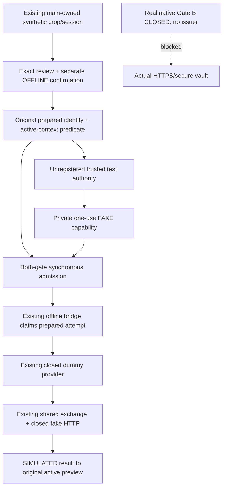

# M3.4b.4f — Privileged vision gate, strictly OFFLINE rehearsal

Date: **2026-10-30, Europe/Madrid**.
Approved parent/unchanged HEAD: **c63b63855482dcdedebfdd0d12852760472484ac**.
Installed DesktopCompanion **v0.1.1 unchanged**.

**OFFLINE implementation verified: 1,014/1,014 tests PASS, 56 new; typecheck,
explicit build, three hidden native synthetic checks and clean smoke PASS.
Actual native Gate B remains CLOSED. No real capability, credential lookup,
provider request, desktop capture or screenshot upload. No commit/tag/push.**

Current M3.4b.4f Windows manual status: **UNTESTED**. M3.4b.4e remains UNTESTED.
M3.4b.4c's **16/16 PASS** is historical and does not validate this new gate.

## 1. Approved checkpoint and preflight

Verified clean status/index, four-commit log, diff check and exact parent SHA.
Read/reused reports **77–82**, including consumed credential/synthetic-pilot
authorizations, approved UI, screen-request provenance and isolated fake bridge.
Inspected actual main composition, owned IPC/preload, renderer, request/session,
builder, bridge, transport, credential-context contract and test/native harness.
No actual settings, encrypted record, Local State, personal image or key read.

Baseline: **279 tracked files; 826 ignored diagnostic artifacts**. Preserve their
contents and consumed claims. Initial sandbox CIM access was unavailable; a
read-only host-context check subsequently confirmed **0 Companion/checkout
processes**. No process was closed or killed to obtain a free single-instance lock.

## 2. Exact files changed

Three existing files modified:

- **package.json:** register screenVisionGate.test.mts; no dependency/engine/version change.
- **src/main/screenVisionRequest.ts:** expose a read-only confirmed/unconsumed
  Gate A predicate; share its existing fingerprint/liveness/deadline validation
  with lease resolution. No issuance, consumption or HTTP behavior change there.
- **scripts/screen-selection-check.mjs:** add standalone --offline-gate synthetic
  composition, preserving original and --offline-bridge modes and their guards.

Three new files:

- **src/main/screenVisionGate.ts:** isolated fake-capability issuance/admission policy.
- **src/main/screenVisionGate.test.mts:** 56 deterministic guarded behavior tests.
- **docs/research/83_M3.4B4F_PRIVILEGED_VISION_GATE.md:** this report.

No changes to offlineVisionSession.ts, screenVisionBridge.ts, its dummy adapter,
qwenVisionTransport.ts, builder, collector/receipts/replica fixture, credential
implementation/context, renderer/preload/IPC, CSS/layout, chat, robot, Follow,
Home/docking, startup, lockfile or installed release.

## 3. Existing transport architecture reused

The existing normal session still calls **executeScreenVisionMock**. It does not
instantiate the new authority or isolated bridge. The original offline-test path
also remains available. There is no additional session manager or HTTP client.

Synthetic trusted composition uses the new gate policy around the existing
**createOfflineScreenVisionBridge**, which already handles request claims,
timeouts, cancellation, classification and preview liveness. That bridge's closed
dummy/fake adapter exercises the existing private bounded Qwen exchange. Actual
HTTPS selection in the old synthetic factory remains hard-disabled and untouched.

## 4. Gate A and Gate B roles

**Future Gate A:** fresh remote-purpose consent for one exact main-owned crop,
question, session, endpoint/provider/model and bounded attempt.
**Future Gate B:** independent privileged native execution capability, issued only
by trusted main composition after separately authorized supervised activation.
Neither can replace the other or establish physical-human-click attestation.

**This milestone has neither real remote consent nor a native Gate B issuer.**
The existing confirmed OFFLINE rehearsal stands in for Gate A in synthetic tests.
A second, independently issued **fake-only** capability rehearses Gate B. An
offline consent cannot be upgraded to live consent. Historical pilot permits and
credential availability outcomes satisfy neither future gate.

## 5. Capability design

The frozen object has a descriptive fake purpose and a toJSON method that throws.
Its public fields do not grant authority. Runtime authority resides in a private
per-issuer WeakMap and in the exact pending request identity. A copied, fabricated,
foreign-authority or JSON-reconstructed object is unrecognized. Structured cloning
also fails because the capability contains a function. No random/string token is
accepted as Gate B and no API key is encoded in the object.

The authority is not a generic permission service. It authorizes only one invocation
of the existing closed fake bridge for its exact prepared request.

## 6. Trusted issuance boundary

**createScreenVisionGateOfflineTest** requires the exact options keys scope,
transport and dummy, with the literal privileged-screen-vision-offline-test scope
and runtime-registered closed handles. Packaged, non-main and insecure-TLS contexts
are rejected. No injected fetch, vault/load callback, live flag, endpoint/model,
authorization boolean or arbitrary capability collaborator is accepted.

This is a main-only synthetic composition boundary, not an IPC handler. Main code
is trusted: the scope literal is an explicit mode label, not a secret or evidence
that arbitrary main code is safe. Safety comes from the absence of any native
driver/real-vault option, runtime identity checks and unregistered composition.

## 7. Test-only issuance scope and ownership

Issuance needs an original prepared object with still-active confirmed offline
Gate A, valid fingerprint, unconsumed attempt and unexpired review/preview. One
pending grant or active run owns each authority; conflicting issuance is rejected.
A module-private WeakSet prevents a second authority from issuing another fake
capability for the same original prepared object, including after failure/expiry.

There is no factory call in ordinary main startup, preview, renderer or preload.
Only tests and the standalone synthetic harness compose this new policy. Its CLI
flag --offline-gate is parsed by that harness only; it is not an application switch.

## 8. Why fake authority cannot invoke real HTTPS

The policy constructs only createOfflineScreenVisionBridge with registered fake
transport and dummy handles. It cannot pass a native driver, real vault or arbitrary
callback. That existing adapter internally constructs its own closed fetch-shaped
script. No native activation method was added to the HTTP module.

The old synthetic native factory is unchanged and denies review/run even with its
old development/argv conditions and this new capability. Real Gate B has no issuer;
all existing live-disabled constants and SCREEN_VISION_NATIVE_GATE_CLOSED are true.
Neither fake result kinds nor leases are accepted as native-pilot authorizations.

## 9. Runtime identity and copying

The issuer's private WeakMap recognizes the capability object, and its pending
entry must refer to that same capability and **wire === originalWire**. The
read-only Gate A predicate separately revalidates private prepared provenance,
fingerprint, active callback and time bounds. TypeScript branding is not trusted.

Tests attempt spread copies, JSON reconstruction, fabrication, a boolean grant,
old pilot-shaped objects, request copying and cross-authority use. None acquires
dummy credentials or invokes fake HTTP. JSON/structured cloning of the original
capability is rejected. No capability crosses preload or appears in logs/files.

## 10. Exact session binding

The existing main session's confirmed callback binds disposal, generation, current
job and original preview deadline. Gate issuance and admission check that context.
The existing bridge rechecks it before/after dummy acquisition and before publishing
a response. Disposal/replacement invalidates the old request even if a fake
capability still exists. A new session cannot acquire the old issuer's authority.

## 11. Image/question provenance

The request remains the existing canonical main-owned PNG plus exact reviewed
question/revision, session/image/request IDs, fixed provider/region/model, endpoint
policy, limits and deadlines. Existing private original fingerprints detect altered
scope/body/URL and repaired public checksums. No recapture or replacement crop.

Renderer actions still cannot submit PNG/Base64, paths, URLs, model/endpoint,
privileged handles or arbitrary JSON. The new gate introduces no renderer argument.
Tests use generated PNG fixtures; no real screen or user image is acquired.

## 12. Atomic single-use admission

After checking Gate B identity, expiry and exact request, admission consumes B
synchronously, clears its pending reference/timer and rechecks Gate A. It then calls
the existing bridge, whose prepared-attempt claim consumes A synchronously before
its first await. There is no asynchronous gap between these consumption operations.

If A has been revoked, B stays spent but no bridge/dummy/fake transport is reached.
For a valid admission, both gates remain consumed after every terminal outcome.
No failure, collector error, cancellation, malformed answer or UNKNOWN restores them.
The original UI token was already synchronously consumed by the existing session.

## 13. Concurrency and replay

Deterministic overlapping run calls with one capability produce at most one dummy
lookup and one fake invocation. A second call sees a spent capability. Repeated
confirmation remains guarded by the existing job/session owner. A second issuer
cannot reissue for the same prepared object or accept a foreign capability.

This proves local in-process at-most-once admission, not remote receipt exactly
once or account-wide/crash-safe budgeting. No queue, resubmission, retry or fallback.
Zero invocation evidence on a rejected call means **no NEW call**, not that an
earlier attempt never happened. Existing unknown evidence remains nullable.

## 14. Expiration and revocation

Preview: unchanged **120 s from selector opening**. Consent: unchanged **at most
30 s**, clipped to preview expiry. An **unused** fake capability is valid for at
most **5 s**, further clipped to both deadlines. One bounded timer releases its
pending request reference; wall-clock checks also reject delayed timers.

The 5-s deadline is an admission window, not a new visible consent timer or a
replacement for the established 20-s execution budget. Once consumed for one
admitted attempt it cannot be renewed; existing review checks before fake dispatch
and preview checks before output remain in force throughout the existing bridge.
No 120/30-s policy was extended. Cancel/dispose permanently revokes unused grants.
An expired old capability cannot clear a newer different request's pending grant.

## 15. Future development credential context — design only

Report 77's AVAILABLE_LOCALLY and report 78's successful synthetic lookup are
historical consumed permissions, not permission to retrieve a key here.

A future separately authorized native adapter must wait for Electron readiness,
use the ordinary development **desktop-companion** identity and the explicitly
selected development userData/sessionData namespace, and enforce the existing
requirePilotCredentialContext contract before constructing/loading the existing
vault. Use only the fixed companion/qwen-key.bin and trusted provider configuration;
no alternate-profile search, copy, migration, rotation or installed-app fallback.
Admission and fresh consent precede the single secure lookup. No separate key
availability probe, key export or secret metadata logging. That adapter is absent.

## 16. Fixed provider, model and budgets

Alibaba Cloud Model Studio / **Singapore** / **qwen3.7-plus**; existing accepted
HTTPS workspace endpoint schema. The rehearsal uses the existing fictional
offline-ux host and neither reads nor contacts a configured account endpoint.
A future actual endpoint must be resolved by trusted main and bound to fresh consent.

Unchanged: one supported display; source **8,388,608 pixels**; local crop
**4,194,304 pixels**; existing local acquisition bounds; vision **PNG only,
2 MiB, 2,097,152 pixels, 2048 per side**; question **500 UTF-16 units / 2000 UTF-8
bytes**; **20 s, 64 KiB, 160 completion tokens**, stream:false,
enable_thinking:false. No tools, history, extra model, resize, fallback or retry.

## 17. Outcomes and UNKNOWN handling

Reuse ScreenVisionResult and existing error codes. Gate admission failures are
authorization/duplicate/busy/expired with closed-fake evidence and no new invocation.
After admission the existing bridge retains its classifications for session/image
errors, missing dummy, failed-before-transport, HTTP errors, timeout, malformed/empty
response, cancellation, incomplete evidence and unknown outcome.

Known fake HTTP 500 is failed/unavailable with status 500, never success. Missing
transport evidence after invocation remains UNKNOWN. Unexpected unobservable
adapter results retain fakeDispatches:null through the existing bridge. No error
authorizes another attempt. Fake success always says SIMULATED and never claims
image understanding, actual provider provenance, remote latency or billed cost.

## 18. Cancellation

An already-aborted caller signal or cancellation at the existing admission
microtask prevents dummy acquisition/dispatch while leaving grants spent. Cancellation
during lookup/HTTP uses the existing abortable finite exchange and liveness checks.
Discard/Close/Edit suppress later output via original generation/job ownership.

The authority clears pending references/timers and forwards cancel/dispose to its
owned bridge. The test/native owner disposes the authority when finished. Aborting
a future real request cannot recall transmission or guarantee no processing/charge;
this milestone tests only local fake invocations.

## 19. Response lifecycle

Only the existing bridge's verified closed-fake result is returned, bound to the
original request and active callback. The original session's generation/expiry
checks remain final publication guards. A response cannot reopen a window, restore
an old image or change destination. Result stays in the temporary preview only.
No chat history, automatic send, TTS or character reaction is introduced.

## 20. Electron and IPC security

Sandbox/context isolation, nodeIntegration:false, webSecurity, CSP/connect-src none,
permission/navigation/popup denial, trusted sender/mainFrame/origin/session/phase
checks and narrow preload are unchanged. No new IPC, native issuer, generic HTTP,
file bridge, persisted preference or renderer/environment/query activation switch.

Compiled preview graph: **9 local modules plus node:crypto/node:zlib**, with no
gate, bridge, native transport, real store/settings or receipt implementation.
Normal main imports none of the isolated gate/bridge/native transport. The isolated
gate graph contains the shared transport source but no real credential/settings/
receipt implementation; type-only imports erase. This inspection does not execute
those modules or retrieve any secret.

## 21. Privacy and bounded references

No image/question/answer, image fingerprint, credential or capability is persisted
in files, preferences, history, receipts, logs, clipboard or telemetry by the gate.
Private capability metadata contains only consumed/expired booleans. The pending
entry retains an existing request reference until admission, revoke/dispose or the
bounded unused-grant deadline. The WeakSet does not strongly retain requests.

Existing main crop/session lifetime and bridge cleanup remain. No extra image
copy/cache or full-display acquisition; transient encoding already belongs to the
existing request builder. GC/reference release is not guaranteed immediate physical
RAM, pagefile or allocator erasure. Synthetic QA logs remain ignored.

## 22. Prompt-injection boundary

Existing system instructions treat visible text as untrusted data. A screenshot
cannot mint a capability, supply authority, invoke tools, access credentials/files,
run a shell, browse or control Windows. Output remains bounded plain text. Fake
tests do not establish the real model's accuracy or prompt-injection resistance.

## 23. Offline matrix and evidence

The **56 new tests**, with retained regressions, cover the requested matrix:

- **A/B/C:** A without B, revoked A with issued B, both valid fake gates; counters
  prove zero lookup/calls before both admissions and one at success.
- **D/E/F/G/H/I/J/R:** wrong/copied request; session/image/question/provider/region/
  endpoint/model changes; body/URL/checksum changes. Zero dummy/fake calls.
- **K/L/M:** preview/consent/capability deadlines, shorter unused fake admission
  window, expired grant cannot dispatch/reissue or revoke a newer grant.
- **N/O/P/Q/U:** replay, copying, JSON reconstruction, fabrication, boolean and old
  pilot-shaped capability, cross-issuer rejection and permanently consumed attempts.
- **S/T:** deterministic overlapping dispatch calls; double confirmation through
  retained coordinator/native regressions; one invocation maximum, no second lookup.
- **V/W/X/Y/Z:** revoke before admission, cancellation in microtask and after fake
  entry, disposal/window closure/edit, no late result or recreated preview.
- **AA/AB/AC/AD/AE/AF/AG/AH/AI/AJ:** fake 200/400/401/429/500, 20-s timeout,
  malformed/empty/unknown and missing dummy. Known failures and UNKNOWN stay distinct.
- **AK/AL/AM/AN:** actual dummy-load/fake-call counters; network/process/private-store/
  capture/persistence guards; native factory refuses the fake capability and old flags.
- **AO/AP/AQ/AR/AS/AT/AU/AV:** one-use/nonserializable authority, no IPC grant,
  renderer-like action/override attempts, no native activation, old-session rejection,
  active preview binding and explicitly simulated output.
- **AW/AX/AY/AZ/BA/BB:** ordinary mock still works without new issuance; persistence
  guards; retained chat/voice/robot/Follow/Home/docking/security/startup regressions;
  unpackaged main/TLS checks; source/installed-release preservation.

Unit tests drive real session/bridge behavior with generated PNGs, fake clocks and
registered handles, not only string/name assertions. Their privileged execution-seam
substitution exists only in the test process, never in normal application wiring.
Installed-release preservation is not a new installed-binary runtime test.

## 24. Automated results

- Initial **npm run typecheck: PASS**, all configurations.
- Focused gate/bridge/request/session/transport: **350/350 PASS**, **9,426.3224 ms**.
- **npm test: 1,014/1,014 PASS**, **56 new** over 958; **26,290.0505 ms** test
  duration, excluding npm/build overhead; 0 failed/cancelled/skipped/todo.
- No failed test, deleted assertion or weakened old test in this milestone.
- Existing receipt/collector regressions passed without changing their replica,
  safety guards, result classifications or invocation budgets.

## 25. Native synthetic results

All three standalone checks executed sequentially, exit **0**, with hidden real
Electron renderer, sandbox preload/app protocol, generated NativeImage crop,
owned disposable TEMP and real desktop acquisition forbidden:

- **node scripts/screen-selection-check.mjs:** PASS, original closed mock.
- **node scripts/screen-selection-check.mjs --offline-bridge:** PASS, prior bridge.
- **node scripts/screen-selection-check.mjs --offline-gate:** PASS, exact review /
  separate confirmation, Gate A valid but B absent rejected with zero loads/calls,
  independent fake B issuance, valid admission, duplicate rejected, success labeled
  simulated, pending cancellation, Discard and normal shutdown.

Each proof observed 1 process before its window and 4 with the hidden window, then
exited and removed its owned profile. All reported **zero external/actual credential/
real capture attempts**. These are synthetic integration checks, not new human
Windows validation or real-provider proof.

The gate proof emitted **GPU state invalid after WaitForGetOffsetInRange** after
its PASS output; exit remained 0 and no proof assertion failed. Cause is unconfirmed;
do not claim error-free GPU diagnostics. Original/bridge proofs emitted no such
message in these logs; the subsequent normal robot WebGL smoke passed.

## 26. Build, smoke and process cleanup

- **npm run build: PASS**, explicitly after full tests; Vite **1.72 s**.
  Existing renderer chunk >500-kB advisory remains, with no unrelated optimization.
- **npm run smoke: PASS**, preceded by successful read-only lock-free process check:
  new process, expected m1.6 preload, first WebGL frame, disposable dummy credential
  self-check, normal exit and isolated-profile cleanup.
- Intel Iris Xe / ANGLE D3D11: **20 draw calls / 14,936 triangles / DPR 1**.
- Harness syntax and git diff --check: PASS; harmless LF/CRLF notices.
- Post-run native process snapshot: **0 installed Companion/checkout Electron or
  matching checkout workers; 0 remaining companion-selection-proof TEMP profiles**.
  No user application was force-closed.

Native/TEMP tests used the host context consistent with prior documented Windows
sandbox restrictions. No security guard or Windows/global setting was disabled.
No installer, dependency install, dev server or background worker was added.

## 27. Network/credential isolation evidence and limits

New unit guard counts: **0 real network/process attempts, 0 actual private access,
0 persistence, 0 desktop capture**. Guards cover global fetch/WebSocket, HTTP(S)/
HTTP2/TCP/TLS, child processes, private modules, safeStorage, capture, clipboard and
writes. The native harness retains its network/decryption/module/capture guards and
URL restriction. Current source has no reachable native screen adapter/issuer.

Execution used no real-key diagnostic, live preflight, provider/pilot/account/billing
command, microphone or desktop capture. **Zero new real provider calls and real-key
retrievals.** This is code-boundary/execution evidence, not machine-wide packet
capture or a claim about unrelated applications' traffic. Mock HTTP is not a POST
to Alibaba. The smoke's disposable dummy crypto check is not real-vault access.

## 28. UI and manual Windows status

Renderer/preload/layout and session controller are byte-identical to the approved
parent. Existing controls remain Review Qwen send (offline), Simulate Qwen send
(offline), and disabled Send to Qwen — unavailable. The new authority is absent
from ordinary composition; no extra consent screen, permanent window or panel.

**M3.4b.4f manual: UNTESTED; M3.4b.4e: UNTESTED; M3.4b.4c: historical 16/16 PASS.**
Automation does not establish real Windows visual/input reliability. If a later
composition changes observable behavior, perform user-led harmless local selection,
exact review, separate confirmation, cancel/discard/expiry, real-send default-deny,
simulated/native labeling, Follow/Home/chat/click-through and normal Tray Quit checks.
Do not automatically capture an image to satisfy that future checklist.

## 29. Performance considerations

No normal-runtime work, polling, resident model, persistent service or additional
image copy. Isolated issuance/admission adds bounded fingerprint validation, weak
identity lookups and at most one unused-grant timer per authority. In-flight work
reuses the existing finite bridge. No ongoing grant exists after dispose/restart.

No peak memory, long-run leak/idle CPU, large-image validation timing or real
provider latency measured. Do not infer performance stability from test durations,
smoke render counts or the historical one-request 2.25-s synthetic pilot. Prior
Follow settled CPU variation remains unresolved and was not retuned.

## 30. Remaining risks

Arbitrary trusted-main compromise can replace code; capabilities are not physical
human-click proof. A compromised owned renderer still requires its existing
validated purpose/session flow, but no cryptographic user-presence claim is made.
This is fake admission policy only, not a production-ready live authorization.

Weak identities and budgets are process-local. Cross-process/restart-safe consumed
accounting, authenticated native result provenance, exact actual workspace/account,
credential validity, retention/billing, real screenshot quality and model injection
resistance are unverified. Future missing evidence must never authorize a retry.
No guaranteed immediate physical erasure, remote recall or zero-charge cancellation.

## 31. Remaining work before actual privileged activation

Recommend **M3.4b.4g — final live screen-vision preflight and supervised activation
plan**, not activation in this milestone:

1. Review this gate/bridge and current main busy/credential-context ownership.
2. Specify a separate real remote-consent purpose and trusted native-capability
   issuer, inaccessible to renderer/env/query/preferences; never upgrade fake grants.
3. Resolve/validate trusted actual Singapore endpoint without logging private data,
   binding exact URL/model/limits and canonical image/question to fresh review.
4. Plan correct development identity/readiness/userData/sessionData and one secure
   lookup after atomic admission, using existing storage without profile fallback.
5. Design minimal durable consumed/attempt/UNKNOWN accounting without image bytes,
   image hash, question, answer, key or reusable permission. Deny reuse after crashes.
6. Connect a narrow native adapter to the existing bounded exchange only after
   separate approval; maintain one owner/invocation, no queues/retries/fallbacks.
7. Test proposed wiring first with closed fake/dummy collaborators, including
   credential/configuration races, cancellation, stalled promises and closed preview.
8. Require source/security review and proportionate Windows checks for any visible
   change; ensure real responses can target only their original active preview.

Do not open Gate B, retrieve a real key or run that pilot as part of this task.

## 32. Consent required before first real screen upload

Obtain **NEW explicit human approval** for one exact harmless selected crop and
exact question, Alibaba Cloud Model Studio / Singapore / qwen3.7-plus, external
transmission, applicable retention and possible charges, **maximum one request,
no retry/fallback**, plus fresh in-app real-purpose review/confirmation. Validate
content before dispatch. All historical synthetic/local-availability approvals
remain consumed. No current offline action supplies that permission.

## 33. Preservation, rollback and stop

Only the three existing files listed above change; other **276 of 279 tracked
files**, including historical reports 77–82, actual HTTP/credential/receipt code,
renderer/preload, robot/chat/movement/startup and lockfile remain byte-identical.
The **826 prior ignored diagnostic artifacts** are retained; an aggregate comparison
confirmed original names/sizes/mtimes. Nine new ignored QA logs bring the current
diagnostic inventory to **835**; consumed claims are untouched. No key/image payload or
capability is added to retained logs. Installed v0.1.1 was not launched or modified.

If separately requested, restore only those three modified files from **c63b638**
and review/remove the two new gate source/test files. Preserve this report, prior
evidence and consumed markers. No reset/clean, unrelated work removal, credential/
profile/global change or installed-app rollback. Rollback never renews consent.

**STOP: offline gate implementation/verification complete. Real Gate B CLOSED.
Zero real API calls/key reads/captures/uploads. No commit, tag, push, new remote,
installer or live screen-vision activation.**
