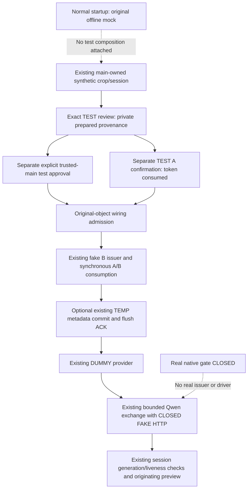

# M3.4b.4i — Privileged screen-vision wiring, final OFFLINE integration

Date: **2026-10-31, Europe/Madrid**.
Approved/unchanged parent: **5f7c4fbf361322e7490230334a1ba1f00d2769f6**.
Installed DesktopCompanion **v0.1.1 untouched**.

**READY_FOR_SUPERVISED_ACTIVATION_DESIGN.** Explicit main-only fake composition
works through the existing session, gate, bridge and shared HTTP implementation.
**1,085/1,085 tests PASS, 37 new; typecheck/build/smoke PASS; five final native
synthetic modes PASS. Real Gate B CLOSED. Actual screen inference remains NO-GO.**

No real capability, actual credential lookup, Alibaba request, desktop capture,
screenshot upload, installer, dependency, commit, tag, push or remote change.
Current Windows manual validation **UNTESTED**; historical M3.4b.4c **16/16 PASS**
remains separate. A native harness timeout occurred and is retained below.

## 1. Preflight and preserved report 85

Initial status contained ONLY the existing untracked report 85. HEAD, four-commit
log, empty index and diff check matched the approved checkpoint. Read/reused
reports 77, 78 and 80–85 and inspected actual session/request/gate/bridge/ledger,
builder/shared HTTP, credential-context/store source, startup/shutdown, selector,
preload/renderer, collector and native/behavioral tests. No private runtime
configuration, vault, Local State, personal audio/image or API key was opened.

Report 85 is preserved exactly, SHA-256:
**e114abfa0423953a5b20ebabfcce6c9decab440fd28f7d854800401d894b1149**.
Its no-restoration/no-automatic-replay conclusion remains in force. Physical
power-loss durability remains unproven and is not newly claimed or required as
a substitute for volatile single-use authority. Existing ledger safeguards stay.

Baseline: **286 tracked files, 852 ignored diagnostic artifacts**. No user
application was closed to run tests. Fresh native preflight found zero Companion
instances and approximately **713 MiB available**; this is not a memory benchmark.

## 2. Minimal gap analysis

**ALREADY IMPLEMENTED:** canonical cropped PNG, existing coordinator/review/token
consumption, private prepared provenance, fake gate, optional attempt ledger,
dummy provider, shared bounded exchange, outcome classification and preview guards.
Older gate/bridge tests connected those pieces with test-time execution-seam
substitution. The normal UI correctly retained its original closed mock.

**IMPLEMENTED NOW:** explicit closed main-only composition that can be attached
once to the existing coordinator; dedicated TEST remote-consent provenance/actions;
independent trusted-main approval for the same reviewed object; existing fake B
issuance/admission and shared HTTP execution without replacing the session's
execution function. Behavioral restart/lost-record/error cases exercise it.

**DISABLED:** native issuer/driver selection, actual vault/configuration lookup,
real-purpose transmission permission, live-send UI/IPC, startup activation.

**FUTURE LIVE-ONLY:** actual endpoint/context resolution, distinct genuine remote
consent and privileged one-operation activation, narrow native adapter and real
response provenance. No new database, queue, monitor or recovery service.

## 3. Exact milestone files — nine

Five existing files modified:

- **src/main/offlineVisionSession.ts:** optional branded test composition, dedicated
  test review/confirmation, original prepared-object retention only for that mode,
  revocation/disposal integration, conservative unknown/cancellation counters.
- **src/main/screenVisionRequest.ts:** private preparer domain and read-only
  integrity predicate; reuse the same validator/builder/provenance implementation.
- **src/main/screenVisionGate.ts:** a second closed test scope/domain, distinct fake
  capability purpose, using the existing identity/consumption/timer/bridge policy.
- **scripts/screen-selection-check.mjs:** --offline-wiring synthetic composition
  and an owned-operation settlement barrier for the existing bridge proof modes.
- **package.json:** register the one new test file; no dependency/version change.

Four files added:

- **src/main/screenVisionWiring.ts:** closed trusted-main composition/attachment.
- **src/main/screenVisionWiring.test.mts:** **37 new tests** in the final suite.
- **scripts/vision-wiring-offline-worker.mjs:** fixed guarded synthetic child probe.
- **docs/research/86_M3.4B4I_PRIVILEGED_VISION_WIRING.md:** this report.

Report 85 remains a pre-existing, unchanged untracked file, not a milestone edit.
No changes to normal main composition, public shared action types, IPC/preload,
renderer/CSS/layout, crop owner, security/CSP/protocol, HTTPS/parser, credential
store/context, ledger implementation, collector/receipts, chat, robot, movement,
Follow/Home/docking, startup, lockfile or installed release.

## 4. Explicit composition, not another vision stack

`createPrivilegedVisionWiringOfflineTest` accepts only the exact closed scope,
registered fake transport, registered dummy and optionally an existing registered
offline attempt handle. Extra URL, fetch, vault, callback, live flag or endpoint
options are rejected. It composes `createScreenVisionGateOfflineTest`, which
already owns the bridge and the shared exchange. There is no new HTTP client.

A private WeakMap recognizes the original wiring handle and permits attachment
to one session only. `authorizeTestOperation()` is available only to its trusted
main owner, after review. It records independent test approval bound to that
exact pending original object. It does not itself load credentials or dispatch.

The constructor's optional `testWiring` is not populated by normal startup or IPC.
A literal, conditional require loads the composition only when that explicit
constructor option exists, preserving the ordinary preview's runtime isolation.
Its type-only import erases. This limited lazy load avoids bringing the gate/HTTP/
filesystem dependency graph into the default preview; it is not a configurable
module path, renderer mode or application launch flag.

## 5. Gate A: dedicated TEST remote-consent simulation

The isolated session accepts `review-remote-consent-test` and
`confirm-remote-consent-test` only with a valid attached handle. They use the
existing review/revision/image digest/token/deadline machinery. A private
prepared-state domain, **test-only-remote-consent**, distinguishes those original
objects from **offline-rehearsal**. A caller-editable field cannot add provenance.

Existing review metadata deliberately retains the offline public policy/purpose;
it is neither a real remote grant nor a new public UI/IPC contract. The test notice
explicitly states TEST-ONLY/no real transmission. A live purpose is still absent.

Old rehearsal confirmation cannot consume a dedicated test review, and ordinary
sessions ignore the new test actions. Old offline/synthetic consent cannot arm
the new composition or authorize real transmission. Editing/cancel/expiry revoke
its exact pending review and main test approval together.

## 6. Gate B: independent test approval and existing fake issuer

Main explicitly calls `authorizeTestOperation()` for the pending reviewed object.
Calling before review, after revocation/expiry/disposal, or a duplicate call fails.
Approval alone performs no lookup or transport, and review/confirmation alone
without this approval produces no dummy acquisition or fake invocation.

After separate valid test A confirmation, the composition synchronously consumes
that main approval/pending reference. Only then does the EXISTING gate issue
**fake-screen-vision-wiring-gate** for that exact original confirmed wire, and its
existing run consumes fake B and claims A without an intervening await.

The new gate scope rejects original legacy-domain prepared objects; the old gate
scope rejects dedicated test-domain objects. Per-issuer private capability identity,
original request equality and existing WeakSet single issuance remain. Neither
fake purpose can satisfy the closed native gate or old synthetic live factory.
This is thin composition of existing authority, not a generic authorization service.

## 7. Main-only integration flow

Edges here describe synthetic execution. The actual selected-screen acquisition
owner and its explicit local capture confirmation are unchanged and were not run.

## 8. Identity, single-use admission and budgets

The main coordinator retains its original prepared test wire from review rather
than rebuilding it at confirmation; it still checks current image digest, exact
question/revision/scenario, session/image IDs and expiry. The port only accepts
that same object. Private original fingerprints and active leases reject body,
question, URL or checksum changes before dummy acquisition. Copies fail provenance.

UI review token, main test intent, fake B and prepared A are consumed before
asynchronous execution. Duplicates and simultaneous confirmation cannot cause
a second call. Existing gate/bridge active ownership prevents overlapping work;
cancel/error/timeout never resets authority. The scope requestId identifies the
operation; an optional ledger has its own independent opaque accounting UUID.

Policy unchanged: Alibaba Cloud Model Studio / **Singapore / qwen3.7-plus**;
validated existing endpoint policy, fictional offline-ux rehearsal endpoint only;
**one crop/question/session, 120-s preview, 30-s consent, 2 MiB PNG, 2,097,152
vision pixels, 2048 side, 500 UTF-16 units / 2000 UTF-8 question bytes, 20-s exchange,
64-KiB response, 160 completion tokens**, stream:false, enable_thinking:false.
No resize, OCR, retry, fallback, tools, history or model/endpoint change.

## 9. Ledger and restart policy

The existing optional ledger is used unchanged, before dummy acquisition/transport.
It retains exclusive creation, used bit, sync/readback, metadata-only records,
terminal UNKNOWN on unconfirmed persistence and no reset/delete/retry API.
The composition neither creates a real ledger nor broadens its TEMP-only root.

Without that option, single-use authority remains volatile. With it, one ledger
handle admits one attempt; another independently authorized operation needs a
fresh appropriate handle/namespace, not resetting the old one. Metadata is not
consent and does not deduplicate image contents or forbid unrelated future approvals.

Owned subprocesses exit before commit, after commit/before fake send and during
fake send. Fresh lifetimes construct no old preview/review/authority or queued work.
Forged old confirmation messages cannot arm or dispatch. Tests then remove or
corrupt ONLY their own known TEMP metadata: recovery still performs zero lookup/
calls. A genuinely NEW review plus main approval can use a missing fixture file;
a corrupt existing file blocks an operation relying on it. These are new approvals,
not automatic replay. No historical claim was removed or reused.

## 10. Credential boundary

The composition accepts only the existing opaque dummy handle. Shared HTTP code
internally loads its fixed dummy value AFTER both gates/admission and optional
metadata ACK. Missing dummy is an admitted pre-transport error. Simulated EACCES,
write and flush failure produce zero loads/calls; terminal failure after a fake
call stays UNKNOWN and suppresses success. No secret crosses any boundary.

Future real lookup still requires readiness, ordinary **desktop-companion**
development identity, explicitly selected userData AND sessionData, Qwen provider
and `requirePilotCredentialContext` before existing safeStorage/vault acquisition.
No profile search, installed fallback, migration, copied encrypted key, separate
availability probe or key in chat/terminal/source/logs. The new dummy composition
does not establish actual credential context/validity; that future binding is absent.

## 11. Closed transport and result collection reuse

Existing bridge -> `executeOfflineScreenVisionExchange` -> private
`runQwenVisionExchange` -> internally built registered closed fake fetch. No caller
can substitute native fetch or a vault callback in the new composition. Existing
serialization, exact URL/body revalidation, bounded reads/parser, TLS/redirect
policy and timeout implementation are unchanged, not copied into another client.

The existing coordinator/notice publication is the result collector for the
originating preview. Historical synthetic-pilot receipt/collector code is unchanged
and its regressions pass. Its synthetic image hashes/answers are deliberately NOT
repurposed into private screen receipts; no second persistent collector is added.

Fake HTTP 200 always returns SIMULATED/no external AI provenance. Fake 400/401/
429/500, empty/malformed body, closed-transport exception, timeout and UNKNOWN
never become success or cause another invocation. A possibly dispatched request
cannot be recalled or assumed unbilled by local cancellation.

## 12. Response-to-preview binding and uncertainty

Existing active session/generation/job/deadline checks decide publication. Closing,
Discard, replacement, editing or cancellation suppress late results; no response
reopens a window or enters another session. No image/history/TTS/OS-action handoff.

The composed cancellation may return to editing before bridge settlement. It now
omits an unconfirmed final call counter rather than showing zero as if no call had
occurred. A nullable final invocation count is likewise not converted to zero by
the session's result notice. Normal simulation labels/layout remain unchanged.
Immediate pre-dispatch running evidence of zero is not a post-cancellation verdict.

## 13. Focused behavioral coverage — 37 new cases

- Separate test A/main approval, no calls before both; ordinary consent and new
  actions remain isolated; old fake issuer rejects the dedicated domain.
- Shared serialized request contains exact main PNG/question/model/160-token
  policy. Question/PNG/body/fingerprint mutation prevents acquisition.
- Duplicate/concurrent confirmation, delayed replay, 30-s/120-s expiry, copied/
  forged/reused handles and arbitrary native collaborators are rejected.
- HTTP 400/401/429/500, timeout, transport exception/UNKNOWN, empty/malformed
  body and missing dummy; no retry after an additional deterministic wait.
- Cancellation before acquisition and after fake entry, Discard/replacement,
  late-result suppression, no false zero counter, fresh deliberate operation.
- Actual owned Node child exit before commit, after ACK and during fake entry;
  new-process cold state, missing/corrupt known fixture evidence, fresh approval.
- Simulated EACCES/write/flush/terminal faults through the COMPLETE composed path,
  with no payload/secret metadata and no acquisition before confirmed admission.
- A separate cold-process test loads only the ordinary coordinator, rejects test
  actions and observes no isolated wiring/gate/bridge/ledger/native HTTP module
  in require.cache. Normal startup does not instantiate this test factory.

Existing gate/request/session/bridge/ledger/HTTP/collector, IPC/security, chat,
voice/robot/Follow/Home/docking and installed-release regressions remain.
Unit tests observe preparer output for mutation assertions but do NOT replace
the session's execution function. Fault/crash substitutions are fixture-only.
Child executables/scripts/modes are fixed, shell-free, bounded and Windows-hidden;
only owned resolved-prefix TEMP directories are recursively cleaned.

## 14. Automated/typecheck/build results

- Initial focused new wiring file: **36/36 PASS**, **17,353.9893 ms**, before adding
  the cold-normal-import regression and final cancellation-counter clarification.
- Final **npm test: 1,085/1,085 PASS**, **37 new** over 1,048; **37,033.3941 ms**,
  zero failed/cancelled/skipped/todo. No assertion/test removed or weakened.
- **npm run typecheck: PASS**, all configurations, including final application source.
- **npm run build: PASS**, explicit final run after full tests; Vite **878 ms**.
  The unchanged >500-kB robot bundle advisory remains. Renderer asset names/hashes
  match the approved UI; no renderer source was edited.
- Harness/worker syntax and Git diff checks: PASS; harmless LF/CRLF notices.

The later settlement correction changes ONLY the standalone native harness.
The full suite/typecheck/build were not rerun after that harness-only change;
final syntax, affected native modes and smoke validate it. No final application
TypeScript or test case changed after the 1,085-case run.

## 15. Native validation, one failure and final outcomes

New finite command: **node scripts/screen-selection-check.mjs --offline-wiring**.
It uses the existing hidden frameless window, strict viewport and synthetic native
crop at 100/125/150%, actual sandbox preload/renderer, exact review and separate
confirmation. Its PRIVATE TEST handler maps old rehearsal control actions to the
dedicated test actions only inside this guarded proof. Production IPC is unchanged.
Main explicitly approves the reviewed operation before confirmation; there is no
renderer-issued privilege or automatic real issuer. Fake/dummy counters are zero
before approval/confirmation and at most one per admitted operation.

First new mode and original/bridge/gate modes passed. **The first --offline-attempt
run timed out at 30 s** on its second pending/cancel flow; exit 1, log retained.
Cleanup audit found **zero processes and proof profiles**, about 788 MiB available.
No RAM/GPU root cause is inferred.

Inspection exposed a harness ordering defect: renderer cancellation makes the
question editable before asynchronous ledger/bridge completion increments its
verification count. Discard previously asserted that count in a separate IPC
callback without awaiting the owned execution. The final harness tracks that
execution promise and awaits settlement inside its existing guarded sequence
BEFORE Discard. Geometry, expected count, assertions and 30-s supervisor remain.

The instrumented run observed **bridgeChecks=1** before settlement and then the
required **2**, followed by PASS. This demonstrates the ordering race and its
correction; it is not unique proof of every prior timeout or native modal behavior.
No application guard, request timeout, flush policy or window geometry was changed.

Against the FINAL harness, all **five modes PASS, exit 0**:
original, --offline-bridge, --offline-gate, --offline-attempt, --offline-wiring.
Each reports zero external/actual-credential/real-capture attempts, one process
before its window/four with it, normal closure and disposable-profile cleanup.
No GPU error/warning matched the inspected current logs. Historical report 83's
GPU warning and older timeouts remain cause-unconfirmed, not declared resolved.

## 16. Smoke, cleanup and resource scope

**npm run smoke: PASS**, after a fresh successful read-only process check found
no installed/checkout Companion instance. New isolated temporary profile, m1.6
preload, first WebGL frame, disposable dummy credential check, normal exit and
profile cleanup. Intel Iris Xe / ANGLE D3D11: **20 calls, 14,936 triangles, DPR 1**.
No second-instance shortcut or bypass of the application lock.

Final native process snapshot: **0 installed/checkout Companion or matching Node
workers**. TEMP inventory: **0 proof profiles, 0 attempt fixtures, 0 smoke profiles**.
No user process was force-closed and no dev server remains from this task.

No new always-running work, model, polling or image cache. Normal preview never
loads the optional composition. Explicit tests retain bounded prepared-request
references until revoke/settlement; no guaranteed physical erasure or GC timing.
No idle CPU/peak RAM/long-run leak or real-provider latency benchmark was performed.

## 17. Live isolation and privacy evidence

`SCREEN_VISION_NATIVE_GATE_CLOSED`, screen/bridge live-disabled constants and the
old native transport default-disabled constant remain true. Normal main supplies
no test handle; ordinary constructor calls do not load the optional runtime module,
as tested by the cold child. No new public action union, preload method, executable
live-send IPC, activation flag/preference, permanent grant or real driver exists.

Registered fake/dummy options cannot open an OS network connection or actual
vault. Test guards block global fetch/WebSocket, Node HTTP(S)/HTTP2/TCP/TLS and
actual private modules; child guards also deny subprocess/capture/clipboard.
Native proofs retain Electron net/decryption/module/capture/URL guards and CSP.
The smoke uses its own dummy profile, not a credential availability command.

**Zero actual key reads, Alibaba/provider requests, real desktop captures or
screenshot uploads.** This is source/guard/execution evidence, not machine-wide
packet capture or a statement about unrelated applications. All images are generated
synthetic fixtures; no actual screenshot, private question or reusable grant is logged.

## 18. Manual Windows and remaining security limitations

Current M3.4b.4i human Windows checks: **UNTESTED**. Historical M3.4b.4c **16/16 PASS**
is preserved, not promoted to current approval. No real local capture was performed
to satisfy tests. The approved layout, robot, chat, Follow and Home remain unchanged.

Trusted main code is assumed trustworthy; runtime identities do not cryptographically
attest a physical human click or survive hostile code/process-memory rollback.
The fake approval models the intended boundary but is NOT remote-sharing consent.
Actual native issuance, configured workspace/context, current credential/account
validity, billing/retention, authenticated real response provenance, screenshot
accuracy and model injection resistance remain unverified/unimplemented here.

Existing TEMP ledger fsync/readback/process tests do not prove OS-crash/power-loss
survival or directory/device persistence. No absolute power-loss, exactly-once
delivery, zero-cost cancellation or immediate physical RAM-erasure claim.

## 19. Readiness decision and genuine remaining work

**READY_FOR_SUPERVISED_ACTIVATION_DESIGN**, because the explicit fake composition,
independent gates, exact identity/admission, no-restoration policy, failure handling,
preview routing, default-deny normal runtime and preserved UX pass their exercised
automated/native scope. The harness failure above is retained and its ordering
correction was verified without weakening assertions.

**This is not READY to send; real Gate B CLOSED, actual screen pilot NO-GO.**
The one next step is a separately authorized design/review of the narrow supervised
native activation contract, reusing this composition and shared exchange. It must
specify genuine real-purpose Gate A, an independently approved main-only native B,
correct trusted endpoint/development context and single secure lookup after admission,
one native transport entry and authenticated response labeling. No new framework.

Any implementation of that contract must remain default-deny and be fake-tested
first, including context/configuration races and restart. Only AFTER that review
and implementation may a separate pilot authorization cover one exact harmless
selected crop/question, Alibaba Cloud Model Studio / Singapore / qwen3.7-plus,
external transmission, applicable retention, possible charges, maximum one POST,
no retry/fallback, plus fresh in-app consent and main privileged approval.
No such permission is requested, consumed or implied by this task.

## 20. Preservation and exact evidence inventory

Only the five tracked paths in section 3 changed; the other **281 of 286** previously
tracked files remain byte-identical. Reports 69–85 are preserved; report 85's exact
hash above was rechecked. No dependency/lockfile, credential/profile, installed
release, startup/global settings or installer change. Index remains empty and HEAD
unchanged; this work is uncommitted by instruction.

All **852 historical ignored artifacts** retain names/sizes/mtimes. Thirteen new
ignored logs bring the diagnostic inventory to **865**:
129-tests.log, 129-build.log, 129-smoke.log; initial native original/bridge/gate/
attempt/wiring logs; 129-native-attempt-settled.log; and final native original/
bridge/gate/wiring logs. The initial timeout was not overwritten. Generated build
output stays ignored; no private runtime ledger, image or authorization is staged.

## 21. Rollback and stop

If separately requested later, review and restore ONLY the five modified paths
from **5f7c4fb**, and review/remove the three new code/test/worker files. Preserve
reports 85/86 and all historical evidence/consumed markers. No reset/clean, profile
deletion, credential migration or installed-app rollback. Rollback cannot renew
an approval. No persistence/global/dependency migration was introduced.

**STOP after offline integration and report. No live activation, real key access,
provider request, desktop capture/upload, commit, tag, push or new remote.**
